# CAPSTONE PROJECT REPORT

## Report 4 – Software Design Specification (DRAFT)

– Hanoi, Nov 2026 –

> Draft synchronized with the backend (`be/src`) and frontend (`fe/src`) code on 14/11/2026 and with the updated Report 3 (`WMSD_Report3_Fix.docx.txt`). Database tables in I.3 are generated from the live Mongoose schemas. The selected scope follows Report 3: SO -> direct Goods Issue, issue-linked receipt evidence and customer returns. Customer catalogue management and separate delivery workflows are excluded. Runtime schema snapshots below retain explicitly labelled compatibility structures; this document update performs no migration.

---

## Table of Contents

- Change Log
- I. High Level Design
  - 1. Software Architecture
  - 2. Package Diagram
  - 3. Database Design
- II. Detailed Code Design
  - 0. Shared command pipeline (Report 3 I.2.9, EX-01–EX-05)
  - 1. BF-01 Replenishment, purchasing and goods receipt
    - 1.1 Replenishment Request (RR)
    - 1.2 Purchase Order (PO)
    - 1.3 Goods Inspection (ARR + INS)
    - 1.4 Purchase Goods Receipt (GR)
  - 2. BF-02 Defect detection, isolation and disposition
  - 3. BF-03 Same-warehouse relocation
  - 4. BF-04 Inter-warehouse transfer
  - 5. BF-05 Stocktake, reconciliation and adjustment
  - 6. BF-06 Sales order and direct warehouse issue
  - 7. BF-07 Customer returns
  - 8. BF-08 Supplier return
- III. Design for Non-Functional Requirements
- IV. Other Design Specifications

---

## Change Log

| Date | A\*/M/D | In charge | Change Description |
|---|---|---|---|
| 14/11/2026 | A | | Draft created from the current code and the synchronized Report 3. |

\*A - Added, M - Modified, D - Deleted

---

## I. High Level Design

### 1. Software Architecture

WMSD is a three-tier web application: a React single-page application, a Node.js/Express REST API and a MongoDB replica set (local replica set for development, MongoDB Atlas `wmsd_database` for the shared environment). Stock-changing commands require one multi-document MongoDB transaction.

```mermaid
flowchart LR
  subgraph Client["Client tier — browser / phone"]
    UI["React 19 SPA (Vite, TypeScript)<br/>Ant Design 6, Tailwind"]
    RTK["Redux Toolkit + RTK Query<br/>baseApi, tag cache"]
    W3D["Warehouse 3D editor<br/>Three.js"]
    UI --> RTK
    UI --> W3D
  end
  subgraph App["Application tier — Node.js (ESM) / Express 5"]
    MW["Middlewares<br/>cors · json · cookie-parser · morgan"]
    AUTH["authenticate<br/>(JWT + reload user/role/permissions)"]
    PERM["checkPermission<br/>(operation permission)"]
    VAL["validate (Zod 4)<br/>upload (multer, 5 MB)"]
    MOD["Feature modules<br/>routes → controller/service"]
    SH["Shared utils<br/>command · transaction · stock · document-number · conversions"]
    ERR["errorHandler<br/>{success,message,data}"]
    MW --> AUTH --> PERM --> VAL --> MOD --> SH
    MOD --> ERR
  end
  subgraph Data["Data tier"]
    DB[("MongoDB replica set / Atlas<br/>58 collections")]
  end
  subgraph Ext["External systems"]
    CLD["Cloudinary (API-02)<br/>authenticated evidence"]
    SMTP["SMTP (API-01)<br/>planned outbox consumer"]
  end
  RTK -- "HTTPS JSON /api/*<br/>Bearer access token + refresh cookie" --> MW
  SH -- "Mongoose 9, snapshot transactions" --> DB
  MOD -- "upload / signed URL" --> CLD
  DB -. "system_events PENDING" .-> SMTP
```

**Architecture component descriptions**

| No | Component | Description |
|---|---|---|
| | **Client tier** | |
| 01 | Pages (`fe/src/features/*/pages`) | One folder per business feature (purchase-orders, receipts, transfers, location-moves, orders, stocktakes, …). Pages render lists, detail and command forms; they never decide permissions on their own. |
| 02 | App shell (`fe/src/app`) | Router (`router.tsx`, `routes.config.ts`), role/permission navigation (`roleNavigation.tsx`, `routeAccess.ts`), layouts and Redux store. |
| 03 | API client (`fe/src/shared/lib/apiClient.ts`) | RTK Query `baseApi` with `fetchBaseQuery`, `credentials: include`, Bearer access token and automatic `/auth/refresh` on 401. Tag invalidation refreshes stock, options and lists after commands. |
| 04 | Warehouse 3D (`fe/src/features/warehouse-3d`) | Three.js 2D/3D editor for warehouse outline, doors, zones, slots and pallets; saves `warehouses.layout3d`. |
| | **Application tier** | |
| 01 | `authenticate` (`middlewares/auth.js`) | Verifies the JWT from the `Authorization` header (or `claim_access_token` cookie), reloads the user with role and permissions from MongoDB on every request and rejects inactive users. |
| 02 | `checkPermission` (`middlewares/permission.js`) | Route-level operation permission check (`ERR-CORE-403-001`). Services repeat permission, warehouse, record, state and version checks inside the transaction. |
| 03 | `validate` / `upload` | Strict Zod schemas for params/query/body; multer for JPEG/PNG/PDF evidence up to 5 MB with content inspection. |
| 04 | Feature modules (`src/modules/*`) | Routes plus native services per domain (replenishments, purchase-orders, po-receiving, goods-receipts, location-movements, transfers, sales-orders, goods-issues, return-workflows, stocktake-closure, warehouse-stock, operational-reports, users, roles, products, lots, suppliers, uoms, auth). |
| 05 | Shared command pipeline (`shared/utils/document-command.js`, `persistence.js`) | `command()` wraps every write: transaction with snapshot read concern and majority write concern, actor reload, idempotency via `operation_records`, audit log and outbox event. |
| 06 | Stock engine (`shared/utils/stock.js`) | Balance lookup by holding point/lot/quality/owner, packaging split, reservations, capacity check, stocktake lock guard and `StockTransaction.movements`. |
| 07 | Document numbering (`shared/utils/document-number.js`) | Allocates `_id = documentNo` = `[type]-[warehouse/department]-[YYMMDD]-[sequence]` inside the transaction; retries on collision. |
| | **Data tier / external** | |
| 01 | MongoDB | 58 collections registered by `src/models/index.js` (`registerModels`). Requires a replica set for transactions. |
| 02 | Cloudinary (API-02) | Authenticated storage for order/inspection/return source evidence; downloads use short-lived signed URLs (60 s for SO evidence). |
| 03 | SMTP (API-01) | Design target. Commands already write `system_events` with status `PENDING`; no dispatcher/SMTP sender exists in the code yet. |

### 2. Package Diagram

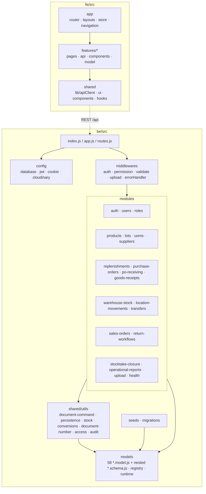

**Package descriptions**

| No | Package | Description and naming conventions |
|---|---|---|
| 01 | `be/src/config` | Environment-bound adapters: `database.js`, `jwt.js`, `cookie.js`, `cloudinary.js`. camelCase file names. |
| 02 | `be/src/middlewares` | Cross-cutting Express middleware. One concern per file (`auth.js`, `permission.js`, `validate.js`, `upload.js`, `errorHandler.js`). |
| 03 | `be/src/modules/<feature>` | One folder per feature in kebab-case. Files: `<feature>.routes.js` (router), `<feature>.controller.js` (HTTP adapter, older modules), `<feature>.service.js` / `.commands.js` (business logic), `<feature>.validation.js` (Zod). Commands are named verb + noun (`createPurchaseOrder`, `confirmPicking`). |
| 04 | `be/src/shared/utils` | Reusable domain helpers: command pipeline, transactions, stock posting, decimal/conversion, document identity, access/scope, audit. |
| 05 | `be/src/models` | One collection per `<name>.model.js` and one nested schema per `<name>.schema.js` (kebab-case). Model names PascalCase (`PurchaseOrder`), collections snake_case plural (`purchase_orders`). Registry in `index.js`/`registry.js`, runtime export in `runtime.js`. |
| 06 | `be/src/seeds`, `be/src/migrations` | Seed data (`seeds/data/*.data.js`, permission catalogue) and migration/rebuild scripts kept for regression. |
| 07 | `fe/src/app` | Application shell, router, navigation by permission, Redux store. |
| 08 | `fe/src/features/<feature>` | Feature folder in kebab-case with `pages/` (PascalCase `*Page.tsx`), `api/` (RTK Query endpoints injected into `baseApi`), `components/`, helpers and co-located `*.test.ts(x)`. |
| 09 | `fe/src/shared` | `lib/apiClient.ts`, `lib/authToken.ts`, shared UI components, hooks. |

### 3. Database Design

**Conventions**

The schema tables preserve the inspected runtime snapshot, rather than asserting that every stored field belongs to the selected functional scope. Customer master, WIR, OD and standalone failed-delivery records are compatibility data. New requirements use document-level buyer details and direct SO/issue links. No new wire field names or backfill rules are approved by this documentation change.

- MongoDB 58 collections; Mongoose `ref` is an application link, not a database-enforced foreign key.
- Business documents share a common envelope: `_id`/`documentNo` (DocumentIdentity), `documentKind`, `workflowStatus`, `version` (optimistic concurrency), `createdBy`, `header` (object), `items[]` (embedded lines with stable `_id`), `sources[]` (links `subjectCollection`, `documentId`, `itemId`, `linkedQty`, `relationCode`), `evidenceIds`, plus display metadata `tenLoaiPhieu`, `maDonVi`, `kyDanhSo`, `soThuTu`, `trangThaiTiengViet`.
- Line quantities: `enteredQty` + `enteredUnit` + `baseUnitsPerUnit` (conversion snapshot) → `qtyBase` (Decimal128, base unit). API returns decimals as strings.
- Catalogue rows (products, lots, warehouses, locations, users) keep ObjectId `_id`; catalogue updates use `expectedUpdatedAt`.
- Full field list per collection: `git_doc/docs/03_thiet_ke/DB_Current_2026-11-12_58/WMSD_Data_Dictionary.md`.

**ERD — master data and stock**

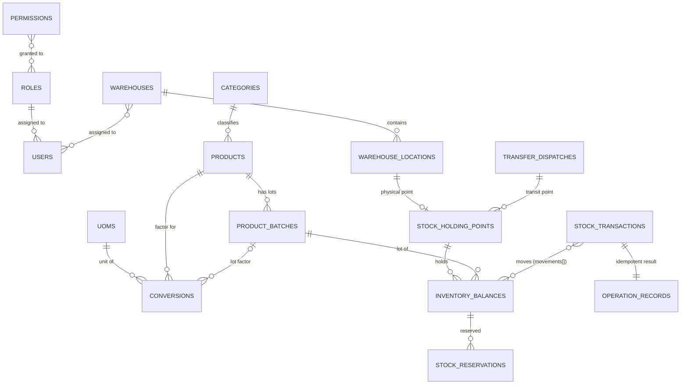

**ERD — purchasing, receiving and transfer**

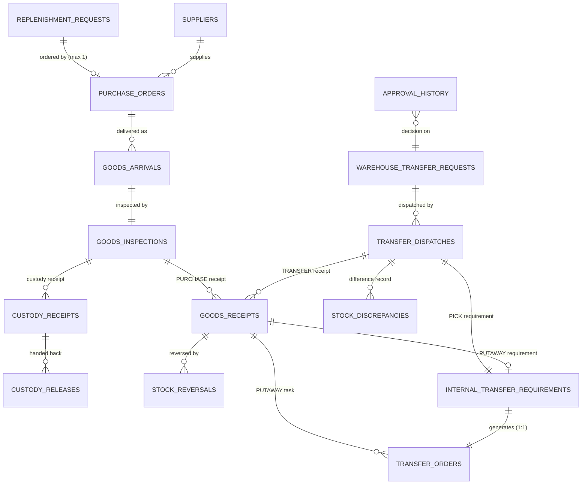

**ERD - direct sales issue, returns and stocktake**

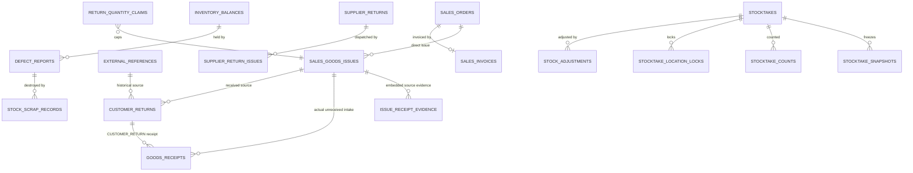

**Runtime collection catalogue (58, including compatibility structures outside the selected scope)**

| No | Collection | Runtime purpose / selected-scope status |
|---|---|---|
| 01 | `approval_history` | Versioned decision on a document/line by an independent approver. |
| 02 | `attachments` | Private evidence file metadata (Cloudinary storage key, hash, access category). |
| 03 | `audit_logs` | Actor, action, result and field changes; separate from stock history. |
| 04 | `categories` | Product category (5 approved groups); one category per product. |
| 05 | `conversions` | Versioned base-unit factor per product and optional lot, valid from a date. |
| 06 | `custody_receipts` | Supplier custody; historical customer custody remains compatibility data. New CR inspection posts no custody balance. |
| 07 | `custody_releases` | Hand-back of custody goods; may embed supplier acknowledgements. |
| 08 | `customer_returns` | Customer return against evidenced received issue quantity or verified external history, with fact-only inspection and current per-line decisions. Buyer details belong to the source document; no customer catalogue screen or required new master record. |
| 09 | `customers` | Historical compatibility only; excluded from new functional requirements. Existing stored references are retained until an explicit migration. |
| 10 | `defect_reports` | Defect case: source, hold, inspections, resolution plans and dispositions. |
| 11 | `delivery_orders` | Historical compatibility only; excluded from new functional requirements. Existing stored references are retained until an explicit migration. |
| 12 | `external_references` | External source document (historical delivery, invoice/credit-note reference). |
| 13 | `failed_deliveries` | Historical compatibility only; excluded from new functional requirements. Existing stored references are retained until an explicit migration. |
| 14 | `goods_arrivals` | One physical purchase delivery, kept even when everything is rejected. |
| 15 | `goods_inspections` | Inspection of one arrival: lot, quality, packaging, ACCEPT/CUSTODY/REJECT. |
| 16 | `goods_receipts` | Goods receipt, five kinds: PURCHASE, CUSTOMER_RETURN, FAILED_DELIVERY, TRANSFER, OTHER. |
| 17 | `internal_transfer_requirements` | Pick/put-away requirement generated from a dispatch or receipt; 1:1 with a TO. |
| 18 | `inventory_balances` | Quantity by holding point + lot + quality + owner, with packaging portions. |
| 19 | `notifications` | Per-recipient notification with read state and SMTP delivery tracking. |
| 20 | `opening_stocks` | Verified opening balance per location/lot/quality/owner. |
| 21 | `operation_records` | Idempotency record: actor-bound operation key, request hash, result refs. |
| 22 | `permissions` | Fixed operation-permission catalogue grouped by function (120 codes). |
| 23 | `product_batches` | Manufacturer lot of a product: fixed pieces per carton, carton dimensions, VERIFIED/UNKNOWN. |
| 24 | `products` | Tile product: manufacturer + SKU + colour, size in mm, base unit, thresholds, images. |
| 25 | `purchase_orders` | PO from one approved RR, one supplier and one warehouse; common expected date. |
| 26 | `replenishment_locks` | Historical RR guard collection; no longer used by the runtime (11/11/2026). |
| 27 | `replenishment_requests` | Replenishment request for one warehouse with submitted warning snapshots. |
| 28 | `return_quantity_claims` | Claimed return quantity per source line, preventing over-return. |
| 29 | `return_source_locks` | Concurrency guard per return source; quantities live in return_quantity_claims. |
| 30 | `roles` | Default or Administrator-created role holding selected permission IDs. |
| 31 | `sales_goods_issues` | Direct sales goods issue: DRAFT -> POSTED against source SO and actual stock. Receipt evidence and actual unreceived-goods intake belong to that issue. Existing PICKED/handover fields are historical compatibility only. |
| 32 | `sales_invoices` | Final invoice per SO (model only; no API yet). |
| 33 | `sales_orders` | Copied sales order with document-level buyer information, source reference, prices and issue/payment history. No active customer catalogue dependency. Existing customerId references describe runtime compatibility until the input/model contract is aligned. |
| 34 | `stock_adjustments` | Approved nonzero stocktake quantity adjustment (ADJ). |
| 35 | `stock_discrepancies` | Shortage/excess/damage record and its resolution documents. |
| 36 | `stock_holding_points` | Where stock is held: one location, or the in-transit point of a dispatch line. |
| 37 | `stock_quality_changes` | Quality reclassification document; totals and location unchanged. |
| 38 | `stock_reservations` | Reservation of a balance for a demand/task; consumed, released or moved. |
| 39 | `stock_reversals` | Reversal of an eligible wrong stock posting, linked to the original. |
| 40 | `stock_scrap_records` | Actual destruction of approved defective quantity. |
| 41 | `stock_transactions` | One successful stock posting with movements, source and idempotency key. |
| 42 | `stocktake_counts` | Count and recount attempts with unit, conversion and evidence. |
| 43 | `stocktake_location_locks` | Freeze of a location during a stocktake; one active lock per location. |
| 44 | `stocktake_snapshots` | Immutable book quantity per location/lot/owner/quality at activation. |
| 45 | `stocktakes` | Stocktake session: scope, schedule, counters, resolution plans, closure. |
| 46 | `supplier_return_issues` | Actual dispatch of store-owned goods back to the supplier. |
| 47 | `supplier_returns` | Supplier return proposal with Accountant-verified agreement per line. |
| 48 | `suppliers` | Supplier: contact, tax code, ACTIVE/SUSPENDED/TERMINATED. |
| 49 | `supply_allocations` | Legacy PO/TR supply allocation records, still read by transfer details. |
| 50 | `system_events` | Outbox event written in the business transaction for post-commit handlers. |
| 51 | `transfer_dispatches` | Transfer dispatch (TD) of one TR with embedded handover; posts source→transit. |
| 52 | `transfer_orders` | Internal task: RELOCATE (BF-03), PICK or PUTAWAY; confirmed against the ledger. |
| 53 | `uoms` | Unit catalogue: immutable code, name, carton flag, optional area mm². |
| 54 | `users` | Staff account: one role, many assigned warehouses, bcrypt hash, lockReason while locked. |
| 55 | `warehouse_issue_requests` | Historical compatibility only; excluded from new functional requirements. Existing stored references are retained until an explicit migration. |
| 56 | `warehouse_locations` | Location inside one warehouse: type, usable size, pickable flag, operation version. |
| 57 | `warehouse_transfer_requests` | Inter-warehouse TR: requested/approved quantities and progress. |
| 58 | `warehouses` | Physical warehouse: immutable code, dimensions, status, 2D/3D layout draft and applied snapshot. |

**Table descriptions (core collections)**

Embedded `sources[]`, packaging/supplier snapshots and Vietnamese display metadata are omitted from the tables below; see Conventions.

#### 3.1 users

Staff account: one role, many assigned warehouses, bcrypt hash, lockReason while locked.

| Column | Type | Constraints | Notes |
|---|---|---|---|
| `username` | String | NOT NULL, UNIQUE |   |
| `fullName` | String | NOT NULL |   |
| `passwordHash` | String | NOT NULL |   |
| `roleId` | ObjectId | NOT NULL, REF Role |   |
| `warehouseIds` | Array[Mixed] | — |   |
| `phone` | String | — |   |
| `email` | String | — |   |
| `isActive` | Boolean | NOT NULL |   |
| `lockReason` | String | — |   |
| `version` | Number | NOT NULL |   |
| `_id` | ObjectId | PRIMARY KEY | Auto ObjectId |
| `createdAt` | Date | — |   |
| `updatedAt` | Date | — |   |

Indexes: `{username:1 (unique)}`

#### 3.2 roles

Default or Administrator-created role holding selected permission IDs.

| Column | Type | Constraints | Notes |
|---|---|---|---|
| `code` | String | NOT NULL, UNIQUE |   |
| `name` | String | NOT NULL |   |
| `description` | String | — |   |
| `permissionIds` | Array[Mixed] | — |   |
| `isSystemRole` | Boolean | — |   |
| `isActive` | Boolean | NOT NULL |   |
| `version` | Number | NOT NULL |   |
| `_id` | ObjectId | PRIMARY KEY | Auto ObjectId |
| `createdAt` | Date | — |   |
| `updatedAt` | Date | — |   |

Indexes: `{code:1 (unique)}`

#### 3.3 permissions

Fixed operation-permission catalogue grouped by function (120 codes).

| Column | Type | Constraints | Notes |
|---|---|---|---|
| `code` | String | NOT NULL, UNIQUE |   |
| `name` | String | NOT NULL |   |
| `description` | String | — |   |
| `featureCode` | String | — |   |
| `isActive` | Boolean | NOT NULL |   |
| `_id` | ObjectId | PRIMARY KEY | Auto ObjectId |
| `createdAt` | Date | — |   |
| `updatedAt` | Date | — |   |

Indexes: `{code:1 (unique)}`

#### 3.4 warehouses

Physical warehouse: immutable code, dimensions, status, 2D/3D layout draft and applied snapshot.

| Column | Type | Constraints | Notes |
|---|---|---|---|
| `code` | String | NOT NULL, UNIQUE |   |
| `name` | String | NOT NULL |   |
| `address` | String | — |   |
| `description` | String | — |   |
| `lengthMm` | Number | — |   |
| `widthMm` | Number | — |   |
| `clearHeightMm` | Number | — |   |
| `isActive` | Boolean | NOT NULL |   |
| `layout3d` | Mixed | — |   |
| `layout3dApplied` | Mixed | — |   |
| `layout3dAppliedAt` | Date | — |   |
| `_id` | ObjectId | PRIMARY KEY | Auto ObjectId |
| `createdAt` | Date | — |   |
| `updatedAt` | Date | — |   |

Indexes: `{code:1 (unique)}`

#### 3.5 warehouse_locations

Location inside one warehouse: type, usable size, pickable flag, operation version.

| Column | Type | Constraints | Notes |
|---|---|---|---|
| `warehouseId` | ObjectId | NOT NULL, REF Warehouse |   |
| `code` | String | NOT NULL |   |
| `name` | String | — |   |
| `areaCode` | String | — |   |
| `locationType` | String | NOT NULL | RECEIVING / STORAGE / STAGING / QUARANTINE / CUSTODY |
| `isPickable` | Boolean | — |   |
| `description` | String | — |   |
| `isActive` | Boolean | NOT NULL |   |
| `version` | Number | NOT NULL |   |
| `operationVersion` | Number | NOT NULL |   |
| `usableLengthMm` | Number | — |   |
| `usableWidthMm` | Number | — |   |
| `_id` | ObjectId | PRIMARY KEY | Auto ObjectId |
| `createdAt` | Date | — |   |
| `updatedAt` | Date | — |   |

Indexes: `{warehouseId:1, code:1 (unique)}`

#### 3.6 products

Tile product: manufacturer + SKU + colour, size in mm, base unit, thresholds, images.

| Column | Type | Constraints | Notes |
|---|---|---|---|
| `sku` | String | NOT NULL |   |
| `manufacturerCode` | String | NOT NULL |   |
| `name` | String | NOT NULL |   |
| `categoryId` | ObjectId | NOT NULL, REF Category |   |
| `material` | String | — |   |
| `surface` | String | — |   |
| `origin` | String | — |   |
| `description` | String | — |   |
| `imageUrls` | Array[Mixed] | — |   |
| `baseUnit` | String | NOT NULL |   |
| `wholeBaseUnits` | Boolean | NOT NULL |   |
| `lengthMm` | Decimal128 | NOT NULL |   |
| `widthMm` | Decimal128 | NOT NULL |   |
| `heightMm` | Decimal128 | NOT NULL |   |
| `color` | String | NOT NULL |   |
| `isActive` | Boolean | NOT NULL |   |
| `_id` | ObjectId | PRIMARY KEY | Auto ObjectId |
| `createdAt` | Date | — |   |
| `updatedAt` | Date | — |   |
| `stockThresholds` | Array[Subdoc] | — |   |
| `stockThresholds[].warehouseId` | ObjectId | NOT NULL, REF Warehouse |   |
| `stockThresholds[].minimumQty` | Decimal128 | NOT NULL |   |
| `stockThresholds[].targetQty` | Decimal128 | NOT NULL |   |
| `stockThresholds[].updatedBy` | ObjectId | REF User |   |

Indexes: `{manufacturerCode:1, sku:1, color:1 (unique)}`; `{categoryId:1}`; `{stockThresholds._id:1 (unique)}`

#### 3.7 product_batches

Manufacturer lot of a product: fixed pieces per carton, carton dimensions, VERIFIED/UNKNOWN.

| Column | Type | Constraints | Notes |
|---|---|---|---|
| `productId` | ObjectId | NOT NULL, REF Product |   |
| `manufacturerLot` | String | NOT NULL |   |
| `identificationStatus` | String | NOT NULL | VERIFIED / UNKNOWN |
| `manufacturedOn` | Date | — |   |
| `piecesPerCarton` | Number | NOT NULL |   |
| `cartonLengthMm` | Decimal128 | NOT NULL |   |
| `cartonWidthMm` | Decimal128 | NOT NULL |   |
| `cartonHeightMm` | Decimal128 | NOT NULL |   |
| `_id` | ObjectId | PRIMARY KEY | Auto ObjectId |
| `createdAt` | Date | — |   |
| `updatedAt` | Date | — |   |

Indexes: `{productId:1, manufacturerLot:1 (unique)}`

#### 3.8 uoms

Unit catalogue: immutable code, name, carton flag, optional area mm².

| Column | Type | Constraints | Notes |
|---|---|---|---|
| `code` | String | NOT NULL, UNIQUE |   |
| `name` | String | NOT NULL |   |
| `isActive` | Boolean | NOT NULL |   |
| `isCarton` | Boolean | NOT NULL |   |
| `areaMm2` | Decimal128 | — |   |
| `_id` | ObjectId | PRIMARY KEY | Auto ObjectId |
| `createdAt` | Date | — |   |
| `updatedAt` | Date | — |   |

Indexes: `{code:1 (unique)}`

#### 3.9 conversions

Versioned base-unit factor per product and optional lot, valid from a date.

| Column | Type | Constraints | Notes |
|---|---|---|---|
| `productId` | ObjectId | NOT NULL, REF Product |   |
| `productBatchId` | ObjectId | REF ProductBatch |   |
| `uomId` | ObjectId | NOT NULL, REF Uom |   |
| `basePerUnit` | Decimal128 | NOT NULL |   |
| `version` | Number | NOT NULL |   |
| `validFrom` | Date | NOT NULL |   |
| `verificationReference` | String | NOT NULL |   |
| `createdBy` | ObjectId | REF User |   |
| `_id` | ObjectId | PRIMARY KEY | Auto ObjectId |
| `createdAt` | Date | — |   |
| `updatedAt` | Date | — |   |

Indexes: `{productId:1, productBatchId:1, uomId:1, validFrom:1 (unique)}`; `{productId:1, productBatchId:1, uomId:1, version:1 (unique)}`

#### 3.10 stock_holding_points

Where stock is held: one location, or the in-transit point of a dispatch line.

| Column | Type | Constraints | Notes |
|---|---|---|---|
| `type` | String | NOT NULL | LOCATION / IN_TRANSIT |
| `locationId` | ObjectId | UNIQUE, REF WarehouseLocation |   |
| `dispatchLineId` | ObjectId | UNIQUE |   |
| `_id` | ObjectId | PRIMARY KEY | Auto ObjectId |
| `createdAt` | Date | — |   |
| `updatedAt` | Date | — |   |

Indexes: `{locationId:1 (unique)}`; `{dispatchLineId:1 (unique)}`

#### 3.11 inventory_balances

Quantity by holding point + lot + quality + owner, with packaging portions.

| Column | Type | Constraints | Notes |
|---|---|---|---|
| `holdingPointId` | ObjectId | NOT NULL, REF StockHoldingPoint |   |
| `batchId` | ObjectId | NOT NULL, REF ProductBatch |   |
| `qualityStatus` | String | NOT NULL | PENDING / GOOD / DAMAGED / BLOCKED |
| `ownerType` | String | NOT NULL | STORE / SUPPLIER / CUSTOMER |
| `ownerId` | ObjectId | — |   |
| `quantityBase` | Decimal128 | NOT NULL |   |
| `version` | Number | NOT NULL |   |
| `_id` | ObjectId | PRIMARY KEY | Auto ObjectId |
| `createdAt` | Date | — |   |
| `updatedAt` | Date | — |   |
| `packagingPortions` | Array[Subdoc] | — |   |
| `packagingPortions[].packagingState` | String | NOT NULL | SEALED / OPEN / LOOSE |
| `packagingPortions[].packagingSnapshot` | Object | — |   |
| `packagingPortions[].packagingKey` | String | — |   |
| `packagingPortions[].sealedPackCount` | Number | — |   |
| `packagingPortions[].quantityBase` | Decimal128 | NOT NULL |   |
| `packagingPortions[].createdBy` | ObjectId | NOT NULL, REF User |   |
| `packagingPortions[].updatedBy` | ObjectId | REF User |   |
| `packagingPortions[].measuredVolumeMm3` | Decimal128 | — |   |
| `packagingPortions[].extraOccupiedVolumeMm3` | Decimal128 | — |   |

Indexes: `{holdingPointId:1, batchId:1, qualityStatus:1, ownerType:1, ownerId:1 (unique)}`

#### 3.12 stock_transactions

One successful stock posting with movements, source and idempotency key.

| Column | Type | Constraints | Notes |
|---|---|---|---|
| `sourceType` | String | NOT NULL |   |
| `operation` | String | NOT NULL |   |
| `eventKey` | String | NOT NULL |   |
| `requestKey` | String | NOT NULL, UNIQUE |   |
| `requestHash` | String | NOT NULL |   |
| `performedBy` | ObjectId | NOT NULL, REF User |   |
| `occurredAt` | Date | NOT NULL |   |
| `recordedAt` | Date | NOT NULL |   |
| `reversedTransactionId` | ObjectId | UNIQUE, REF StockTransaction |   |
| `_id` | ObjectId | PRIMARY KEY | Auto ObjectId |
| `createdAt` | Date | — |   |
| `updatedAt` | Date | — |   |
| `movements` | Array[Subdoc] | — |   |
| `movements[].transactionId` | ObjectId | NOT NULL, REF StockTransaction |   |
| `movements[].lineNo` | Number | NOT NULL |   |
| `movements[].packagingPortionIds` | Array[Mixed] | — |   |
| `movements[].sourceLineId` | ObjectId | NOT NULL |   |
| `movements[].fromBalanceId` | ObjectId | REF InventoryBalance |   |
| `movements[].toBalanceId` | ObjectId | REF InventoryBalance |   |
| `movements[].quantityBase` | Decimal128 | NOT NULL |   |
| `movements[].fromBefore` | Decimal128 | — |   |
| `movements[].fromAfter` | Decimal128 | — |   |
| `movements[].toBefore` | Decimal128 | — |   |
| `movements[].toAfter` | Decimal128 | — |   |
| `sourceId` | DocumentIdentity | NOT NULL |   |

Indexes: `{requestKey:1 (unique)}`; `{sourceId:1, operation:1, eventKey:1 (unique)}`; `{reversedTransactionId:1 (unique)}`; `{movements._id:1 (unique)}`; `{movements.fromBalanceId:1, occurredAt:1}`; `{movements.toBalanceId:1, occurredAt:1}`

#### 3.13 stock_reservations

Reservation of a balance for a demand/task; consumed, released or moved.

| Column | Type | Constraints | Notes |
|---|---|---|---|
| `demandRef` | Object | NOT NULL |   |
| `demandRef.documentType` | String | NOT NULL | replenishment_requests / purchase_orders / goods_arrivals / goods_inspections / goods_receipts / goods_receipts / transfer_orders / warehouse_transfer_requests … |
| `demandRef.itemId` | ObjectId | — |   |
| `demandRef.revision` | Number | — |   |
| `demandRef.documentId` | DocumentIdentity | NOT NULL |   |
| `executionRef` | Object | — |   |
| `executionRef.documentType` | String | NOT NULL | replenishment_requests / purchase_orders / goods_arrivals / goods_inspections / goods_receipts / goods_receipts / transfer_orders / warehouse_transfer_requests … |
| `executionRef.itemId` | ObjectId | — |   |
| `executionRef.revision` | Number | — |   |
| `executionRef.documentId` | DocumentIdentity | NOT NULL |   |
| `balanceId` | ObjectId | NOT NULL, REF InventoryBalance |   |
| `reservedQty` | Decimal128 | NOT NULL |   |
| `consumedQty` | Decimal128 | NOT NULL |   |
| `releasedQty` | Decimal128 | NOT NULL |   |
| `movedQty` | Decimal128 | NOT NULL |   |
| `previousReservationId` | ObjectId | REF StockReservation |   |
| `sourceAllocationId` | ObjectId | REF SupplyAllocation |   |
| `originMovementId` | ObjectId | — |   |
| `creationKey` | String | NOT NULL, UNIQUE |   |
| `createdBy` | ObjectId | NOT NULL, REF User |   |
| `updatedBy` | ObjectId | REF User |   |
| `version` | Number | NOT NULL |   |
| `_id` | ObjectId | PRIMARY KEY | Auto ObjectId |
| `createdAt` | Date | — |   |
| `updatedAt` | Date | — |   |

Indexes: `{creationKey:1 (unique)}`; `{balanceId:1}`; `{demandRef.documentId:1, demandRef.itemId:1}`

#### 3.14 replenishment_requests

Replenishment request for one warehouse with submitted warning snapshots.

| Column | Type | Constraints | Notes |
|---|---|---|---|
| `documentNo` | String | NOT NULL, UNIQUE |   |
| `documentKind` | String | NOT NULL | REPLENISHMENT |
| `workflowStatus` | String | NOT NULL |   |
| `version` | Number | NOT NULL |   |
| `createdBy` | ObjectId | NOT NULL, REF User |   |
| `occurredAt` | Date | — |   |
| `note` | String | — |   |
| `externalReferenceIds` | Array[Mixed] | — |   |
| `sources` | Array[Subdoc] | — |   |
| `header` | Object | NOT NULL |   |
| `header.warehouseId` | ObjectId | NOT NULL, REF Warehouse |   |
| `header.neededOn` | Date | NOT NULL |   |
| `header.triggerReason` | String | NOT NULL |   |
| `header.creationKey` | String | NOT NULL |   |
| `header.submittedBy` | ObjectId | REF User |   |
| `header.submittedAt` | Date | — |   |
| `header.approvedRevision` | Number | — |   |
| `header.latestDecisionId` | ObjectId | REF ApprovalHistory |   |
| `updatedBy` | ObjectId | REF User |   |
| `evidenceIds` | Array[Mixed] | — |   |
| `cancelledBy` | ObjectId | REF User |   |
| `cancelledAt` | Date | — |   |
| `cancelReason` | String | — |   |
| `createdAt` | Date | — |   |
| `updatedAt` | Date | — |   |
| `items` | Array[Subdoc] | — |   |
| `items[].lineNo` | Number | NOT NULL |   |
| `items[].lineKind` | String | NOT NULL | PO_INSPECTION / PURCHASE_RECEIPT / STANDARD / REPLENISHMENT / SALES_ORDER / OUTBOUND_DELIVERY / SALES_GOODS_ISSUE / DELIVERY_CONFIRMATION … |
| `items[].productId` | ObjectId | NOT NULL, REF Product |   |
| `items[].lotId` | ObjectId | REF ProductBatch |   |
| `items[].enteredUnit` | String | NOT NULL |   |
| `items[].baseUnitSnapshot` | String | NOT NULL |   |
| `items[].baseUnitsPerUnit` | Decimal128 | NOT NULL |   |
| `items[].packagingSnapshot` | Object | — |   |
| `items[].enteredQty` | Decimal128 | NOT NULL |   |
| `items[].qtyBase` | Decimal128 | NOT NULL |   |
| `items[].productNameSnapshot` | String | NOT NULL |   |
| `items[].sources` | Array[Subdoc] | — |   |
| `items[].note` | String | — |   |
| `items[].evidenceIds` | Array[Mixed] | — |   |
| `items[].approvedQtyBase` | Decimal128 | — |   |
| `items[].requiredBatchId` | ObjectId | REF ProductBatch |   |
| `items[].neededBy` | Date | — |   |
| `submissions` | Array[Subdoc] | — |   |
| `submissions[].documentVersion` | Number | NOT NULL |   |
| `submissions[].submittedBy` | ObjectId | NOT NULL, REF User |   |
| `submissions[].submittedAt` | Date | NOT NULL |   |
| `submissions[].warehouseId` | ObjectId | NOT NULL, REF Warehouse |   |
| `submissions[].warehouseCodeSnapshot` | String | NOT NULL |   |
| `submissions[].warehouseNameSnapshot` | String | NOT NULL |   |
| `submissions[].neededOn` | Date | NOT NULL |   |
| `submissions[].triggerReason` | String | NOT NULL |   |
| `submissions[].note` | String | — |   |
| `submissions[].lines` | Array[Subdoc] | NOT NULL |   |
| `submissions[].lines[].lineId` | ObjectId | NOT NULL |   |
| `submissions[].lines[].lineNo` | Number | NOT NULL |   |
| `submissions[].lines[].productId` | ObjectId | NOT NULL, REF Product |   |
| `submissions[].lines[].productSkuSnapshot` | String | NOT NULL |   |
| `submissions[].lines[].productNameSnapshot` | String | NOT NULL |   |
| `submissions[].lines[].baseUomCodeSnapshot` | String | NOT NULL |   |
| `submissions[].lines[].enteredUomCodeSnapshot` | String | NOT NULL |   |
| `submissions[].lines[].conversionVersion` | Number | NOT NULL |   |
| `submissions[].lines[].enteredQty` | Decimal128 | NOT NULL |   |
| `submissions[].lines[].conversionSnapshot` | Decimal128 | NOT NULL |   |
| `submissions[].lines[].qtyBase` | Decimal128 | NOT NULL |   |
| `submissions[].lines[].triggerType` | String | NOT NULL | SALES_SHORTAGE / STOCK_THRESHOLD / STOCKTAKE_LOW_STOCK / MANUAL_OTHER |
| `submissions[].lines[].evaluation` | Object | — |   |
| `submissions[].lines[].reasonNote` | String | — |   |
| `submissions[].lines[].baseUnitSnapshot` | String | NOT NULL |   |
| `submissions[].lines[].enteredUnit` | String | NOT NULL |   |
| `submissions[].lines[].baseUnitsPerUnit` | Decimal128 | NOT NULL |   |
| `_id` | DocumentIdentity | PRIMARY KEY | documentNo, assigned in the creating transaction |

Indexes: `{documentNo:1 (unique)}`; `{items._id:1}`; `{sources.documentId:1}`; `{items.sources.itemId:1}`; `{workflowStatus:1, createdAt:-1}`

#### 3.15 purchase_orders

PO from one approved RR, one supplier and one warehouse; common expected date.

| Column | Type | Constraints | Notes |
|---|---|---|---|
| `documentNo` | String | NOT NULL, UNIQUE |   |
| `documentKind` | String | NOT NULL | PO |
| `workflowStatus` | String | NOT NULL |   |
| `version` | Number | NOT NULL |   |
| `createdBy` | ObjectId | NOT NULL, REF User |   |
| `occurredAt` | Date | — |   |
| `note` | String | — |   |
| `externalReferenceIds` | Array[Mixed] | — |   |
| `sources` | Array[Subdoc] | — |   |
| `header` | Object | NOT NULL |   |
| `header.warehouseId` | ObjectId | NOT NULL, REF Warehouse |   |
| `header.supplierId` | ObjectId | NOT NULL, REF Supplier |   |
| `header.expectedOn` | Date | — |   |
| `header.approvedRequestRevision` | Number | — |   |
| `header.orderDate` | Date | — |   |
| `header.issuedAt` | Date | — |   |
| `header.closedAt` | Date | — |   |
| `header.closureDecisionId` | ObjectId | REF ApprovalHistory |   |
| `header.closureReason` | String | — |   |
| `header.supplierSnapshot` | Object | — |   |
| `updatedBy` | ObjectId | REF User |   |
| `evidenceIds` | Array[Mixed] | — |   |
| `cancelledBy` | ObjectId | REF User |   |
| `cancelledAt` | Date | — |   |
| `cancelReason` | String | — |   |
| `createdAt` | Date | — |   |
| `updatedAt` | Date | — |   |
| `items` | Array[Subdoc] | — |   |
| `items[].lineNo` | Number | NOT NULL |   |
| `items[].lineKind` | String | NOT NULL | PO_INSPECTION / PURCHASE_RECEIPT / STANDARD / REPLENISHMENT / SALES_ORDER / OUTBOUND_DELIVERY / SALES_GOODS_ISSUE / DELIVERY_CONFIRMATION … |
| `items[].productId` | ObjectId | NOT NULL, REF Product |   |
| `items[].lotId` | ObjectId | REF ProductBatch |   |
| `items[].enteredUnit` | String | NOT NULL |   |
| `items[].baseUnitSnapshot` | String | NOT NULL |   |
| `items[].baseUnitsPerUnit` | Decimal128 | NOT NULL |   |
| `items[].packagingSnapshot` | Object | — |   |
| `items[].enteredQty` | Decimal128 | NOT NULL |   |
| `items[].qtyBase` | Decimal128 | NOT NULL |   |
| `items[].productNameSnapshot` | String | NOT NULL |   |
| `items[].sources` | Array[Subdoc] | — |   |
| `items[].unitPurchasePrice` | Decimal128 | NOT NULL |   |
| `items[].lineAmount` | Decimal128 | NOT NULL |   |
| `items[].note` | String | — |   |
| `items[].evidenceIds` | Array[Mixed] | — |   |
| `items[].requestItemId` | ObjectId | — |   |
| `items[].cancelledRemainderQtyBase` | Decimal128 | — |   |
| `items[].cancellationDecisionId` | ObjectId | REF ApprovalHistory |   |
| `totalAmount` | Decimal128 | NOT NULL |   |
| `currency` | String | NOT NULL |   |
| `_id` | DocumentIdentity | PRIMARY KEY | documentNo, assigned in the creating transaction |
| `replenishmentRequestId` | DocumentIdentity | NOT NULL, UNIQUE |   |

Indexes: `{documentNo:1 (unique)}`; `{items._id:1}`; `{sources.documentId:1}`; `{items.sources.itemId:1}`; `{workflowStatus:1, createdAt:-1}`; `{replenishmentRequestId:1 (unique)}`

#### 3.16 goods_arrivals

One physical purchase delivery, kept even when everything is rejected.

| Column | Type | Constraints | Notes |
|---|---|---|---|
| `documentNo` | String | NOT NULL, UNIQUE |   |
| `documentKind` | String | NOT NULL | ARRIVAL |
| `workflowStatus` | String | NOT NULL |   |
| `version` | Number | NOT NULL |   |
| `createdBy` | ObjectId | NOT NULL, REF User |   |
| `occurredAt` | Date | — |   |
| `note` | String | — |   |
| `externalReferenceIds` | Array[Mixed] | — |   |
| `sources` | Array[Subdoc] | — |   |
| `header` | Object | NOT NULL |   |
| `header.warehouseId` | ObjectId | NOT NULL, REF Warehouse |   |
| `header.supplierId` | ObjectId | REF Supplier |   |
| `header.arrivedAt` | Date | NOT NULL |   |
| `header.deliveryReference` | String | — |   |
| `header.recordedAt` | Date | — |   |
| `header.deliveredBy` | String | — |   |
| `header.vehicleReference` | String | — |   |
| `header.purchaseOrderId` | DocumentIdentity | REF PurchaseOrder |   |
| `updatedBy` | ObjectId | REF User |   |
| `evidenceIds` | Array[Mixed] | — |   |
| `cancelledBy` | ObjectId | REF User |   |
| `cancelledAt` | Date | — |   |
| `cancelReason` | String | — |   |
| `createdAt` | Date | — |   |
| `updatedAt` | Date | — |   |
| `items` | Array[Subdoc] | — |   |
| `items[].lineNo` | Number | NOT NULL |   |
| `items[].lineKind` | String | NOT NULL | PO_INSPECTION / PURCHASE_RECEIPT / STANDARD / REPLENISHMENT / SALES_ORDER / OUTBOUND_DELIVERY / SALES_GOODS_ISSUE / DELIVERY_CONFIRMATION … |
| `items[].productId` | ObjectId | NOT NULL, REF Product |   |
| `items[].lotId` | ObjectId | REF ProductBatch |   |
| `items[].enteredUnit` | String | NOT NULL |   |
| `items[].baseUnitSnapshot` | String | NOT NULL |   |
| `items[].baseUnitsPerUnit` | Decimal128 | NOT NULL |   |
| `items[].packagingSnapshot` | Object | — |   |
| `items[].enteredQty` | Decimal128 | NOT NULL |   |
| `items[].qtyBase` | Decimal128 | NOT NULL |   |
| `items[].productNameSnapshot` | String | NOT NULL |   |
| `items[].sources` | Array[Subdoc] | — |   |
| `items[].note` | String | — |   |
| `items[].evidenceIds` | Array[Mixed] | — |   |
| `items[].purchaseOrderItemId` | ObjectId | — |   |
| `items[].expectedProductId` | ObjectId | REF Product |   |
| `items[].observedLabel` | String | — |   |
| `items[].lotLabelSnapshot` | String | — |   |
| `items[].packagingCondition` | String | — |   |
| `_id` | DocumentIdentity | PRIMARY KEY | documentNo, assigned in the creating transaction |

Indexes: `{documentNo:1 (unique)}`; `{items._id:1}`; `{sources.documentId:1}`; `{items.sources.itemId:1}`; `{workflowStatus:1, createdAt:-1}`

#### 3.17 goods_inspections

Inspection of one arrival: lot, quality, packaging, ACCEPT/CUSTODY/REJECT.

| Column | Type | Constraints | Notes |
|---|---|---|---|
| `documentNo` | String | NOT NULL, UNIQUE |   |
| `documentKind` | String | NOT NULL | INSPECTION |
| `workflowStatus` | String | NOT NULL |   |
| `version` | Number | NOT NULL |   |
| `createdBy` | ObjectId | NOT NULL, REF User |   |
| `occurredAt` | Date | — |   |
| `note` | String | — |   |
| `externalReferenceIds` | Array[Mixed] | — |   |
| `sources` | Array[Subdoc] | — |   |
| `header` | Object | NOT NULL |   |
| `header.warehouseId` | ObjectId | REF Warehouse |   |
| `header.correctionReason` | String | — |   |
| `header.participants` | Array[Mixed] | — |   |
| `header.confirmedBy` | ObjectId | REF User |   |
| `header.confirmedAt` | Date | — |   |
| `header.arrivalId` | DocumentIdentity | REF GoodsArrival |   |
| `header.previousInspectionId` | DocumentIdentity | REF GoodsInspection |   |
| `updatedBy` | ObjectId | REF User |   |
| `evidenceIds` | Array[Mixed] | — |   |
| `cancelledBy` | ObjectId | REF User |   |
| `cancelledAt` | Date | — |   |
| `cancelReason` | String | — |   |
| `createdAt` | Date | — |   |
| `updatedAt` | Date | — |   |
| `items` | Array[Subdoc] | — |   |
| `items[].lineNo` | Number | NOT NULL |   |
| `items[].lineKind` | String | NOT NULL | PO_INSPECTION / PURCHASE_RECEIPT / STANDARD / REPLENISHMENT / SALES_ORDER / OUTBOUND_DELIVERY / SALES_GOODS_ISSUE / DELIVERY_CONFIRMATION … |
| `items[].productId` | ObjectId | NOT NULL, REF Product |   |
| `items[].lotId` | ObjectId | REF ProductBatch |   |
| `items[].enteredUnit` | String | NOT NULL |   |
| `items[].baseUnitSnapshot` | String | NOT NULL |   |
| `items[].baseUnitsPerUnit` | Decimal128 | NOT NULL |   |
| `items[].packagingSnapshot` | Object | — |   |
| `items[].enteredQty` | Decimal128 | NOT NULL |   |
| `items[].qtyBase` | Decimal128 | NOT NULL |   |
| `items[].productNameSnapshot` | String | NOT NULL |   |
| `items[].sources` | Array[Subdoc] | — |   |
| `items[].note` | String | — |   |
| `items[].evidenceIds` | Array[Mixed] | — |   |
| `_id` | DocumentIdentity | PRIMARY KEY | documentNo, assigned in the creating transaction |

Indexes: `{documentNo:1 (unique)}`; `{items._id:1}`; `{sources.documentId:1}`; `{items.sources.itemId:1}`; `{workflowStatus:1, createdAt:-1}`

#### 3.18 goods_receipts

Goods receipt, five kinds: PURCHASE, CUSTOMER_RETURN, FAILED_DELIVERY, TRANSFER, OTHER. Discriminators: PurchaseReceipt, CustomerReturnReceipt, FailedDeliveryReceipt, TransferReceipt, OtherGoodsReceipt.

| Column | Type | Constraints | Notes |
|---|---|---|---|
| `documentNo` | String | NOT NULL |   |
| `documentKind` | String | NOT NULL | PURCHASE / CUSTOMER_RETURN / FAILED_DELIVERY / TRANSFER / OTHER |
| `workflowStatus` | String | NOT NULL |   |
| `version` | Number | NOT NULL |   |
| `createdBy` | ObjectId | NOT NULL, REF User |   |
| `occurredAt` | Date | — |   |
| `note` | String | — |   |
| `externalReferenceIds` | Array[Mixed] | — |   |
| `sources` | Array[Subdoc] | — |   |
| `updatedBy` | ObjectId | REF User |   |
| `evidenceIds` | Array[Mixed] | — |   |
| `cancelledBy` | ObjectId | REF User |   |
| `cancelledAt` | Date | — |   |
| `cancelReason` | String | — |   |
| `stockTransactionId` | ObjectId | REF StockTransaction |   |
| `postedBy` | ObjectId | REF User |   |
| `postedAt` | Date | — |   |
| `custodyDecisionId` | ObjectId | REF ApprovalHistory |   |
| `createdAt` | Date | — |   |
| `updatedAt` | Date | — |   |
| `items` | Array[Subdoc] | — |   |
| `items[].lineNo` | Number | NOT NULL |   |
| `items[].lineKind` | String | NOT NULL | PO_INSPECTION / PURCHASE_RECEIPT / STANDARD / REPLENISHMENT / SALES_ORDER / OUTBOUND_DELIVERY / SALES_GOODS_ISSUE / DELIVERY_CONFIRMATION … |
| `items[].productId` | ObjectId | NOT NULL, REF Product |   |
| `items[].lotId` | ObjectId | REF ProductBatch |   |
| `items[].enteredUnit` | String | NOT NULL |   |
| `items[].baseUnitSnapshot` | String | NOT NULL |   |
| `items[].baseUnitsPerUnit` | Decimal128 | NOT NULL |   |
| `items[].packagingSnapshot` | Object | — |   |
| `items[].enteredQty` | Decimal128 | NOT NULL |   |
| `items[].qtyBase` | Decimal128 | NOT NULL |   |
| `items[].productNameSnapshot` | String | NOT NULL |   |
| `items[].sources` | Array[Subdoc] | — |   |
| `items[].note` | String | — |   |
| `items[].evidenceIds` | Array[Mixed] | — |   |
| `items[].purchaseOrderItemId` | ObjectId | — |   |
| `items[].arrivalItemId` | ObjectId | — |   |
| `items[].inspectionResultId` | ObjectId | — |   |
| `items[].destinationLocationId` | ObjectId | REF WarehouseLocation |   |
| `items[].custodyReceiptRef` | Object | — |   |
| `items[].custodyReceiptRef.documentType` | String | NOT NULL | replenishment_requests / purchase_orders / goods_arrivals / goods_inspections / goods_receipts / goods_receipts / transfer_orders / warehouse_transfer_requests … |
| `items[].custodyReceiptRef.itemId` | ObjectId | — |   |
| `items[].custodyReceiptRef.revision` | Number | — |   |
| `items[].custodyReceiptRef.documentId` | DocumentIdentity | NOT NULL |   |
| `items[].custodyBalanceId` | ObjectId | REF InventoryBalance |   |
| `items[].supplierScheduleId` | ObjectId | — |   |
| `items[].qualityCode` | String | — | PENDING / GOOD / DAMAGED / BLOCKED |
| `items[].inspectionId` | DocumentIdentity | — |   |
| `_id` | DocumentIdentity | PRIMARY KEY | documentNo, assigned in the creating transaction |

Indexes: `{items._id:1}`; `{sources.documentId:1}`; `{items.sources.itemId:1}`; `{workflowStatus:1, createdAt:-1}`; `{documentKind:1, documentNo:1 (unique)}`; `{documentKind:1, header.warehouseId:1, createdAt:-1}`; `{demandReopenings._id:1 (unique)}`; `{commitmentTransfers._id:1 (unique)}`

#### 3.19 transfer_orders

Internal task: RELOCATE (BF-03), PICK or PUTAWAY; confirmed against the ledger.

| Column | Type | Constraints | Notes |
|---|---|---|---|
| `documentNo` | String | NOT NULL, UNIQUE |   |
| `documentKind` | String | NOT NULL | TO |
| `workflowStatus` | String | NOT NULL |   |
| `version` | Number | NOT NULL |   |
| `createdBy` | ObjectId | NOT NULL, REF User |   |
| `occurredAt` | Date | — |   |
| `note` | String | — |   |
| `externalReferenceIds` | Array[Mixed] | — |   |
| `sources` | Array[Subdoc] | — |   |
| `header` | Object | NOT NULL |   |
| `header.warehouseId` | ObjectId | NOT NULL, REF Warehouse |   |
| `header.taskKind` | String | NOT NULL | PUTAWAY / PICK / RELOCATE / QUARANTINE / UNPICK |
| `header.assignedTo` | ObjectId | NOT NULL, REF User |   |
| `header.reason` | String | — |   |
| `header.confirmedBy` | ObjectId | REF User |   |
| `header.confirmedAt` | Date | — |   |
| `header.requirementId` | DocumentIdentity | UNIQUE, REF InternalTransferRequirement |   |
| `updatedBy` | ObjectId | REF User |   |
| `evidenceIds` | Array[Mixed] | — |   |
| `cancelledBy` | ObjectId | REF User |   |
| `cancelledAt` | Date | — |   |
| `cancelReason` | String | — |   |
| `stockTransactionId` | ObjectId | REF StockTransaction |   |
| `postedBy` | ObjectId | REF User |   |
| `postedAt` | Date | — |   |
| `createdAt` | Date | — |   |
| `updatedAt` | Date | — |   |
| `items` | Array[Subdoc] | — |   |
| `items[].lineNo` | Number | NOT NULL |   |
| `items[].lineKind` | String | NOT NULL | PO_INSPECTION / PURCHASE_RECEIPT / STANDARD / REPLENISHMENT / SALES_ORDER / OUTBOUND_DELIVERY / SALES_GOODS_ISSUE / DELIVERY_CONFIRMATION … |
| `items[].productId` | ObjectId | NOT NULL, REF Product |   |
| `items[].lotId` | ObjectId | REF ProductBatch |   |
| `items[].enteredUnit` | String | NOT NULL |   |
| `items[].baseUnitSnapshot` | String | NOT NULL |   |
| `items[].baseUnitsPerUnit` | Decimal128 | NOT NULL |   |
| `items[].packagingSnapshot` | Object | — |   |
| `items[].enteredQty` | Decimal128 | NOT NULL |   |
| `items[].qtyBase` | Decimal128 | NOT NULL |   |
| `items[].productNameSnapshot` | String | NOT NULL |   |
| `items[].sources` | Array[Subdoc] | — |   |
| `items[].note` | String | — |   |
| `items[].evidenceIds` | Array[Mixed] | — |   |
| `_id` | DocumentIdentity | PRIMARY KEY | documentNo, assigned in the creating transaction |

Indexes: `{documentNo:1 (unique)}`; `{items._id:1}`; `{sources.documentId:1}`; `{items.sources.itemId:1}`; `{workflowStatus:1, createdAt:-1}`; `{header.requirementId:1 (unique)}`

#### 3.20 warehouse_transfer_requests

Inter-warehouse TR: requested/approved quantities and progress.

| Column | Type | Constraints | Notes |
|---|---|---|---|
| `documentNo` | String | NOT NULL, UNIQUE |   |
| `documentKind` | String | NOT NULL | TRANSFER_REQUEST |
| `workflowStatus` | String | NOT NULL |   |
| `version` | Number | NOT NULL |   |
| `createdBy` | ObjectId | NOT NULL, REF User |   |
| `occurredAt` | Date | — |   |
| `note` | String | — |   |
| `externalReferenceIds` | Array[Mixed] | — |   |
| `sources` | Array[Subdoc] | — |   |
| `header` | Object | NOT NULL |   |
| `header.sourceWarehouseId` | ObjectId | NOT NULL, REF Warehouse |   |
| `header.destinationWarehouseId` | ObjectId | NOT NULL, REF Warehouse |   |
| `header.neededOn` | Date | — |   |
| `header.approvedVersion` | Number | — |   |
| `header.approvedRevision` | Number | — |   |
| `header.requestedBy` | ObjectId | REF User |   |
| `header.requestedAt` | Date | — |   |
| `header.reason` | String | — |   |
| `header.approvalStatus` | String | — |   |
| `header.executionStatus` | String | — |   |
| `header.reviewedBy` | ObjectId | REF User |   |
| `header.reviewedAt` | Date | — |   |
| `header.rejectionReason` | String | — |   |
| `header.closedBy` | ObjectId | REF User |   |
| `header.closedAt` | Date | — |   |
| `header.closureMode` | String | — |   |
| `header.closureReason` | String | — |   |
| `updatedBy` | ObjectId | REF User |   |
| `evidenceIds` | Array[Mixed] | — |   |
| `cancelledBy` | ObjectId | REF User |   |
| `cancelledAt` | Date | — |   |
| `cancelReason` | String | — |   |
| `createdAt` | Date | — |   |
| `updatedAt` | Date | — |   |
| `items` | Array[Subdoc] | — |   |
| `items[].lineNo` | Number | NOT NULL |   |
| `items[].lineKind` | String | NOT NULL | PO_INSPECTION / PURCHASE_RECEIPT / STANDARD / REPLENISHMENT / SALES_ORDER / OUTBOUND_DELIVERY / SALES_GOODS_ISSUE / DELIVERY_CONFIRMATION … |
| `items[].productId` | ObjectId | NOT NULL, REF Product |   |
| `items[].lotId` | ObjectId | REF ProductBatch |   |
| `items[].enteredUnit` | String | NOT NULL |   |
| `items[].baseUnitSnapshot` | String | NOT NULL |   |
| `items[].baseUnitsPerUnit` | Decimal128 | NOT NULL |   |
| `items[].packagingSnapshot` | Object | — |   |
| `items[].enteredQty` | Decimal128 | NOT NULL |   |
| `items[].qtyBase` | Decimal128 | NOT NULL |   |
| `items[].productNameSnapshot` | String | NOT NULL |   |
| `items[].sources` | Array[Subdoc] | — |   |
| `items[].note` | String | — |   |
| `items[].evidenceIds` | Array[Mixed] | — |   |
| `items[].approvedQtyBase` | Decimal128 | — |   |
| `_id` | DocumentIdentity | PRIMARY KEY | documentNo, assigned in the creating transaction |

Indexes: `{documentNo:1 (unique)}`; `{items._id:1}`; `{sources.documentId:1}`; `{items.sources.itemId:1}`; `{workflowStatus:1, createdAt:-1}`

#### 3.21 transfer_dispatches

Transfer dispatch (TD) of one TR with embedded handover; posts source→transit.

| Column | Type | Constraints | Notes |
|---|---|---|---|
| `documentNo` | String | NOT NULL, UNIQUE |   |
| `documentKind` | String | NOT NULL | TRANSFER_DISPATCH |
| `workflowStatus` | String | NOT NULL |   |
| `version` | Number | NOT NULL |   |
| `createdBy` | ObjectId | NOT NULL, REF User |   |
| `occurredAt` | Date | — |   |
| `note` | String | — |   |
| `externalReferenceIds` | Array[Mixed] | — |   |
| `sources` | Array[Subdoc] | — |   |
| `header` | Object | NOT NULL |   |
| `header.dispatchedBy` | ObjectId | NOT NULL, REF User |   |
| `header.dispatchedAt` | Date | NOT NULL |   |
| `header.approvedRevision` | Number | — |   |
| `header.sourceWarehouseId` | ObjectId | REF Warehouse |   |
| `header.destinationWarehouseId` | ObjectId | REF Warehouse |   |
| `header.requestId` | DocumentIdentity | NOT NULL |   |
| `updatedBy` | ObjectId | REF User |   |
| `evidenceIds` | Array[Mixed] | — |   |
| `cancelledBy` | ObjectId | REF User |   |
| `cancelledAt` | Date | — |   |
| `cancelReason` | String | — |   |
| `stockTransactionId` | ObjectId | REF StockTransaction |   |
| `postedBy` | ObjectId | REF User |   |
| `postedAt` | Date | — |   |
| `createdAt` | Date | — |   |
| `updatedAt` | Date | — |   |
| `items` | Array[Subdoc] | — |   |
| `items[].lineNo` | Number | NOT NULL |   |
| `items[].lineKind` | String | NOT NULL | PO_INSPECTION / PURCHASE_RECEIPT / STANDARD / REPLENISHMENT / SALES_ORDER / OUTBOUND_DELIVERY / SALES_GOODS_ISSUE / DELIVERY_CONFIRMATION … |
| `items[].productId` | ObjectId | NOT NULL, REF Product |   |
| `items[].lotId` | ObjectId | REF ProductBatch |   |
| `items[].enteredUnit` | String | NOT NULL |   |
| `items[].baseUnitSnapshot` | String | NOT NULL |   |
| `items[].baseUnitsPerUnit` | Decimal128 | NOT NULL |   |
| `items[].packagingSnapshot` | Object | — |   |
| `items[].enteredQty` | Decimal128 | NOT NULL |   |
| `items[].qtyBase` | Decimal128 | NOT NULL |   |
| `items[].productNameSnapshot` | String | NOT NULL |   |
| `items[].sources` | Array[Subdoc] | — |   |
| `items[].note` | String | — |   |
| `items[].evidenceIds` | Array[Mixed] | — |   |
| `handovers` | Array[Subdoc] | — |   |
| `handovers[].documentNo` | String | NOT NULL |   |
| `handovers[].documentKind` | String | NOT NULL | HANDOVER |
| `handovers[].workflowStatus` | String | NOT NULL |   |
| `handovers[].version` | Number | NOT NULL |   |
| `handovers[].createdBy` | ObjectId | NOT NULL, REF User |   |
| `handovers[].occurredAt` | Date | — |   |
| `handovers[].note` | String | — |   |
| `handovers[].externalReferenceIds` | Array[Mixed] | — |   |
| `handovers[].sources` | Array[Subdoc] | — |   |
| `handovers[].header` | Object | NOT NULL |   |
| `handovers[].header.recipientName` | String | NOT NULL |   |
| `handovers[].header.handedOverAt` | Date | NOT NULL |   |
| `handovers[].header.confirmedBy` | ObjectId | NOT NULL, REF User |   |
| `handovers[].header.vehiclePlate` | String | — |   |
| `handovers[].header.relatedDocumentId` | DocumentIdentity | NOT NULL |   |
| `handovers[].items` | Array[Subdoc] | — |   |
| `handovers[].items[].lineNo` | Number | NOT NULL |   |
| `handovers[].items[].lineKind` | String | NOT NULL | PO_INSPECTION / PURCHASE_RECEIPT / STANDARD / REPLENISHMENT / SALES_ORDER / OUTBOUND_DELIVERY / SALES_GOODS_ISSUE / DELIVERY_CONFIRMATION … |
| `handovers[].items[].productId` | ObjectId | NOT NULL, REF Product |   |
| `handovers[].items[].lotId` | ObjectId | REF ProductBatch |   |
| `handovers[].items[].enteredUnit` | String | NOT NULL |   |
| `handovers[].items[].baseUnitSnapshot` | String | NOT NULL |   |
| `handovers[].items[].baseUnitsPerUnit` | Decimal128 | NOT NULL |   |
| `handovers[].items[].packagingSnapshot` | Object | — |   |
| `handovers[].items[].enteredQty` | Decimal128 | NOT NULL |   |
| `handovers[].items[].qtyBase` | Decimal128 | NOT NULL |   |
| `handovers[].items[].productNameSnapshot` | String | NOT NULL |   |
| `handovers[].items[].sources` | Array[Subdoc] | — |   |
| `_id` | DocumentIdentity | PRIMARY KEY | documentNo, assigned in the creating transaction |

Indexes: `{documentNo:1 (unique)}`; `{items._id:1}`; `{sources.documentId:1}`; `{items.sources.itemId:1}`; `{workflowStatus:1, createdAt:-1}`

#### 3.22 internal_transfer_requirements

Pick/put-away requirement generated from a dispatch or receipt; 1:1 with a TO.

| Column | Type | Constraints | Notes |
|---|---|---|---|
| `documentNo` | String | NOT NULL, UNIQUE |   |
| `documentKind` | String | NOT NULL | INTERNAL_TRANSFER_REQUIREMENT |
| `workflowStatus` | String | NOT NULL |   |
| `version` | Number | NOT NULL |   |
| `createdBy` | ObjectId | NOT NULL, REF User |   |
| `occurredAt` | Date | — |   |
| `note` | String | — |   |
| `externalReferenceIds` | Array[Mixed] | — |   |
| `sources` | Array[Subdoc] | — |   |
| `header` | Object | NOT NULL |   |
| `header.warehouseId` | ObjectId | NOT NULL, REF Warehouse |   |
| `header.taskKind` | String | NOT NULL | PICK / PUTAWAY |
| `header.sourceType` | String | — |   |
| `header.sourceDocumentId` | DocumentIdentity | NOT NULL, UNIQUE |   |
| `updatedBy` | ObjectId | REF User |   |
| `evidenceIds` | Array[Mixed] | — |   |
| `cancelledBy` | ObjectId | REF User |   |
| `cancelledAt` | Date | — |   |
| `cancelReason` | String | — |   |
| `createdAt` | Date | — |   |
| `updatedAt` | Date | — |   |
| `items` | Array[Subdoc] | — |   |
| `items[].lineNo` | Number | NOT NULL |   |
| `items[].lineKind` | String | NOT NULL | PO_INSPECTION / PURCHASE_RECEIPT / STANDARD / REPLENISHMENT / SALES_ORDER / OUTBOUND_DELIVERY / SALES_GOODS_ISSUE / DELIVERY_CONFIRMATION … |
| `items[].productId` | ObjectId | NOT NULL, REF Product |   |
| `items[].lotId` | ObjectId | REF ProductBatch |   |
| `items[].enteredUnit` | String | NOT NULL |   |
| `items[].baseUnitSnapshot` | String | NOT NULL |   |
| `items[].baseUnitsPerUnit` | Decimal128 | NOT NULL |   |
| `items[].packagingSnapshot` | Object | — |   |
| `items[].enteredQty` | Decimal128 | NOT NULL |   |
| `items[].qtyBase` | Decimal128 | NOT NULL |   |
| `items[].productNameSnapshot` | String | NOT NULL |   |
| `items[].sources` | Array[Subdoc] | — |   |
| `items[].note` | String | — |   |
| `items[].evidenceIds` | Array[Mixed] | — |   |
| `_id` | DocumentIdentity | PRIMARY KEY | documentNo, assigned in the creating transaction |

Indexes: `{documentNo:1 (unique)}`; `{items._id:1}`; `{sources.documentId:1}`; `{items.sources.itemId:1}`; `{workflowStatus:1, createdAt:-1}`; `{header.sourceDocumentId:1 (unique)}`

#### 3.23 sales_orders

Copied sales order with document-level buyer information, source reference, prices and issue/payment history. No active customer catalogue dependency. Existing customerId references describe runtime compatibility until the input/model contract is aligned.

| Column | Type | Constraints | Notes |
|---|---|---|---|
| `documentNo` | String | NOT NULL, UNIQUE |   |
| `documentKind` | String | NOT NULL | SALES_ORDER |
| `workflowStatus` | String | NOT NULL |   |
| `version` | Number | NOT NULL |   |
| `replenishmentPlanningVersion` | Number | NOT NULL |   |
| `createdBy` | ObjectId | NOT NULL, REF User |   |
| `occurredAt` | Date | — |   |
| `note` | String | — |   |
| `externalReferenceIds` | Array[Mixed] | — |   |
| `sources` | Array[Subdoc] | — |   |
| `header` | Object | NOT NULL |   |
| `header.externalReferenceId` | ObjectId | NOT NULL, UNIQUE, REF ExternalReference |   |
| `header.customerId` | ObjectId | Existing runtime REF Customer | Compatibility field; not a new customer-catalogue requirement. Document-level buyer input needs API/model alignment before rollout. |
| `header.neededOn` | Date | NOT NULL |   |
| `header.deliveryAddressSnapshot` | String | NOT NULL |   |
| `header.recipientName` | String | — |   |
| `header.recipientPhone` | String | — |   |
| `updatedBy` | ObjectId | REF User |   |
| `evidenceIds` | Array[Mixed] | — |   |
| `cancelledBy` | ObjectId | REF User |   |
| `cancelledAt` | Date | — |   |
| `cancelReason` | String | — |   |
| `createdAt` | Date | — |   |
| `updatedAt` | Date | — |   |
| `items` | Array[Subdoc] | — |   |
| `items[].lineNo` | Number | NOT NULL |   |
| `items[].lineKind` | String | NOT NULL | PO_INSPECTION / PURCHASE_RECEIPT / STANDARD / REPLENISHMENT / SALES_ORDER / OUTBOUND_DELIVERY / SALES_GOODS_ISSUE / DELIVERY_CONFIRMATION … |
| `items[].productId` | ObjectId | NOT NULL, REF Product |   |
| `items[].lotId` | ObjectId | REF ProductBatch |   |
| `items[].enteredUnit` | String | NOT NULL |   |
| `items[].baseUnitSnapshot` | String | NOT NULL |   |
| `items[].baseUnitsPerUnit` | Decimal128 | NOT NULL |   |
| `items[].packagingSnapshot` | Object | — |   |
| `items[].enteredQty` | Decimal128 | NOT NULL |   |
| `items[].qtyBase` | Decimal128 | NOT NULL |   |
| `items[].productNameSnapshot` | String | NOT NULL |   |
| `items[].sources` | Array[Subdoc] | — |   |
| `items[].unitSellingPrice` | Decimal128 | NOT NULL |   |
| `items[].lineAmount` | Decimal128 | NOT NULL |   |
| `items[].note` | String | — |   |
| `items[].evidenceIds` | Array[Mixed] | — |   |
| `items[].priceRevision` | Number | — |   |
| `orderAmount` | Decimal128 | NOT NULL |   |
| `currencyCode` | String | NOT NULL |   |
| `paymentConfirmations` | Array[Subdoc] | — |   |
| `paymentConfirmations[].documentNo` | String | NOT NULL |   |
| `paymentConfirmations[].documentKind` | String | NOT NULL | PAYMENT_CONFIRMATION |
| `paymentConfirmations[].workflowStatus` | String | NOT NULL |   |
| `paymentConfirmations[].version` | Number | NOT NULL |   |
| `paymentConfirmations[].createdBy` | ObjectId | NOT NULL, REF User |   |
| `paymentConfirmations[].occurredAt` | Date | — |   |
| `paymentConfirmations[].note` | String | — |   |
| `paymentConfirmations[].externalReferenceIds` | Array[Mixed] | — |   |
| `paymentConfirmations[].sources` | Array[Subdoc] | — |   |
| `paymentConfirmations[].header` | Object | NOT NULL |   |
| `paymentConfirmations[].header.deliveredOrderVersion` | Number | NOT NULL |   |
| `paymentConfirmations[].header.fullPaymentReceived` | Boolean | NOT NULL |   |
| `paymentConfirmations[].header.externalReceiptReference` | String | — |   |
| `paymentConfirmations[].header.receiptEvidenceId` | ObjectId | REF Attachment |   |
| `paymentConfirmations[].header.confirmationNote` | String | — |   |
| `paymentConfirmations[].header.confirmedBy` | ObjectId | NOT NULL, REF User |   |
| `paymentConfirmations[].header.confirmedAt` | Date | NOT NULL |   |
| `paymentConfirmations[].header.operationId` | ObjectId | NOT NULL, REF OperationRecord |   |
| `paymentConfirmations[].header.voidedBy` | ObjectId | REF User |   |
| `paymentConfirmations[].header.voidedAt` | Date | — |   |
| `paymentConfirmations[].header.voidReason` | String | — |   |
| `paymentConfirmations[].header.salesOrderId` | DocumentIdentity | NOT NULL |   |
| `paymentConfirmations[].header.replacesId` | DocumentIdentity | — |   |
| `paymentConfirmations[].updatedBy` | ObjectId | REF User |   |
| `paymentConfirmations[].evidenceIds` | Array[Mixed] | — |   |
| `paymentConfirmations[].cancelledBy` | ObjectId | REF User |   |
| `paymentConfirmations[].cancelledAt` | Date | — |   |
| `paymentConfirmations[].cancelReason` | String | — |   |
| `paymentConfirmations[].items` | Array[Subdoc] | — |   |
| `paymentConfirmations[].items[].lineNo` | Number | NOT NULL |   |
| `paymentConfirmations[].items[].lineKind` | String | NOT NULL | PO_INSPECTION / PURCHASE_RECEIPT / STANDARD / REPLENISHMENT / SALES_ORDER / OUTBOUND_DELIVERY / SALES_GOODS_ISSUE / DELIVERY_CONFIRMATION … |
| `paymentConfirmations[].items[].productId` | ObjectId | NOT NULL, REF Product |   |
| `paymentConfirmations[].items[].lotId` | ObjectId | REF ProductBatch |   |
| `paymentConfirmations[].items[].enteredUnit` | String | NOT NULL |   |
| `paymentConfirmations[].items[].baseUnitSnapshot` | String | NOT NULL |   |
| `paymentConfirmations[].items[].baseUnitsPerUnit` | Decimal128 | NOT NULL |   |
| `paymentConfirmations[].items[].packagingSnapshot` | Object | — |   |
| `paymentConfirmations[].items[].enteredQty` | Decimal128 | NOT NULL |   |
| `paymentConfirmations[].items[].qtyBase` | Decimal128 | NOT NULL |   |
| `paymentConfirmations[].items[].productNameSnapshot` | String | NOT NULL |   |
| `paymentConfirmations[].items[].sources` | Array[Subdoc] | — |   |
| `paymentConfirmations[].items[].note` | String | — |   |
| `paymentConfirmations[].items[].evidenceIds` | Array[Mixed] | — |   |
| `cancellations` | Array[Subdoc] | — |   |
| `cancellations[].salesOrderLineId` | ObjectId | NOT NULL |   |
| `cancellations[].sourceKind` | String | NOT NULL | UNISSUED / FAILED_DELIVERY_RETURN |
| `cancellations[].reopeningReceiptLineId` | ObjectId | — |   |
| `cancellations[].cancelledQtyBase` | Decimal128 | NOT NULL |   |
| `cancellations[].reason` | String | NOT NULL |   |
| `cancellations[].sourceVersion` | Number | NOT NULL |   |
| `cancellations[].cancelledBy` | ObjectId | NOT NULL, REF User |   |
| `cancellations[].cancelledAt` | Date | NOT NULL |   |
| `cancellations[].operationId` | ObjectId | NOT NULL, REF OperationRecord |   |
| `cancellations[].salesOrderId` | DocumentIdentity | NOT NULL, REF SalesOrder |   |
| `_id` | DocumentIdentity | PRIMARY KEY | documentNo, assigned in the creating transaction |

Indexes: `{documentNo:1 (unique)}`; `{items._id:1}`; `{sources.documentId:1}`; `{items.sources.itemId:1}`; `{workflowStatus:1, createdAt:-1}`; `{header.externalReferenceId:1 (unique)}`; `{paymentConfirmations._id:1 (unique)}`; `{cancellations._id:1 (unique)}` …

#### 3.24 warehouse_issue_requests (historical compatibility)

Excluded from the selected functional design. New sales use SO -> direct GI; actual unreceived-goods intake is an action on the source issue. This documentation change does not delete the existing collection or historical records. Schema history remains in the referenced runtime Data Dictionary.

#### 3.25 delivery_orders (historical compatibility)

Excluded from the selected functional design. New sales use SO -> direct GI; actual unreceived-goods intake is an action on the source issue. This documentation change does not delete the existing collection or historical records. Schema history remains in the referenced runtime Data Dictionary.

#### 3.26 sales_goods_issues

Direct sales goods issue: DRAFT -> POSTED against source SO and actual stock. Receipt evidence and actual unreceived-goods intake belong to that issue. Existing PICKED/handover fields are historical compatibility only.

| Column | Type | Constraints | Notes |
|---|---|---|---|
| `documentNo` | String | NOT NULL, UNIQUE |   |
| `documentKind` | String | NOT NULL | GI_SALE |
| `workflowStatus` | String | NOT NULL |   |
| `version` | Number | NOT NULL |   |
| `createdBy` | ObjectId | NOT NULL, REF User |   |
| `occurredAt` | Date | — |   |
| `note` | String | — |   |
| `externalReferenceIds` | Array[Mixed] | — |   |
| `sources` | Array[Subdoc] | — |   |
| `header` | Object | NOT NULL |   |
| `header.warehouseId` | ObjectId | NOT NULL, REF Warehouse |   |
| `header.issueKind` | String | NOT NULL | SALE |
| `header.issuedAt` | Date | — |   |
| `header.issuedBy` | ObjectId | REF User |   |
| `header.deliveryOrderId` | DocumentIdentity | Legacy REF DeliveryOrder | Historical records only; direct issues reference SO instead. |
| `updatedBy` | ObjectId | REF User |   |
| `evidenceIds` | Array[Mixed] | — |   |
| `cancelledBy` | ObjectId | REF User |   |
| `cancelledAt` | Date | — |   |
| `cancelReason` | String | — |   |
| `stockTransactionId` | ObjectId | REF StockTransaction |   |
| `postedBy` | ObjectId | REF User |   |
| `postedAt` | Date | — |   |
| `createdAt` | Date | — |   |
| `updatedAt` | Date | — |   |
| `items` | Array[Subdoc] | — |   |
| `items[].lineNo` | Number | NOT NULL |   |
| `items[].lineKind` | String | NOT NULL | PO_INSPECTION / PURCHASE_RECEIPT / STANDARD / REPLENISHMENT / SALES_ORDER / OUTBOUND_DELIVERY / SALES_GOODS_ISSUE / DELIVERY_CONFIRMATION … |
| `items[].productId` | ObjectId | NOT NULL, REF Product |   |
| `items[].lotId` | ObjectId | REF ProductBatch |   |
| `items[].enteredUnit` | String | NOT NULL |   |
| `items[].baseUnitSnapshot` | String | NOT NULL |   |
| `items[].baseUnitsPerUnit` | Decimal128 | NOT NULL |   |
| `items[].packagingSnapshot` | Object | — |   |
| `items[].enteredQty` | Decimal128 | NOT NULL |   |
| `items[].qtyBase` | Decimal128 | NOT NULL |   |
| `items[].productNameSnapshot` | String | NOT NULL |   |
| `items[].sources` | Array[Subdoc] | — |   |
| `items[].note` | String | — |   |
| `items[].evidenceIds` | Array[Mixed] | — |   |
| `items[].salesOrderItemId` | ObjectId | — |   |
| `items[].salePriceSnapshot` | Object | — |   |
| `items[].salePriceSnapshot.saleUnit` | String | NOT NULL |   |
| `items[].salePriceSnapshot.baseUnitsPerSaleUnit` | Decimal128 | NOT NULL |   |
| `items[].salePriceSnapshot.unitSellingPrice` | Decimal128 | NOT NULL |   |
| `items[].salePriceSnapshot.salesOrderRevision` | Number | NOT NULL |   |
| `handovers` | Array[Subdoc] | — |   |
| `handovers[].documentNo` | String | NOT NULL |   |
| `handovers[].documentKind` | String | NOT NULL | HANDOVER |
| `handovers[].workflowStatus` | String | NOT NULL |   |
| `handovers[].version` | Number | NOT NULL |   |
| `handovers[].createdBy` | ObjectId | NOT NULL, REF User |   |
| `handovers[].occurredAt` | Date | — |   |
| `handovers[].note` | String | — |   |
| `handovers[].externalReferenceIds` | Array[Mixed] | — |   |
| `handovers[].sources` | Array[Subdoc] | — |   |
| `handovers[].header` | Object | NOT NULL |   |
| `handovers[].header.recipientName` | String | NOT NULL |   |
| `handovers[].header.handedOverAt` | Date | NOT NULL |   |
| `handovers[].header.confirmedBy` | ObjectId | NOT NULL, REF User |   |
| `handovers[].header.vehiclePlate` | String | — |   |
| `handovers[].header.relatedDocumentId` | DocumentIdentity | NOT NULL |   |
| `handovers[].items` | Array[Subdoc] | — |   |
| `handovers[].items[].lineNo` | Number | NOT NULL |   |
| `handovers[].items[].lineKind` | String | NOT NULL | PO_INSPECTION / PURCHASE_RECEIPT / STANDARD / REPLENISHMENT / SALES_ORDER / OUTBOUND_DELIVERY / SALES_GOODS_ISSUE / DELIVERY_CONFIRMATION … |
| `handovers[].items[].productId` | ObjectId | NOT NULL, REF Product |   |
| `handovers[].items[].lotId` | ObjectId | REF ProductBatch |   |
| `handovers[].items[].enteredUnit` | String | NOT NULL |   |
| `handovers[].items[].baseUnitSnapshot` | String | NOT NULL |   |
| `handovers[].items[].baseUnitsPerUnit` | Decimal128 | NOT NULL |   |
| `handovers[].items[].packagingSnapshot` | Object | — |   |
| `handovers[].items[].enteredQty` | Decimal128 | NOT NULL |   |
| `handovers[].items[].qtyBase` | Decimal128 | NOT NULL |   |
| `handovers[].items[].productNameSnapshot` | String | NOT NULL |   |
| `handovers[].items[].sources` | Array[Subdoc] | — |   |
| `_id` | DocumentIdentity | PRIMARY KEY | documentNo, assigned in the creating transaction |

Indexes: `{documentNo:1 (unique)}`; `{items._id:1}`; `{sources.documentId:1}`; `{items.sources.itemId:1}`; `{workflowStatus:1, createdAt:-1}`

#### 3.27 defect_reports

Defect case: source, hold, inspections, resolution plans and dispositions.

| Column | Type | Constraints | Notes |
|---|---|---|---|
| `documentNo` | String | NOT NULL, UNIQUE |   |
| `documentKind` | String | NOT NULL | DEFECT_CASE |
| `workflowStatus` | String | NOT NULL |   |
| `version` | Number | NOT NULL |   |
| `createdBy` | ObjectId | NOT NULL, REF User |   |
| `occurredAt` | Date | — |   |
| `note` | String | — |   |
| `externalReferenceIds` | Array[Mixed] | — |   |
| `sources` | Array[Subdoc] | — |   |
| `header` | Object | NOT NULL |   |
| `header.discoveredAt` | Date | NOT NULL |   |
| `header.reason` | String | NOT NULL |   |
| `header.warehouseId` | ObjectId | REF Warehouse |   |
| `header.reportedBy` | ObjectId | REF User |   |
| `header.recordedAt` | Date | — |   |
| `header.sourceRef` | Object | — |   |
| `header.sourceRef.documentType` | String | NOT NULL | replenishment_requests / purchase_orders / goods_arrivals / goods_inspections / goods_receipts / goods_receipts / transfer_orders / warehouse_transfer_requests … |
| `header.sourceRef.itemId` | ObjectId | — |   |
| `header.sourceRef.revision` | Number | — |   |
| `header.sourceRef.documentId` | DocumentIdentity | NOT NULL |   |
| `header.sourceKind` | String | — |   |
| `updatedBy` | ObjectId | REF User |   |
| `evidenceIds` | Array[Mixed] | — |   |
| `cancelledBy` | ObjectId | REF User |   |
| `cancelledAt` | Date | — |   |
| `cancelReason` | String | — |   |
| `createdAt` | Date | — |   |
| `updatedAt` | Date | — |   |
| `items` | Array[Subdoc] | — |   |
| `items[].lineNo` | Number | NOT NULL |   |
| `items[].lineKind` | String | NOT NULL | PO_INSPECTION / PURCHASE_RECEIPT / STANDARD / REPLENISHMENT / SALES_ORDER / OUTBOUND_DELIVERY / SALES_GOODS_ISSUE / DELIVERY_CONFIRMATION … |
| `items[].productId` | ObjectId | NOT NULL, REF Product |   |
| `items[].lotId` | ObjectId | REF ProductBatch |   |
| `items[].enteredUnit` | String | NOT NULL |   |
| `items[].baseUnitSnapshot` | String | NOT NULL |   |
| `items[].baseUnitsPerUnit` | Decimal128 | NOT NULL |   |
| `items[].packagingSnapshot` | Object | — |   |
| `items[].enteredQty` | Decimal128 | NOT NULL |   |
| `items[].qtyBase` | Decimal128 | NOT NULL |   |
| `items[].productNameSnapshot` | String | NOT NULL |   |
| `items[].sources` | Array[Subdoc] | — |   |
| `items[].note` | String | — |   |
| `items[].evidenceIds` | Array[Mixed] | — |   |
| `items[].sourceRef` | Object | — |   |
| `items[].sourceRef.documentType` | String | NOT NULL | replenishment_requests / purchase_orders / goods_arrivals / goods_inspections / goods_receipts / goods_receipts / transfer_orders / warehouse_transfer_requests … |
| `items[].sourceRef.itemId` | ObjectId | — |   |
| `items[].sourceRef.revision` | Number | — |   |
| `items[].sourceRef.documentId` | DocumentIdentity | NOT NULL |   |
| `items[].balanceId` | ObjectId | REF InventoryBalance |   |
| `items[].ownerType` | String | — |   |
| `items[].ownerId` | ObjectId | — |   |
| `inspections` | Array[Subdoc] | — |   |
| `inspections[].itemId` | ObjectId | NOT NULL |   |
| `inspections[].performedBy` | ObjectId | NOT NULL, REF User |   |
| `inspections[].performedAt` | Date | NOT NULL |   |
| `inspections[].quantityBase` | Decimal128 | NOT NULL |   |
| `inspections[].transactionId` | ObjectId | REF StockTransaction |   |
| `inspections[].evidenceIds` | Array[Mixed] | — |   |
| `inspections[].note` | String | — |   |
| `holds` | Array[Subdoc] | — |   |
| `holds[].defectReportLineId` | ObjectId | NOT NULL |   |
| `holds[].recordedBy` | ObjectId | NOT NULL, REF User |   |
| `holds[].recordedAt` | Date | NOT NULL |   |
| `holds[].reason` | String | NOT NULL |   |
| `holds[].evidenceIds` | Array[Mixed] | — |   |
| `holds[].allocations` | Array[Subdoc] | — |   |
| `holds[].allocations[].balanceId` | ObjectId | NOT NULL, REF InventoryBalance |   |
| `holds[].allocations[].quantityBase` | Decimal128 | NOT NULL |   |
| `holds[].events` | Array[Subdoc] | — |   |
| `holds[].events[].kind` | String | NOT NULL |   |
| `holds[].events[].quantityBase` | Decimal128 | NOT NULL |   |
| `holds[].events[].sourceRef` | Object | — |   |
| `holds[].events[].performedBy` | ObjectId | NOT NULL, REF User |   |
| `holds[].events[].performedAt` | Date | NOT NULL |   |
| `holds[].events[].reason` | String | — |   |
| `holds[].status` | String | NOT NULL | ACTIVE / RESOLVED |
| `holds[].version` | Number | NOT NULL |   |
| `holds[].stocktakeId` | DocumentIdentity | REF Stocktake |   |
| `resolutionPlans` | Array[Subdoc] | — |   |
| `resolutionPlans[].documentNo` | String | NOT NULL |   |
| `resolutionPlans[].documentKind` | String | NOT NULL | DISPOSITION |
| `resolutionPlans[].workflowStatus` | String | NOT NULL |   |
| `resolutionPlans[].version` | Number | NOT NULL |   |
| `resolutionPlans[].createdBy` | ObjectId | NOT NULL, REF User |   |
| `resolutionPlans[].occurredAt` | Date | — |   |
| `resolutionPlans[].note` | String | — |   |
| `resolutionPlans[].externalReferenceIds` | Array[Mixed] | — |   |
| `resolutionPlans[].sources` | Array[Subdoc] | — |   |
| `resolutionPlans[].header` | Object | NOT NULL |   |
| `resolutionPlans[].header.proposedBy` | ObjectId | REF User |   |
| `resolutionPlans[].header.submittedAt` | Date | — |   |
| `resolutionPlans[].header.defectReportId` | DocumentIdentity | REF DefectReport |   |
| `resolutionPlans[].header.previousPlanId` | DocumentIdentity | — |   |
| `resolutionPlans[].updatedBy` | ObjectId | REF User |   |
| `resolutionPlans[].evidenceIds` | Array[Mixed] | — |   |
| `resolutionPlans[].cancelledBy` | ObjectId | REF User |   |
| `resolutionPlans[].cancelledAt` | Date | — |   |
| `resolutionPlans[].cancelReason` | String | — |   |
| `resolutionPlans[].items` | Array[Subdoc] | — |   |
| `resolutionPlans[].items[].lineNo` | Number | NOT NULL |   |
| `resolutionPlans[].items[].lineKind` | String | NOT NULL | PO_INSPECTION / PURCHASE_RECEIPT / STANDARD / REPLENISHMENT / SALES_ORDER / OUTBOUND_DELIVERY / SALES_GOODS_ISSUE / DELIVERY_CONFIRMATION … |
| `resolutionPlans[].items[].productId` | ObjectId | NOT NULL, REF Product |   |
| `resolutionPlans[].items[].lotId` | ObjectId | REF ProductBatch |   |
| `resolutionPlans[].items[].enteredUnit` | String | NOT NULL |   |
| `resolutionPlans[].items[].baseUnitSnapshot` | String | NOT NULL |   |
| `resolutionPlans[].items[].baseUnitsPerUnit` | Decimal128 | NOT NULL |   |
| `resolutionPlans[].items[].packagingSnapshot` | Object | — |   |
| `resolutionPlans[].items[].enteredQty` | Decimal128 | NOT NULL |   |
| `resolutionPlans[].items[].qtyBase` | Decimal128 | NOT NULL |   |
| `resolutionPlans[].items[].productNameSnapshot` | String | NOT NULL |   |
| `resolutionPlans[].items[].sources` | Array[Subdoc] | — |   |
| `resolutionPlans[].items[].note` | String | — |   |
| `resolutionPlans[].items[].evidenceIds` | Array[Mixed] | — |   |
| `resolutionPlans[].items[].approvedQtyBase` | Decimal128 | — |   |
| `resolutionPlans[].reviewDecisions` | Array[Subdoc] | — |   |
| `resolutionPlans[].reviewDecisions[].decisionId` | ObjectId | NOT NULL, REF ApprovalHistory |   |
| `resolutionPlans[].reviewDecisions[].revision` | Number | NOT NULL |   |
| `resolutionPlans[].reviewDecisions[].reviewedBy` | ObjectId | NOT NULL, REF User |   |
| `resolutionPlans[].reviewDecisions[].reviewedAt` | Date | NOT NULL |   |
| `resolutionPlans[].reviewDecisions[].decision` | String | NOT NULL | APPROVE / REJECT / REVISE |
| `resolutionPlans[].reviewDecisions[].reason` | String | NOT NULL |   |
| `_id` | DocumentIdentity | PRIMARY KEY | documentNo, assigned in the creating transaction |

Indexes: `{documentNo:1 (unique)}`; `{items._id:1}`; `{sources.documentId:1}`; `{items.sources.itemId:1}`; `{workflowStatus:1, createdAt:-1}`; `{holds._id:1 (unique)}`; `{resolutionPlans._id:1 (unique)}`; `{holds.allocations.balanceId:1, holds.status:1}`

#### 3.28 customer_returns

Customer return against evidenced received issue quantity or verified external history, with fact-only inspection and current per-line decisions. Buyer details belong to the source document; no customer catalogue screen or required new master record.

| Column | Type | Constraints | Notes |
|---|---|---|---|
| `documentNo` | String | NOT NULL, UNIQUE |   |
| `documentKind` | String | NOT NULL | CUSTOMER_RETURN |
| `workflowStatus` | String | NOT NULL |   |
| `version` | Number | NOT NULL |   |
| `createdBy` | ObjectId | NOT NULL, REF User |   |
| `occurredAt` | Date | — |   |
| `note` | String | — |   |
| `externalReferenceIds` | Array[Mixed] | — |   |
| `sources` | Array[Subdoc] | — |   |
| `header` | Object | NOT NULL |   |
| `header.warehouseId` | ObjectId | NOT NULL, REF Warehouse |   |
| `header.customerId` | ObjectId | Existing runtime REF Customer | Compatibility field; not a new customer-catalogue requirement. Document-level buyer input needs API/model alignment before rollout. |
| `header.financialFollowupStatus` | String | NOT NULL |   |
| `header.openedBy` | ObjectId | REF User |   |
| `header.openedAt` | Date | — |   |
| `updatedBy` | ObjectId | REF User |   |
| `evidenceIds` | Array[Mixed] | — |   |
| `cancelledBy` | ObjectId | REF User |   |
| `cancelledAt` | Date | — |   |
| `cancelReason` | String | — |   |
| `createdAt` | Date | — |   |
| `updatedAt` | Date | — |   |
| `items` | Array[Subdoc] | — |   |
| `items[].lineNo` | Number | NOT NULL |   |
| `items[].lineKind` | String | NOT NULL | PO_INSPECTION / PURCHASE_RECEIPT / STANDARD / REPLENISHMENT / SALES_ORDER / OUTBOUND_DELIVERY / SALES_GOODS_ISSUE / DELIVERY_CONFIRMATION … |
| `items[].productId` | ObjectId | NOT NULL, REF Product |   |
| `items[].lotId` | ObjectId | REF ProductBatch |   |
| `items[].enteredUnit` | String | NOT NULL |   |
| `items[].baseUnitSnapshot` | String | NOT NULL |   |
| `items[].baseUnitsPerUnit` | Decimal128 | NOT NULL |   |
| `items[].packagingSnapshot` | Object | — |   |
| `items[].enteredQty` | Decimal128 | NOT NULL |   |
| `items[].qtyBase` | Decimal128 | NOT NULL |   |
| `items[].productNameSnapshot` | String | NOT NULL |   |
| `items[].sources` | Array[Subdoc] | — |   |
| `items[].note` | String | — |   |
| `items[].evidenceIds` | Array[Mixed] | — |   |
| `decisions` | Array[Subdoc] | — |   |
| `decisions[].decisionId` | ObjectId | NOT NULL, REF ApprovalHistory |   |
| `decisions[].revision` | Number | NOT NULL |   |
| `decisions[].reviewedBy` | ObjectId | NOT NULL, REF User |   |
| `decisions[].reviewedAt` | Date | NOT NULL |   |
| `decisions[].decision` | String | NOT NULL | APPROVE / REJECT / REVISE |
| `decisions[].reason` | String | NOT NULL |   |
| `inspections` | Array[Subdoc] | — |   |
| `inspections[].returnLineId` | ObjectId | NOT NULL |   |
| `inspections[].inspectionNo` | Number | NOT NULL |   |
| `inspections[].returnVersion` | Number | NOT NULL |   |
| `inspections[].warehouseId` | ObjectId | NOT NULL, REF Warehouse |   |
| `inspections[].inspectedBy` | ObjectId | NOT NULL, REF User |   |
| `inspections[].inspectedAt` | Date | NOT NULL |   |
| `inspections[].portions` | Array[Subdoc] | — |   |
| `inspections[].portions[].quantityBase` | Decimal128 | NOT NULL |   |
| `inspections[].portions[].packagingCondition` | String | NOT NULL | SEALED / OPENED / TORN / UNKNOWN |
| `inspections[].portions[].installationStatus` | String | NOT NULL | UNUSED / INSTALLED / UNKNOWN |
| `inspections[].portions[].damageCause` | String | NOT NULL | NONE / CUSTOMER / SUPPLIER / OTHER / UNKNOWN |
| `inspections[].portions[].deadlineStatus` | String | NOT NULL | WITHIN / EXCEEDED / NOT_APPLICABLE / UNKNOWN |
| `inspections[].portions[].deadlineReference` | String | — |   |
| `inspections[].portions[].eligibilityStatus` | String | NOT NULL | PENDING / CASE_REVIEW / INELIGIBLE |
| `inspections[].portions[].reason` | String | NOT NULL |   |
| `inspections[].portions[].evidenceIds` | Array[Mixed] | — |   |
| `_id` | DocumentIdentity | PRIMARY KEY | documentNo, assigned in the creating transaction |

Indexes: `{documentNo:1 (unique)}`; `{items._id:1}`; `{sources.documentId:1}`; `{items.sources.itemId:1}`; `{workflowStatus:1, createdAt:-1}`; `{inspections._id:1 (unique)}`

#### 3.29 failed_deliveries (historical compatibility)

Excluded from the selected functional design. New sales use SO -> direct GI; actual unreceived-goods intake is an action on the source issue. This documentation change does not delete the existing collection or historical records. Schema history remains in the referenced runtime Data Dictionary.

#### 3.30 supplier_returns

Supplier return proposal with Accountant-verified agreement per line.

| Column | Type | Constraints | Notes |
|---|---|---|---|
| `documentNo` | String | NOT NULL, UNIQUE |   |
| `documentKind` | String | NOT NULL | SUPPLIER_RETURN |
| `workflowStatus` | String | NOT NULL |   |
| `version` | Number | NOT NULL |   |
| `createdBy` | ObjectId | NOT NULL, REF User |   |
| `occurredAt` | Date | — |   |
| `note` | String | — |   |
| `externalReferenceIds` | Array[Mixed] | — |   |
| `sources` | Array[Subdoc] | — |   |
| `header` | Object | NOT NULL |   |
| `header.warehouseId` | ObjectId | NOT NULL, REF Warehouse |   |
| `header.supplierId` | ObjectId | NOT NULL, REF Supplier |   |
| `header.agreementReference` | String | — |   |
| `header.agreedAt` | Date | — |   |
| `header.financialFollowupStatus` | String | NOT NULL |   |
| `updatedBy` | ObjectId | REF User |   |
| `evidenceIds` | Array[Mixed] | — |   |
| `cancelledBy` | ObjectId | REF User |   |
| `cancelledAt` | Date | — |   |
| `cancelReason` | String | — |   |
| `createdAt` | Date | — |   |
| `updatedAt` | Date | — |   |
| `items` | Array[Subdoc] | — |   |
| `items[].lineNo` | Number | NOT NULL |   |
| `items[].lineKind` | String | NOT NULL | PO_INSPECTION / PURCHASE_RECEIPT / STANDARD / REPLENISHMENT / SALES_ORDER / OUTBOUND_DELIVERY / SALES_GOODS_ISSUE / DELIVERY_CONFIRMATION … |
| `items[].productId` | ObjectId | NOT NULL, REF Product |   |
| `items[].lotId` | ObjectId | REF ProductBatch |   |
| `items[].enteredUnit` | String | NOT NULL |   |
| `items[].baseUnitSnapshot` | String | NOT NULL |   |
| `items[].baseUnitsPerUnit` | Decimal128 | NOT NULL |   |
| `items[].packagingSnapshot` | Object | — |   |
| `items[].enteredQty` | Decimal128 | NOT NULL |   |
| `items[].qtyBase` | Decimal128 | NOT NULL |   |
| `items[].productNameSnapshot` | String | NOT NULL |   |
| `items[].sources` | Array[Subdoc] | — |   |
| `items[].note` | String | — |   |
| `items[].evidenceIds` | Array[Mixed] | — |   |
| `agreements` | Array[Subdoc] | — |   |
| `agreements[].itemId` | ObjectId | NOT NULL |   |
| `agreements[].agreedQtyBase` | Decimal128 | NOT NULL |   |
| `agreements[].verifiedBy` | ObjectId | NOT NULL, REF User |   |
| `agreements[].verifiedAt` | Date | NOT NULL |   |
| `agreements[].version` | Number | NOT NULL |   |
| `agreements[].evidenceIds` | Array[Mixed] | — |   |
| `closure` | Object | — |   |
| `closure.closedBy` | ObjectId | NOT NULL, REF User |   |
| `closure.closedAt` | Date | NOT NULL |   |
| `closure.reason` | String | NOT NULL |   |
| `_id` | DocumentIdentity | PRIMARY KEY | documentNo, assigned in the creating transaction |

Indexes: `{documentNo:1 (unique)}`; `{items._id:1}`; `{sources.documentId:1}`; `{items.sources.itemId:1}`; `{workflowStatus:1, createdAt:-1}`

#### 3.31 stocktakes

Stocktake session: scope, schedule, counters, resolution plans, closure.

| Column | Type | Constraints | Notes |
|---|---|---|---|
| `documentNo` | String | NOT NULL, UNIQUE |   |
| `documentKind` | String | NOT NULL | STOCKTAKE |
| `workflowStatus` | String | NOT NULL |   |
| `version` | Number | NOT NULL |   |
| `createdBy` | ObjectId | NOT NULL, REF User |   |
| `occurredAt` | Date | — |   |
| `note` | String | — |   |
| `externalReferenceIds` | Array[Mixed] | — |   |
| `sources` | Array[Subdoc] | — |   |
| `header` | Object | NOT NULL |   |
| `header.warehouseId` | ObjectId | NOT NULL, REF Warehouse |   |
| `header.cutoffAt` | Date | — |   |
| `header.completedAt` | Date | — |   |
| `header.mode` | String | NOT NULL | FROZEN |
| `header.scopeLocationIds` | Array[Mixed] | — |   |
| `header.reason` | String | — |   |
| `header.plannedAt` | Date | — |   |
| `header.scopeVersion` | Number | — |   |
| `header.scope` | Object | — |   |
| `header.scope.locationIds` | Array[Mixed] | — |   |
| `header.scope.batchIds` | Array[Mixed] | — |   |
| `header.scope.productIds` | Array[Mixed] | — |   |
| `header.scope.areaCodes` | Array[Mixed] | — |   |
| `header.assignedCounterIds` | Array[Mixed] | — |   |
| `header.activatedBy` | ObjectId | REF User |   |
| `header.activatedAt` | Date | — |   |
| `header.closedBy` | ObjectId | REF User |   |
| `header.closureReferenceId` | ObjectId | — |   |
| `updatedBy` | ObjectId | REF User |   |
| `evidenceIds` | Array[Mixed] | — |   |
| `cancelledBy` | ObjectId | REF User |   |
| `cancelledAt` | Date | — |   |
| `cancelReason` | String | — |   |
| `createdAt` | Date | — |   |
| `updatedAt` | Date | — |   |
| `items` | Array[Subdoc] | — |   |
| `items[].lineNo` | Number | NOT NULL |   |
| `items[].lineKind` | String | NOT NULL | PO_INSPECTION / PURCHASE_RECEIPT / STANDARD / REPLENISHMENT / SALES_ORDER / OUTBOUND_DELIVERY / SALES_GOODS_ISSUE / DELIVERY_CONFIRMATION … |
| `items[].productId` | ObjectId | NOT NULL, REF Product |   |
| `items[].lotId` | ObjectId | REF ProductBatch |   |
| `items[].enteredUnit` | String | NOT NULL |   |
| `items[].baseUnitSnapshot` | String | NOT NULL |   |
| `items[].baseUnitsPerUnit` | Decimal128 | NOT NULL |   |
| `items[].packagingSnapshot` | Object | — |   |
| `items[].enteredQty` | Decimal128 | NOT NULL |   |
| `items[].qtyBase` | Decimal128 | NOT NULL |   |
| `items[].productNameSnapshot` | String | NOT NULL |   |
| `items[].sources` | Array[Subdoc] | — |   |
| `items[].note` | String | — |   |
| `items[].evidenceIds` | Array[Mixed] | — |   |
| `resolutionPlans` | Array[Subdoc] | — |   |
| `resolutionPlans[].documentNo` | String | NOT NULL |   |
| `resolutionPlans[].documentKind` | String | NOT NULL | ST_RESOLUTION |
| `resolutionPlans[].workflowStatus` | String | NOT NULL |   |
| `resolutionPlans[].version` | Number | NOT NULL |   |
| `resolutionPlans[].createdBy` | ObjectId | NOT NULL, REF User |   |
| `resolutionPlans[].occurredAt` | Date | — |   |
| `resolutionPlans[].note` | String | — |   |
| `resolutionPlans[].externalReferenceIds` | Array[Mixed] | — |   |
| `resolutionPlans[].sources` | Array[Subdoc] | — |   |
| `resolutionPlans[].header` | Object | NOT NULL |   |
| `resolutionPlans[].header.planVersion` | Number | NOT NULL |   |
| `resolutionPlans[].header.approvalId` | ObjectId | REF ApprovalHistory |   |
| `resolutionPlans[].header.closureBatchId` | ObjectId | REF StockTransaction |   |
| `resolutionPlans[].header.scopeVersion` | Number | — |   |
| `resolutionPlans[].header.reason` | String | — |   |
| `resolutionPlans[].header.proposedBy` | ObjectId | REF User |   |
| `resolutionPlans[].header.proposedAt` | Date | — |   |
| `resolutionPlans[].header.closedBy` | ObjectId | REF User |   |
| `resolutionPlans[].header.closedAt` | Date | — |   |
| `resolutionPlans[].header.stocktakeId` | DocumentIdentity | NOT NULL |   |
| `resolutionPlans[].header.previousPlanId` | DocumentIdentity | — |   |
| `resolutionPlans[].updatedBy` | ObjectId | REF User |   |
| `resolutionPlans[].evidenceIds` | Array[Mixed] | — |   |
| `resolutionPlans[].cancelledBy` | ObjectId | REF User |   |
| `resolutionPlans[].cancelledAt` | Date | — |   |
| `resolutionPlans[].cancelReason` | String | — |   |
| `resolutionPlans[].items` | Array[Subdoc] | — |   |
| `resolutionPlans[].items[].lineNo` | Number | NOT NULL |   |
| `resolutionPlans[].items[].lineKind` | String | NOT NULL | PO_INSPECTION / PURCHASE_RECEIPT / STANDARD / REPLENISHMENT / SALES_ORDER / OUTBOUND_DELIVERY / SALES_GOODS_ISSUE / DELIVERY_CONFIRMATION … |
| `resolutionPlans[].items[].productId` | ObjectId | NOT NULL, REF Product |   |
| `resolutionPlans[].items[].lotId` | ObjectId | REF ProductBatch |   |
| `resolutionPlans[].items[].enteredUnit` | String | NOT NULL |   |
| `resolutionPlans[].items[].baseUnitSnapshot` | String | NOT NULL |   |
| `resolutionPlans[].items[].baseUnitsPerUnit` | Decimal128 | NOT NULL |   |
| `resolutionPlans[].items[].packagingSnapshot` | Object | — |   |
| `resolutionPlans[].items[].enteredQty` | Decimal128 | NOT NULL |   |
| `resolutionPlans[].items[].qtyBase` | Decimal128 | NOT NULL |   |
| `resolutionPlans[].items[].productNameSnapshot` | String | NOT NULL |   |
| `resolutionPlans[].items[].sources` | Array[Subdoc] | — |   |
| `resolutionPlans[].items[].note` | String | — |   |
| `resolutionPlans[].items[].evidenceIds` | Array[Mixed] | — |   |
| `resolutionPlans[].selectedCounts` | Array[Subdoc] | — |   |
| `resolutionPlans[].selectedCounts[].snapshotId` | ObjectId | NOT NULL, REF StocktakeSnapshot |   |
| `resolutionPlans[].selectedCounts[].countId` | ObjectId | NOT NULL, REF StocktakeCount |   |
| `resolutionPlans[].reviewDecisions` | Array[Subdoc] | — |   |
| `resolutionPlans[].reviewDecisions[].decisionId` | ObjectId | NOT NULL, REF ApprovalHistory |   |
| `resolutionPlans[].reviewDecisions[].revision` | Number | NOT NULL |   |
| `resolutionPlans[].reviewDecisions[].reviewedBy` | ObjectId | NOT NULL, REF User |   |
| `resolutionPlans[].reviewDecisions[].reviewedAt` | Date | NOT NULL |   |
| `resolutionPlans[].reviewDecisions[].decision` | String | NOT NULL | APPROVE / REJECT / REVISE |
| `resolutionPlans[].reviewDecisions[].reason` | String | NOT NULL |   |
| `resolutionPlans[].executionRecords` | Array[Subdoc] | — |   |
| `resolutionPlans[].executionRecords[].itemId` | ObjectId | NOT NULL |   |
| `resolutionPlans[].executionRecords[].performedBy` | ObjectId | NOT NULL, REF User |   |
| `resolutionPlans[].executionRecords[].performedAt` | Date | NOT NULL |   |
| `resolutionPlans[].executionRecords[].quantityBase` | Decimal128 | NOT NULL |   |
| `resolutionPlans[].executionRecords[].transactionId` | ObjectId | REF StockTransaction |   |
| `resolutionPlans[].executionRecords[].evidenceIds` | Array[Mixed] | — |   |
| `resolutionPlans[].executionRecords[].note` | String | — |   |
| `_id` | DocumentIdentity | PRIMARY KEY | documentNo, assigned in the creating transaction |

Indexes: `{documentNo:1 (unique)}`; `{items._id:1}`; `{sources.documentId:1}`; `{items.sources.itemId:1}`; `{workflowStatus:1, createdAt:-1}`; `{resolutionPlans._id:1 (unique)}`

#### 3.32 operation_records

Idempotency record: actor-bound operation key, request hash, result refs.

| Column | Type | Constraints | Notes |
|---|---|---|---|
| `actorType` | String | NOT NULL | USER / SYSTEM |
| `actorId` | ObjectId | REF User |   |
| `operationCode` | String | NOT NULL |   |
| `requestKey` | String | NOT NULL |   |
| `requestHash` | String | NOT NULL |   |
| `operationKey` | String | NOT NULL, UNIQUE |   |
| `subjectType` | String | NOT NULL |   |
| `versionBefore` | Number | NOT NULL |   |
| `versionAfter` | Number | NOT NULL |   |
| `resultRefs` | Array[Subdoc] | — |   |
| `resultRefs[].documentType` | String | NOT NULL | replenishment_requests / purchase_orders / goods_arrivals / goods_inspections / goods_receipts / goods_receipts / transfer_orders / warehouse_transfer_requests … |
| `resultRefs[].itemId` | ObjectId | — |   |
| `resultRefs[].revision` | Number | — |   |
| `resultRefs[].documentId` | DocumentIdentity | NOT NULL |   |
| `resultCode` | String | NOT NULL |   |
| `completedAt` | Date | NOT NULL |   |
| `stockTransactionId` | ObjectId | REF StockTransaction |   |
| `decisionId` | ObjectId | REF ApprovalHistory |   |
| `correlationId` | String | — |   |
| `_id` | ObjectId | PRIMARY KEY | Auto ObjectId |
| `createdAt` | Date | — |   |
| `updatedAt` | Date | — |   |
| `subjectId` | DocumentIdentity | NOT NULL |   |

Indexes: `{actorType:1, actorId:1, operationCode:1, requestKey:1 (unique)}`; `{operationKey:1 (unique)}`

#### 3.33 audit_logs

Actor, action, result and field changes; separate from stock history.

| Column | Type | Constraints | Notes |
|---|---|---|---|
| `eventKey` | String | NOT NULL, UNIQUE |   |
| `correlationId` | String | — |   |
| `actorType` | String | NOT NULL | USER / SYSTEM |
| `actorId` | ObjectId | REF User |   |
| `actorSnapshot` | Object | — |   |
| `actorSnapshot.username` | String | NOT NULL |   |
| `actorSnapshot.roleCode` | String | NOT NULL |   |
| `action` | String | NOT NULL |   |
| `result` | String | NOT NULL | SUCCESS / REJECTED / FAILED |
| `reason` | String | — |   |
| `subjectType` | String | NOT NULL |   |
| `warehouseIds` | Array[Mixed] | — |   |
| `versionBefore` | Number | — |   |
| `versionAfter` | Number | — |   |
| `changes` | Array[Subdoc] | — |   |
| `changes[].field` | String | NOT NULL |   |
| `changes[].before` | Mixed | — |   |
| `changes[].after` | Mixed | — |   |
| `decisionId` | ObjectId | REF ApprovalHistory |   |
| `transactionId` | ObjectId | REF StockTransaction |   |
| `operationId` | ObjectId | REF OperationRecord |   |
| `occurredAt` | Date | NOT NULL |   |
| `recordedAt` | Date | NOT NULL |   |
| `_id` | ObjectId | PRIMARY KEY | Auto ObjectId |
| `createdAt` | Date | — |   |
| `updatedAt` | Date | — |   |
| `subjectId` | DocumentIdentity | NOT NULL |   |

Indexes: `{eventKey:1 (unique)}`; `{subjectId:1, occurredAt:1}`

#### 3.34 system_events

Outbox event written in the business transaction for post-commit handlers.

| Column | Type | Constraints | Notes |
|---|---|---|---|
| `eventKey` | String | NOT NULL |   |
| `handlerCode` | String | NOT NULL |   |
| `eventType` | String | NOT NULL |   |
| `sourceType` | String | NOT NULL |   |
| `sourceVersion` | Number | NOT NULL |   |
| `correlationId` | String | — |   |
| `payload` | Mixed | NOT NULL |   |
| `payloadVersion` | Number | NOT NULL |   |
| `status` | String | NOT NULL | PENDING / PROCESSING / COMPLETED / FAILED |
| `attempts` | Number | NOT NULL |   |
| `nextAttemptAt` | Date | — |   |
| `leaseOwner` | String | — |   |
| `leaseToken` | String | — |   |
| `leaseUntil` | Date | — |   |
| `lastErrorCode` | String | — |   |
| `lastErrorSummary` | String | — |   |
| `completedAt` | Date | — |   |
| `occurredAt` | Date | NOT NULL |   |
| `_id` | ObjectId | PRIMARY KEY | Auto ObjectId |
| `createdAt` | Date | — |   |
| `updatedAt` | Date | — |   |
| `sourceId` | DocumentIdentity | NOT NULL |   |

Indexes: `{eventKey:1, handlerCode:1 (unique)}`; `{status:1, nextAttemptAt:1}`

---

## II. Detailed Code Design

Implementation status legend used in this section: **Implemented** = native API route exists and is covered by local integration tests; **Design target** = required by Report 3 but no API route yet.

### 0. Shared command pipeline (Report 3 I.2.9, EX-01–EX-05)

Every write command in sections 1–8 follows this pipeline; later diagrams show only the business steps.

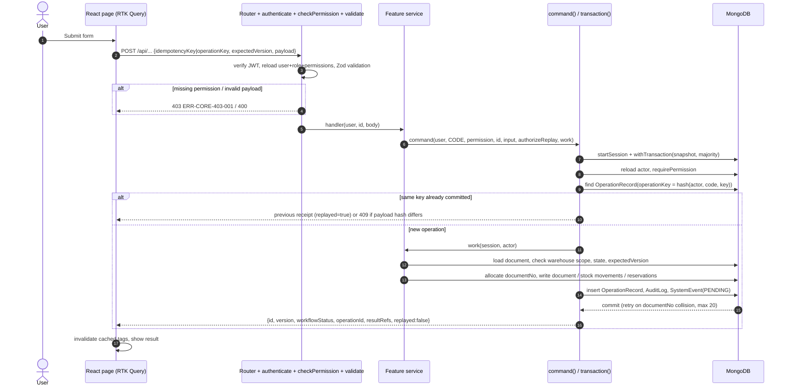

### 1. BF-01 Replenishment, purchasing and goods receipt — Implemented

BF-01 creates four linked documents in this order: Replenishment Request (RR), Purchase Order (PO), Goods Inspection (INS, created with its Goods Arrival ARR) and purchase Goods Receipt (GR). Sections 1.1 to 1.4 give one class diagram and one sequence diagram per document. Every write command also runs the shared pipeline in section 0. In the class diagrams, a dotted arrow is a call or read/write dependency and a solid arrow with multiplicity is a stored reference.

#### 1.1 Replenishment Request (RR)

##### 1.1.1 Class Diagram

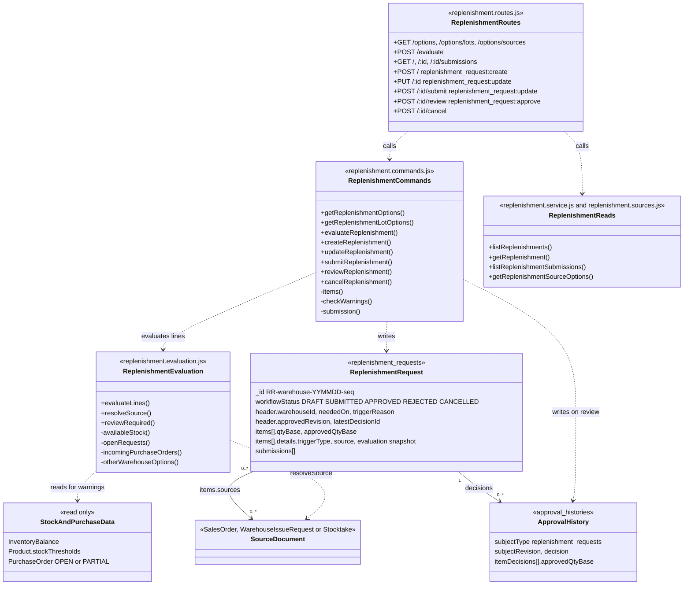

##### 1.1.2 Sequence — Create, submit, review and cancel RR

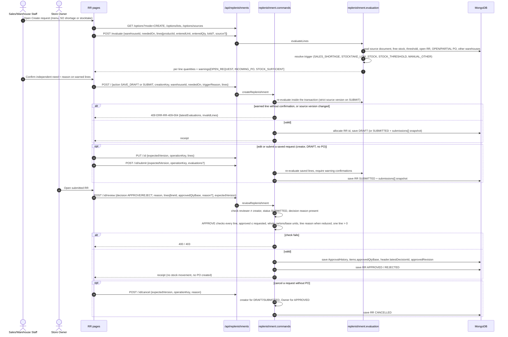

#### 1.2 Purchase Order (PO)

##### 1.2.1 Class Diagram

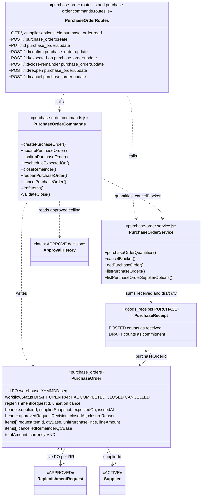

##### 1.2.2 Sequence — Create, confirm, reschedule, close remainder and cancel PO

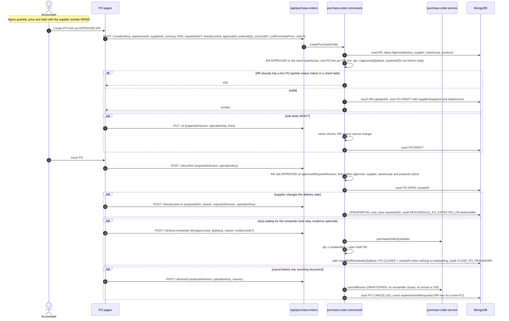

#### 1.3 Goods Inspection (ARR + INS)

##### 1.3.1 Class Diagram

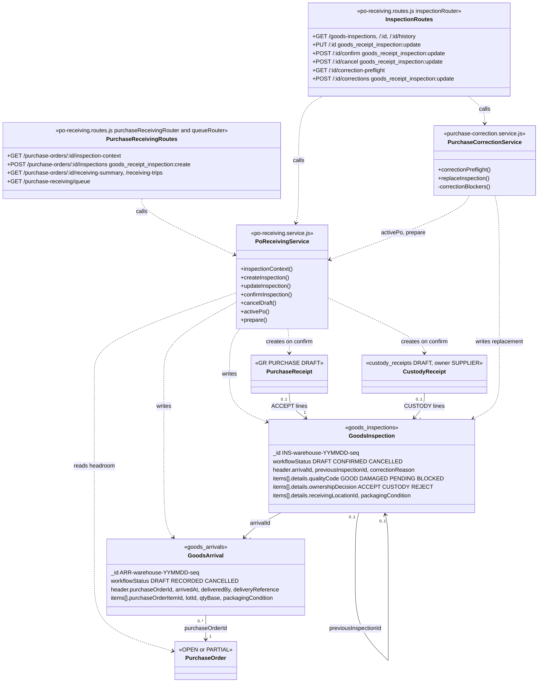

##### 1.3.2 Sequence — Record arrival, inspect and confirm

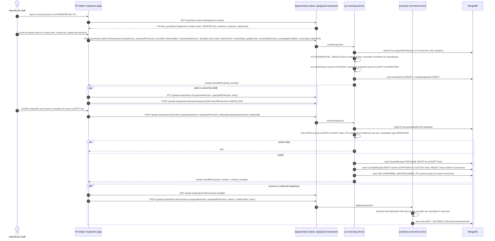

#### 1.4 Purchase Goods Receipt (GR)

##### 1.4.1 Class Diagram

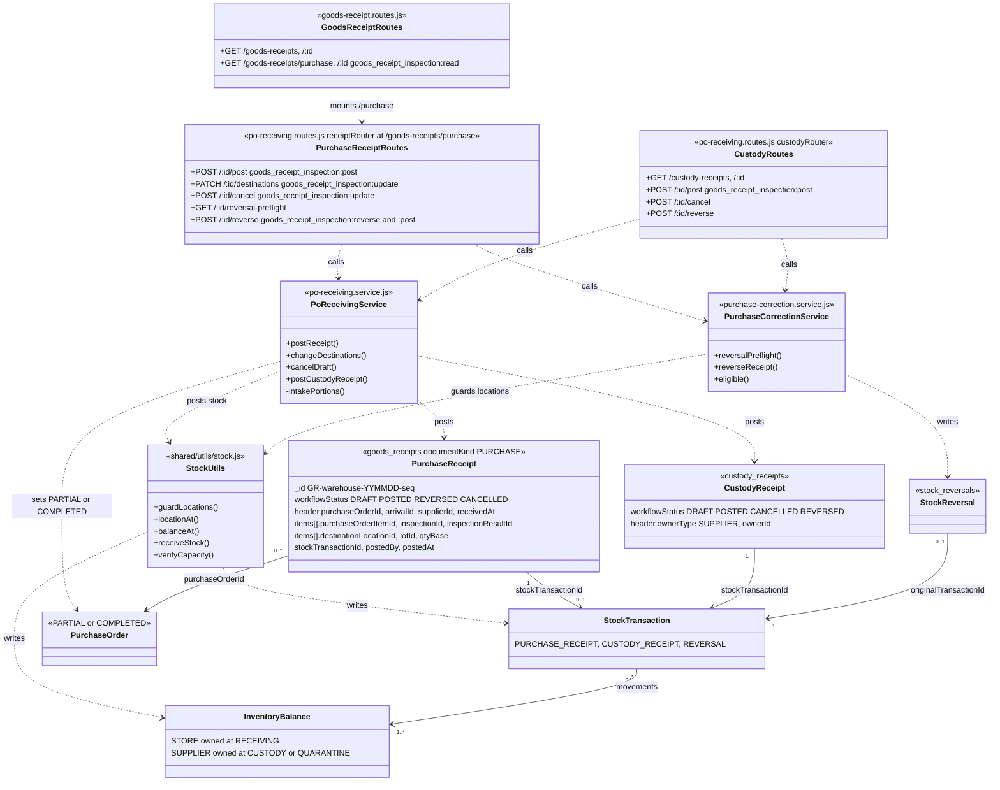

##### 1.4.2 Sequence — Post GR, custody receipt and reversal

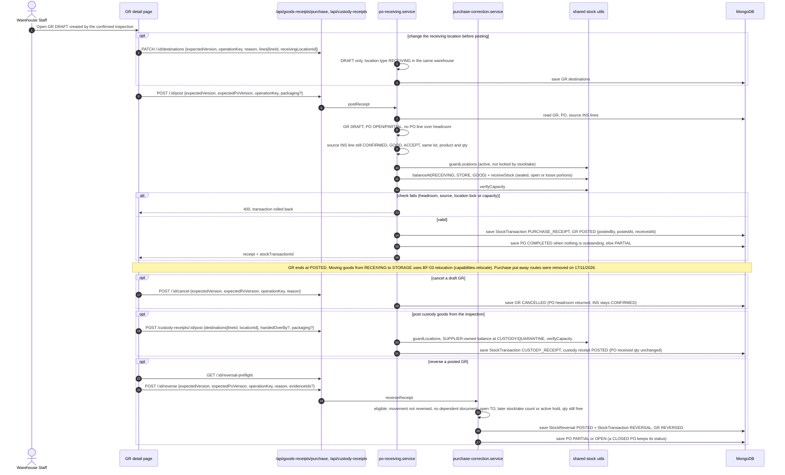

### 2. BF-02 Defect detection, isolation and disposition — Implemented

#### 2.1 Class Diagram

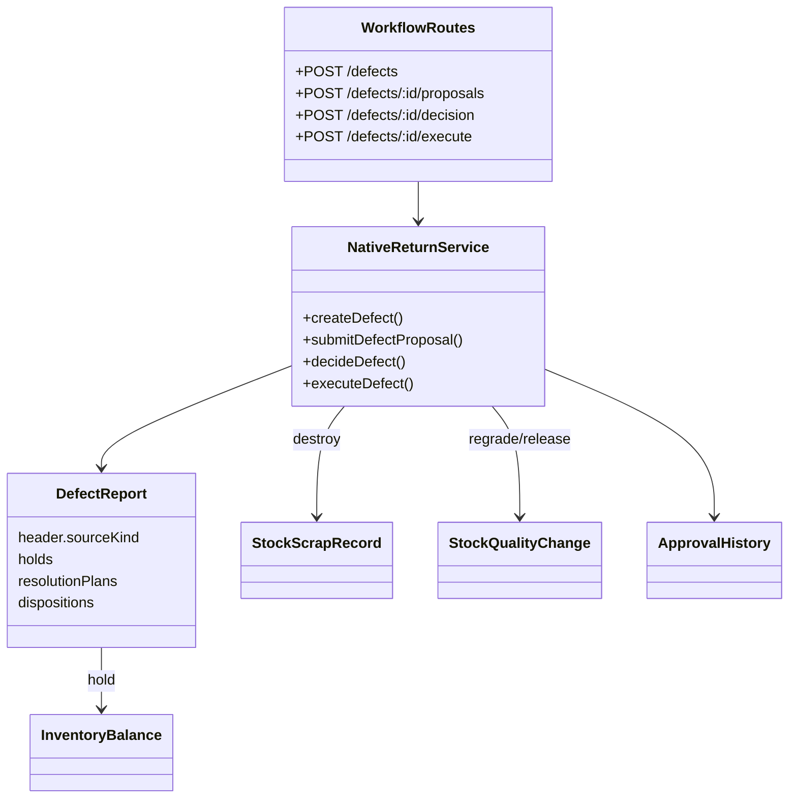

#### 2.2 Sequence — Detect, hold, decide and execute

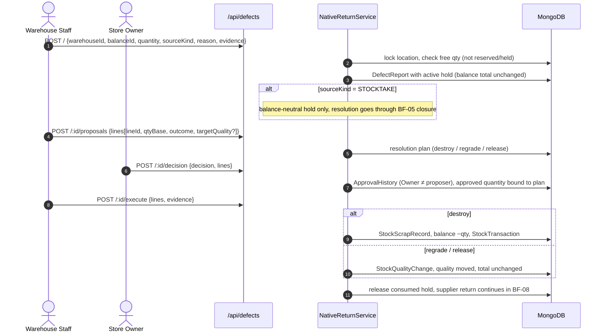

### 3. BF-03 Same-warehouse relocation — Implemented

#### 3.1 Class Diagram

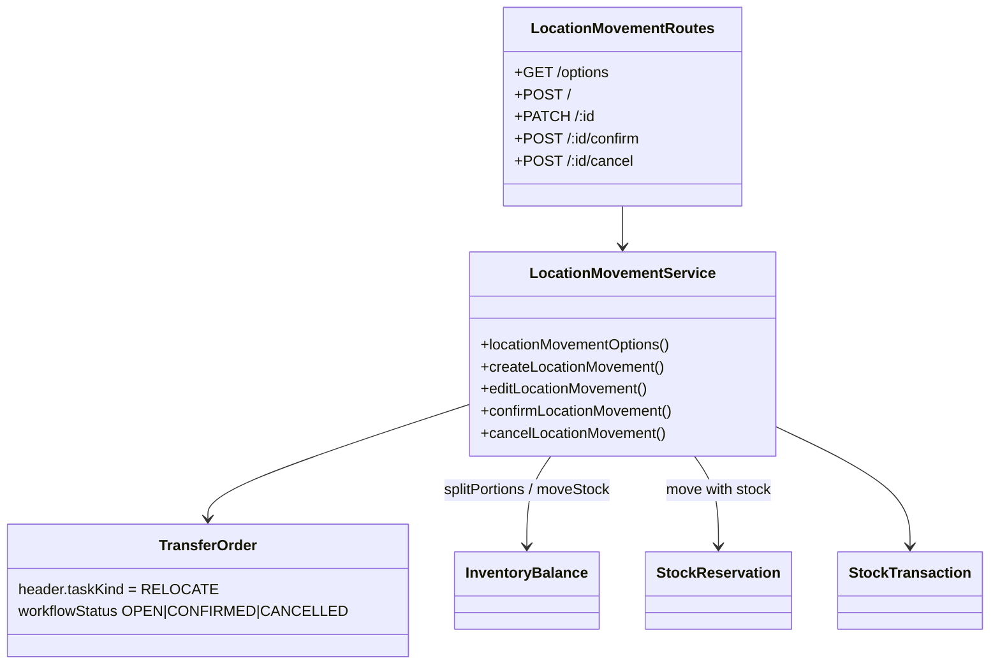

#### 3.2 Sequence — Create and confirm relocation

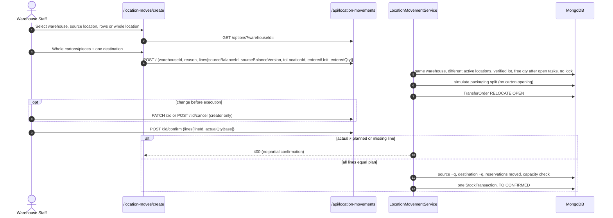

### 4. BF-04 Inter-warehouse transfer — Implemented

#### 4.1 Class Diagram

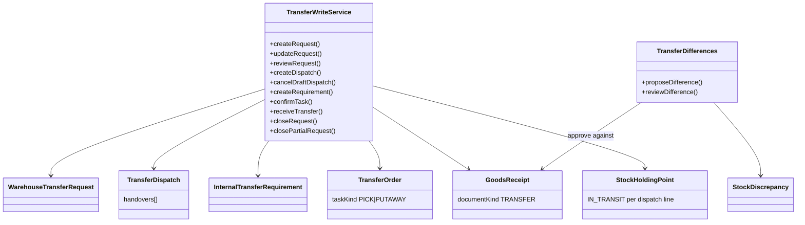

#### 4.2 Sequence — Request, approval and draft dispatch

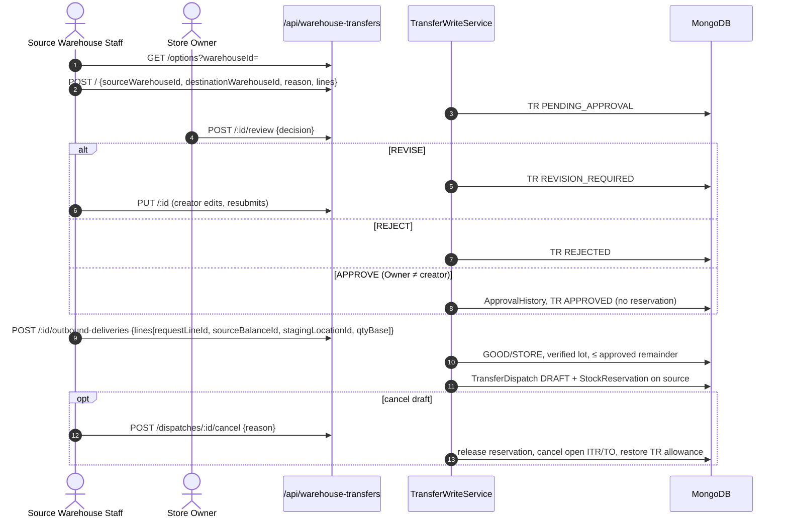

#### 4.3 Sequence — Pick with handover, receipt, put-away and close

```mermaid
sequenceDiagram
  autonumber
  actor WS as Source Warehouse Staff
  actor WD as Destination Warehouse Staff
  participant API as /api/warehouse-transfers
  participant S as TransferWriteService
  participant DB as MongoDB
  WS->>API: POST /documents/:dispatchId/internal-requirements
  S->>DB: one ITR + one PICK TO (unique), reservation → task
  WS->>API: POST /tasks/:pickToId/confirm {recipientName, vehiclePlate?}
  S->>DB: source → staging → IN_TRANSIT point (atomic), handover, TD POSTED
  WD->>API: GET /dispatches?receivable=true
  WD->>API: POST /dispatches/:id/receipts {lines[dispatchLineId, locationId, qtyBase, qualityCode, damageReason?]}
  S->>DB: receiver ≠ dispatcher, qty ≤ transit
  S->>DB: GoodsReceipt TRANSFER: GOOD → RECEIVING, DAMAGED → QUARANTINE, transit −qty
  alt receipt has GOOD lines
    WD->>API: POST /documents/:receiptId/internal-requirements {destinations}
    S->>DB: one ITR + PUTAWAY TO
    WD->>API: POST /tasks/:putawayToId/confirm
    S->>DB: RECEIVING → STORAGE
  else all DAMAGED
    Note over S: no empty TO is created
  end
  WD->>API: POST /:id/close
  S->>DB: all approved dispatched, transit = 0, putaway done, no open difference → COMPLETED
  opt remaining approved qty will not be sent
    WD->>API: POST /:id/close-partial {reason}
  end
```

#### 4.4 Sequence — Transfer difference

```mermaid
sequenceDiagram
  autonumber
  actor WD as Destination Warehouse Staff
  actor O as Store Owner
  participant API as /api/warehouse-transfers
  participant D as TransferDifferences
  participant DB as MongoDB
  WD->>API: POST /dispatches/:id/differences {reason, lines[dispatchLineId, qtyBase]}
  D->>DB: qty ≤ transit, no duplicate open record → StockDiscrepancy (CLCK) OPEN
  O->>API: POST /differences/:id/review {decision, receiptId?}
  alt APPROVE (Owner ≠ reporter)
    D->>DB: receiptId = later POSTED receipt of the same dispatch with enough unused qty
    D->>DB: ApprovalHistory + resolutionEvents, record resolved
  else REJECT / REVISE
    D->>DB: decision history, record stays OPEN
  end
  Note over D: posted quantities are never edited, no automatic loss write-off
```

### 5. BF-05 Stocktake, reconciliation and adjustment — Closure implemented; planning/counting design target

#### 5.1 Class Diagram

```mermaid
classDiagram
  class StocktakeClosureService {
    +listStocktakes()
    +getStocktake()
    +approvalContent(plan)
    +closeStocktake()
  }
  class Stocktake {
    header.scope
    resolutionPlans[]
    workflowStatus
  }
  class StocktakeSnapshot
  class StocktakeCount
  class StocktakeLocationLock
  class StockAdjustment
  class ApprovalHistory
  class InventoryBalance
  StocktakeClosureService --> Stocktake
  StocktakeClosureService --> StocktakeSnapshot
  StocktakeClosureService --> StocktakeCount : latest selected
  StocktakeClosureService --> ApprovalHistory : plan approval
  StocktakeClosureService --> StockAdjustment : DELTA
  StocktakeClosureService --> InventoryBalance : RECLASS / RELOCATE
  StocktakeClosureService --> StocktakeLocationLock : unlock
```

#### 5.2 Sequence — Plan, freeze and count (design target)

```mermaid
sequenceDiagram
  autonumber
  actor O as Store Owner
  actor W as Warehouse Staff
  participant API as Stocktake API (planned)
  participant DB as MongoDB
  O->>API: Create session (scope, schedule, counters)
  W->>API: Activate session
  API->>DB: check open tasks / overlap, atomically lock locations + immutable snapshot
  W->>API: Export count sheet
  loop each location / lot
    W->>API: Record count attempt (carton/piece, quality, evidence)
    API->>DB: append StocktakeCount (blank ≠ zero)
  end
  W->>API: Reconcile, recount when evidence is insufficient
  W->>API: Propose resolution plan (DELTA / RECLASS / RELOCATE)
  O->>API: Approve plan (Owner ≠ proposer) → ApprovalHistory
  W->>API: Record execution evidence per line
  Note over API: Not yet exposed by the API, data is the input of 5.3
```

#### 5.3 Sequence — Close stocktake (implemented)

```mermaid
sequenceDiagram
  autonumber
  actor O as Store Owner
  participant API as /api/stocktakes
  participant S as StocktakeClosureService
  participant DB as MongoDB
  O->>API: POST /:id/close {planId?, expectedPlanVersion?, selectedCounts?, reason}
  S->>DB: stock_adjustment:post, warehouse scope, latest counts, balances still match snapshot
  alt no variance
    S->>DB: every snapshot has selected count (EMPTY_LOCATION = 0)
    S->>DB: close + unlock, no ADJ, no ledger of 0
  else variance with approved plan
    S->>DB: ApprovalHistory matches approvalContent(plan), approver ≠ proposer
    S->>DB: executionRecords complete, executor ≠ closer, evidence attached
    S->>DB: DELTA → StockAdjustment, RECLASS quality, RELOCATE location
    S->>DB: capacity + reservation checks, StockTransaction, unlock in same transaction
  end
  alt unresolved defect hold or mismatch
    S-->>API: reject, keep freeze
  end
```

### 6. BF-06 Sales order and direct warehouse issue

Report 3 BF-06 is the requirements authority. Sales owns SO entry and issue-linked customer receipt evidence; Warehouse owns direct issue posting and actual unreceived-goods intake. Buyer information is document-scoped. New records require no customer catalogue, WIR, OD or sales picking task.

#### 6.1 Direct issue relationships

```mermaid
classDiagram
  class SalesOrder
  class SalesGoodsIssue
  class InventoryBalance
  class IssueReceiptEvidence
  class GoodsReceipt
  SalesOrder "1" --> "many" SalesGoodsIssue : source order
  SalesGoodsIssue --> InventoryBalance : actual source stock
  SalesGoodsIssue "1" --> "many" IssueReceiptEvidence : embedded evidence
  SalesGoodsIssue "1" --> "many" GoodsReceipt : actual unreceived intake
```

#### 6.2 SO and direct warehouse issue

```mermaid
sequenceDiagram
  autonumber
  actor SA as Sales Staff
  actor W as Warehouse Staff
  participant API as Order and Goods Issue API
  participant DB as MongoDB
  SA->>API: Save verified source SO, document buyer details and lines
  API->>DB: Validate source identity and save SO without stock change
  W->>API: Create direct issue for SO and actual source stock
  API->>DB: Check order allowance and save DRAFT without stock change
  W->>API: Post actual issue with current version and operation key
  API->>DB: Recheck allowance, stock, scope, packaging, holds and freeze
  API->>DB: Deduct stock and commit issue, ledger, audit and idempotent result
  SA->>API: Record externally evidenced customer receipt on issue
  API->>DB: Check per-item shared caps and save evidence, no stock change
  opt Unreceived goods physically return
    W->>API: Record actual quantity, quality, destination, reason and evidence
    API->>DB: Post linked receipt once and restore actual stock/order allowance
  end
```

The current direct-issue runtime is described in [GOODS_ISSUES.md](../08_api/GOODS_ISSUES.md). Removing required customer-master input is a scope change that still needs API/model alignment; these diagrams do not prove that change is deployed.

### 7. BF-07 Customer returns

Customer returns remain active. Source eligibility uses issue-linked receipt evidence or verified external history and cumulative return claims. Inspection records facts without custody; only accepted receipt posts STORE stock. Separate failed-delivery requests/worklists are outside the selected design.

#### 7.1 Return relationships

```mermaid
classDiagram
  class CustomerReturn
  class SalesGoodsIssue
  class ExternalReference
  class ReturnQuantityClaim
  class GoodsReceipt
  CustomerReturn --> SalesGoodsIssue : evidenced received source
  CustomerReturn --> ExternalReference : verified history alternative
  CustomerReturn --> ReturnQuantityClaim : remaining source quantity
  CustomerReturn --> GoodsReceipt : accepted actual receipt
```

#### 7.2 Inspect, decide and receive

```mermaid
sequenceDiagram
  autonumber
  actor SA as Sales Staff
  actor W as Warehouse Staff
  actor O as Store Owner
  participant API as Customer Return API
  participant DB as MongoDB
  SA->>API: Request CR from evidenced issue or verified external source
  API->>DB: Validate remaining received quantity, save CR and source claim
  W->>API: Record actual quantity, condition, packaging and evidence
  API->>DB: Save inspection facts, no custody or stock posting
  alt Ordinary eligible case
    SA->>API: Accept or reject inspected quantities
  else Eligible substantiated exception
    O->>API: Decide current exception, distinct from proposer
  end
  W->>API: Receive current accepted quantities, quality and destination
  API->>DB: Post CUSTOMER_RETURN receipt and STORE stock once
  opt Rejected goods handed back
    W->>API: Record recipient, quantity and evidence
    API->>DB: Save handback event, no stock movement
  end
```

Buyer details come from the source document. Exact API/model input changes for removing customer-master dependence remain implementation work; historical references and posted ledgers remain intact.

### 8. BF-08 Supplier return — Implemented

#### 8.1 Class Diagram

```mermaid
classDiagram
  class NativeReturnService {
    +createSupplierReturn()
    +supplierAgreement()
    +dispatchSupplierReturn()
    +acknowledgeSupplierReturn()
    +closeSupplierReturn()
  }
  class SupplierReturn {
    items.details PROPOSED|VERIFIED
  }
  class SupplierReturnIssue
  class CustodyRelease {
    supplier acknowledgements
  }
  class StockReservation
  class DefectReport
  NativeReturnService --> SupplierReturn
  NativeReturnService --> SupplierReturnIssue : store-owned
  NativeReturnService --> CustodyRelease : supplier-owned
  NativeReturnService --> StockReservation
  SupplierReturn --> DefectReport : optional evidenced hold
```

#### 8.2 Sequence — Propose, agree, dispatch, acknowledge and close

```mermaid
sequenceDiagram
  autonumber
  actor W as Warehouse Staff
  actor A as Accountant
  participant API as /api/supplier-returns
  participant S as NativeReturnService
  participant DB as MongoDB
  W->>API: POST / {warehouseId, supplierId, lines[originLineId, balanceId, qtyBase, defectHoldId?]}
  S->>DB: source traces to a posted receipt / custody of this supplier, reserve qty → SR PROPOSED
  A->>API: POST /:id/agreement {reference, evidence, lines[lineId, qtyBase]}
  S->>DB: VERIFIED agreement per line (0 = refusal)
  W->>API: POST /:id/dispatch {recipientName, evidence, lines}
  alt store-owned stock
    S->>DB: SupplierReturnIssue, stock −qty once
  else supplier-owned custody
    S->>DB: CustodyRelease, custody −qty
  end
  A->>API: POST /:id/acknowledgement {lines[lineId, qtyBase, outcome ACCEPTED|REJECTED|DAMAGED]}
  A->>API: POST /:id/close {reason}
  S->>DB: all agreed dispatched + accepted ACK, release unused reservations (no stock posting, no Owner)
```

---

## III. Design for Non-Functional Requirements

### 1. Security Design

#### 1.1 Authentication Flow

WMSD uses JWT authentication. `POST /api/auth/login` checks the username (lower-cased) and the bcrypt hash; inactive or locked accounts are rejected. The response returns an access token and sets a refresh token cookie. The `authenticate` middleware reloads the user, role and permissions from MongoDB on every request, so locking an account or changing a role takes effect immediately.

```mermaid
sequenceDiagram
  autonumber
  actor U as User
  participant FE as SPA (apiClient)
  participant API as /api/auth
  participant DB as MongoDB
  U->>FE: username + password
  FE->>API: POST /login
  API->>DB: find user + role + permissions
  API->>API: bcrypt.compare, isActive
  API-->>FE: {accessToken, user profile+permissions} + Set-Cookie refresh_token (HttpOnly, SameSite=Strict)
  FE->>FE: store access token, build menu from permissions
  FE->>API: any /api call with Authorization: Bearer
  alt 401 expired
    FE->>API: POST /refresh (cookie)
    API-->>FE: new accessToken + profile
    FE->>API: retry original request
  end
  U->>FE: Logout
  FE->>API: POST /logout → clear cookies
```

**a. Token design**

| Aspect | Current design | Recommended before production |
|---|---|---|
| Token format | JWT signed with `JWT_SECRET` (jsonwebtoken default HS256) | Keep HS256 with a strong secret from the environment; remove the code fallback secrets. |
| Access token expiry | `JWT_EXPIRES_IN`, default 7 days | 15–30 minutes. |
| Access token storage | Browser `localStorage`, sent as Bearer | Memory-only storage to reduce XSS exposure. |
| Refresh token | JWT signed with `REFRESH_TOKEN_SECRET`, 7 days, cookie `refresh_token` HttpOnly, SameSite=Strict, Secure in production | Add rotation/revocation. |
| Login failure message | Same message for unknown user and wrong password | Keep (GB-04). Account lockout after repeated failures is not implemented. |

**b. CORS configuration**

| Environment | Allowed origins | Methods | Credentials |
|---|---|---|---|
| Development | Vite dev server proxies `/api` to the backend (`VITE_API_PROXY_TARGET`); `cors({origin:true})` reflects the request origin | GET, POST, PUT, PATCH, DELETE, OPTIONS | true |
| Production (recommended) | Explicit allowlist of the deployed FE origin instead of `origin:true` | Same | true |

**c. Email password recovery**

Report 3 specifies two password recovery requirements. UC-145 (Reset Own Password by Email, formerly UC-131) is implemented: the account holder requests an OTP from Sign In (`POST /api/auth/forgot-password/otp`), WMSD sends a six-digit code to the registered email address and the account holder enters the code and the new password on the Sign In screen (`POST /api/auth/forgot-password/reset`). UC-160 (formerly UC-132), where the Administrator requests an OTP from the target account's details, is still pending implementation.

The account update API no longer accepts a password; an email change goes through an OTP sent to the new address.

#### 1.2 Authorization & RBAC Implementation

| Aspect | Decision |
|---|---|
| Permission catalogue | 120 fixed codes `resource:action` in `seeds/data/permissions.data.js` (e.g. `purchase_order:create`, `stock_transfer:approve_variance`). Admin cannot invent codes. |
| Roles | Five default roles OWNER, ACCOUNTANT, WAREHOUSE, SALES, ADMIN plus Administrator-created custom roles that select existing permissions. One role per user; multiple `warehouseIds`. |
| Route check | `checkPermission('<code>')` per route → 403 `ERR-CORE-403-001`. |
| Service check | Inside the transaction `command()` reloads the actor and calls `requirePermission`; services check warehouse scope (403 `ERR-CORE-403-002`), record ownership, state and `expectedVersion`. Owner reads all warehouses. |
| Separation of duties | Approver ≠ requester (RR, TR, TR difference, PO closure, OTHER receipt, defect plan, CR exception, stocktake plan); transfer receiver ≠ dispatcher; stocktake executor ≠ closer. |
| Data redaction | Purchase prices only for Owner/Accountant; SO prices, source evidence and internal references hidden from Warehouse and custom roles; Sales sees only available quantity, not holds/custody. |
| FE | Menu and route guards use the session permission list (`routeAccess.ts`); the backend remains authoritative. |

Selected-scope role responsibilities (existing permission catalogue still includes compatibility codes; documentation alone does not revoke grants):

| Role | Key permissions |
|---|---|
| OWNER | `replenishment_request:approve`, `purchase_order:approve_exception`, `stock_transfer:approve`, `stock_transfer:approve_variance`, `defect:approve`, `customer_return:approve_exception`, `goods_receipt_other:approve`, `stocktake:create`, `stock_adjustment:approve/post`, `product:*`, `uom:*`, `warehouse_location:create/update` |
| ACCOUNTANT | `purchase_order:create/update`, `supplier:create/update`, `purchase_custody:decide`, `supplier_return:record_agreement/close`, `external_reference:*` |
| WAREHOUSE | receiving (`goods_receipt_inspection:*`, `putaway_task:*`), `stock_relocation:*`, `stock_transfer:create/update/dispatch/receive`, `goods_issue:*`, `defect:create/execute`, `customer_return:inspect/post`, `failed_delivery:post` (actual intake on issue only), `supplier_return:create/dispatch`, `stocktake:update/reconcile` |
| SALES | `replenishment_request:create/update`, `sales_order:*`, `delivery_confirmation:confirm` (issue-linked evidence), `customer_return:create/accept`, `payment_confirmation:confirm` |
| ADMIN | `user:*`, `access_control:*`, `warehouse_layout_function:update`; no business permissions |

#### 1.3 Data Protection

| Data category | At rest | In transit | Notes |
|---|---|---|---|
| Passwords | bcryptjs hash in `users.passwordHash` (`select:false`) | TLS in deployment | Never returned by the API. |
| Evidence files (SO source, inspection, returns) | Cloudinary authenticated assets; `attachments` keeps storage key, checksum, owner revision, access category | TLS | Download only through scoped endpoints issuing short-lived signed URLs; storage keys never in DTOs. Upload limited to real JPEG/PNG/PDF, 5 MB. |
| Prices | `purchase_orders.items[].unitPurchasePrice`, SO line prices | TLS | Redacted by role in DTOs, exports and audit views. |
| Secrets (JWT, Cloudinary, MongoDB URI) | Environment variables (`.env`, not committed) | — | Code fallback secrets must be removed for production. |

### 2. Performance & Scalability Design

#### 2.1 Caching Strategy

There is no server-side cache (no Redis). Consistency is preferred over caching because every stock read must reflect committed transactions.

| What is cached | Where | Invalidation |
|---|---|---|
| List/detail/options responses | RTK Query cache in the browser (`baseApi` tag types such as `NativeStock`) | Tags invalidated after each successful command; network/5xx retries keep the same idempotency key and payload. |
| Session profile and permissions | Browser storage | Replaced on login/refresh; server reloads permissions on every request. |

#### 2.2 Database Query Optimization

- Indexes declared on every model (see I.3): unique `documentNo`, `items._id`, `sources.documentId`, `{workflowStatus, createdAt}`, unique balance key `{holdingPointId, batchId, qualityStatus, ownerType, ownerId}`, unique partial index one PO per RR, one ITR per source and one TO per ITR.
- Automatic index creation is disabled at runtime (`_autoIndex:false`); indexes are created by the deployment scripts.
- Lists paginate server-side (`page`, `limit` ≤ 100), filter and apply warehouse scope before counting, and search by literal, case-insensitive document number.
- Reads that combine several collections run in a snapshot transaction; reports return `capturedAt`.
- Concurrency uses optimistic `version`, location operation guards and unique indexes instead of long locks; transactions retry on snapshot conflicts and document-number collisions.

---

## IV. Other Design Specifications

### 1. Document identity

New business documents use `_id = documentNo` = `[type]-[warehouse code or KD]-[YYMMDD]-[6-digit sequence]` in Asia/Ho_Chi_Minh time, e.g. `ĐMH-K-GACH-01-261113-000001`. Transfer-group documents shorten the warehouse code (`K-GACH-01` → `KG1`). The sequence is the highest existing number in the documents and `operation_records` for the same type/unit/day plus one, allocated inside the creating transaction; a duplicate-key collision retries the transaction. Selected-scope type codes (historical WIR/OD/FD numbering remains readable): YCBS (RR), ĐMH (PO), HĐK (arrival), PKN (inspection), PNM (purchase GR), PNK (other GR), LCV (relocation TO), YCĐC (TR), PXĐC (TD), YCNB (ITR), PNĐC (transfer receipt), CLCK (transfer difference), ĐBH (SO), PXB (GI-S), BCH (defect), ĐTK (CR), ĐTNCC (SR), KK (stocktake), ĐCKK (adjustment).

### 2. Inventory posting model

- A balance is keyed by holding point + lot + quality (PENDING/GOOD/DAMAGED/BLOCKED) + owner (STORE/SUPPLIER/CUSTOMER). Transit stock lives on an IN_TRANSIT holding point of the dispatch line.
- `packagingPortions[]` records sealed cartons and open/loose portions with measured volume; moves split only at whole-carton boundaries, so cartons are never opened implicitly.
- Every posting writes one `StockTransaction` with `movements[]` (from/to, before/after), the source document and an idempotency key; corrections append reversal transactions.
- Available quantity = GOOD/STORE in pickable STORAGE, verified lot, active product/warehouse/location, not frozen, minus reservations, uncovered open tasks and active defect holds.
- Capacity: locations have usable length/width and the warehouse clear height; postings check carton dimensions and total volume.

### 3. Units and conversions

`products.baseUnit` holds a UOM code. `conversions` keeps versioned factors per product and optional lot; a verified lot's carton factor equals `piecesPerCarton`. Area units (`uoms.areaMm2`, m² = 1,000,000) derive their factor from tile length × width and round quantities up to whole pieces. Document lines snapshot the factor (`baseUnitsPerUnit`) and keep `qtyBase` as the authoritative quantity.

### 4. Outbox and notifications

Each command writes a `system_events` row with status `PENDING` in the same transaction. A post-commit dispatcher (Report 3 JOB-01 and API-01 SMTP) is a design target: it should claim pending events, create per-recipient `notifications`, send email and record attempts without repeating any stock effect.

### 5. Warehouse 2D/3D layout

`warehouses.layout3d` stores a draft (outline, walls, doors, zones as rotated rectangles, slots, pallets, function catalogue per warehouse); `layout3dApplied` and `layout3dAppliedAt` store the applied snapshot. `PUT /api/warehouse-catalogue/:id/layout` saves drafts with `expectedUpdatedAt`; `apply:true` validates containment, slot overlap and height limits and writes audit atomically. Layout data never changes stock or location types.

### 6. Implementation status against Report 3

| Report 3 area | Status in code (14/11/2026) |
|---|---|
| BF-01 RR, PO, inspection, GR, custody, reversal (UC-01–16, 37, 45–46) | Implemented; UC-11 retired. Purchase put-away routes were removed on 17/11/2026; RECEIVING → STORAGE uses BF-03 relocation. |
| BF-02 defects (UC-73–78) | Implemented. |
| BF-03 relocation (UC-47–50) | Implemented. |
| BF-04 transfer (UC-51–56, 120) | Implemented, including differences and partial close. |
| BF-05 stocktake (UC-93–105, 121) | List/detail and closure (UC-105) implemented; planning, activation, counting, plan proposal/approval and execution recording have no API yet. |
| BF-06 sales (UC-57-61, 69-72, 117-119, 129-130) | Selected design uses SO/direct issue with inline receipt evidence/intake. The current direct runtime contract records implemented behavior; removing customer-master input still needs API/model alignment. WIR/OD/sales picking requirements are retired. |
| BF-07 customer returns (UC-79-84, 86, 122-123) | Customer returns retained with fact-only inspection and accepted receipt. Standalone failed-delivery UCs 85/87 are retired; actual intake belongs to the source issue. Customer-master removal still needs contract alignment. |
| BF-08 supplier return (UC-88–92) | Implemented. |
| Master data, warehouses/locations/inventory/movement log (UC-17-32, 37-44, 114-116) | Retained. Customer catalogue UCs 33-36 are retired; existing customer records remain compatibility data pending explicit migration. |
| Accounts/roles (UC-106–112), reports (UC-113) | Implemented; account lockout after failed logins and SMTP notifications not implemented. |
