# BF-01 · Giải thích và đối chiếu 25 sơ đồ với mã nguồn

**20 hình khớp ở mức thiết kế, 4 hình khớp một phần, 1 hình cần chỉnh điều kiện nghiệp vụ.** Luồng chính từ yêu cầu bổ sung đến ghi tồn mua và tồn giữ hộ có đối ứng trong mã nguồn. Điểm khác rõ nhất là trang 19 chỉ vẽ vị trí `RECEIVING`, trong khi API đổi vị trí kiểm theo chất lượng nguồn và cũng có nhánh `QUARANTINE`. Ba sơ đồ lớp cần làm rõ bội số hoặc cách lưu tham chiếu, còn sơ đồ đảo nhập mua cần làm rõ thao tác lặp theo biến động gốc.

Ảnh PNG xuất trực tiếp từ file draw.io đang làm việc, theo nguyên thứ tự và nội dung 25 trang. Bấm vào ảnh để mở kích thước gốc. Đối chiếu mã ngày 25/11/2026 trên BE `minhtd` (`027b9dc`) và FE `minhtd` (`601f1b9`). Kết luận dựa trên route, middleware, controller, service, model và nơi FE gọi API. Các đường dẫn FE dùng cấu trúc hai checkout `be` và `fe` đặt cạnh nhau. Mã UC theo tên trang gốc. Report 3 dùng UC-40 và UC-42 rộng hơn phạm vi luồng mua trong hai hình tương ứng. [Sơ đồ nguồn](WMSD_BF01_Diagrams.drawio), [Report 3 §4.2](../01_bao_cao/WMSD_Report3_Fix.docx.txt#L510).

## Mục lục và kết quả

| Trang | Nhóm | Khớp ở mức thiết kế | Khớp một phần | Cần chỉnh |
| --- | --- | --- | --- | --- |
| 1-5 | [Yêu cầu bổ sung](#yeu-cau-bo-sung) | 2-5 | 1 | |
| 6-12 | [Đơn mua](#don-mua) | 6-12 | | |
| 13-17 | [Hàng đến và kiểm nhận](#hang-den-va-kiem-nhan) | 14-17 | 13 | |
| 18-25 | [Nhập mua, giữ hộ và ghi tồn](#nhap-mua-giu-ho-va-ghi-ton) | 20, 21, 23-25 | 18, 22 | 19 |

**Khớp ở mức thiết kế** nghĩa là vai trò đại diện, đường gọi chính và tác động nghiệp vụ khớp trong phạm vi hình. Hình vẫn có thể lược các bước dùng chung hoặc điều kiện chi tiết. **Khớp một phần** dùng khi luồng có thật nhưng một quan hệ, cấu trúc dữ liệu hoặc cách vẽ dễ dẫn đến kết luận sai. **Cần chỉnh** dùng khi điều kiện thể hiện trên hình hẹp hơn hoặc khác hành vi API hiện hành. Đây là kết quả rà soát sơ đồ từ mã nguồn, kèm các test khoanh vùng ở cuối báo cáo.

## Quy ước đọc các đường nối

| Ký hiệu trên hình | Cách đọc và lý do dùng |
| --- | --- |
| Sơ đồ lớp, nét đứt đầu mũi tên mở | **Phụ thuộc**. A gọi B, dùng dữ liệu B hoặc đọc/ghi model B. Mũi tên đi từ bên dùng sang bên được dùng. Dùng cho router → controller → service và cho service → model, vì quan hệ đó phát sinh khi thực thi. Hai kiểu khoảng cách gạch trên file đều cùng nghĩa. |
| Sơ đồ lớp, nét liền đầu mở | **Liên kết dữ liệu có hướng**. Hướng chỉ phía mà đối tượng đầu nguồn có thể lần tới từ trường ID hoặc danh sách nguồn đã lưu. Mỗi nhãn bội số nằm ở đầu đối tượng được đếm: `1` đúng một, `0..1` tùy chọn tối đa một, `0..*` có thể chưa có hoặc có nhiều, `1..*` ít nhất một. Bội số áp dụng trong phạm vi nghiệp vụ ghi rõ bên dưới. `ref` Mongoose và ID đa hình cần service kiểm nguồn, trạng thái và phạm vi khi xử lý. |
| Sơ đồ lớp, hình thoi đen | **Hợp thành**. Đầu có hình thoi chứa phần tử nhúng của đầu còn lại. Trang 18 dùng cho `StockTransaction.movements[]`. Hai đường nét liền tiếp theo nối movement với số dư nguồn và đích qua hai trường riêng. |
| Góc gấp, đường cong và cầu vượt nhỏ ở điểm giao | Các đoạn bẻ góc phục vụ bố cục. Cầu vượt cho biết hai đường đi qua nhau. Chỉ đầu mút được gắn vào một hộp mới tạo liên kết. Vòng nét liền quay về chính hộp `GoodsInspection` ở trang 13 thể hiện tham chiếu phiếu kiểm trước đó. |
| Sơ đồ tuần tự, nét liền ngang đầu đặc | **Lời gọi hoặc thao tác**. Người dùng thao tác trên UI, UI gửi HTTP, controller chuyển vào hàm nghiệp vụ, service gọi service khác hoặc thực hiện đọc/ghi qua model. Mũi tên gập trở lại cùng đường sống biểu thị bước tự xử lý trong cùng service. |
| Sơ đồ tuần tự, nét đứt ngang đầu mở | **Phản hồi**. DB trả dữ liệu/kết quả lưu, service trả kết quả hoặc chuyển lỗi về tầng HTTP, UI hiển thị kết quả cho người dùng. `Saved` là phản hồi ở bước ghi được mô tả. Thành công của cả lệnh còn phụ thuộc commit transaction. `Error response` đại diện cho phản hồi lỗi, mã cụ thể phụ thuộc điểm chặn. |
| Đường dọc nét đứt, thanh chữ nhật hẹp | Đường dọc là **đường sống** của một vai trò hoặc thành phần. Đọc thời gian từ trên xuống. Thanh hẹp mô tả đoạn thành phần đang xử lý. Độ dài trên ảnh giúp theo dõi luồng và mang tính minh họa. |
| Khung `sd`, `alt`, `opt`, `loop` và đường ngang đứt không đầu | `sd` đặt phạm vi một tương tác. `alt` chọn một nhánh theo điều kiện trong `[ ]`. Đường ngang đứt không đầu bên trong `alt` ngăn hai nhánh. `opt` chạy phần bên trong nếu điều kiện đúng, nên hai khung `opt` liên tiếp có thể cùng chạy. `loop` lặp phần bên trong theo đối tượng được chỉ định. |

`«router»`, `«controller»`, `«service»`, `«utility»`, `«entity»`, `«embedded»` chỉ vai trò của hộp. Các dấu `+` và `-` thể hiện thao tác thành phần cung cấp và helper nội bộ ở mức mô hình. BE dùng module JavaScript, hàm và model Mongoose. Các lớp mang tên module là cách biểu diễn thiết kế. Ví dụ các field vẽ phẳng có thể nằm trong `header`, còn `id` trên hình tương ứng với `_id` lưu hoặc `id` ở DTO. Chữ `MongoDB` trên sơ đồ tuần tự bao quát cả lớp model và persistence phía BE.

### Các bước dùng chung được lược trong hình

- UI đi qua Express router, xác thực và validation trước controller. Route có quyền tĩnh kiểm permission bằng middleware, còn RR cancel chọn permission trong command. Các vai trò ghi trên hình đại diện luồng điển hình theo quyền mặc định. Backend còn xét quyền hiệu lực, người tạo, kho và trạng thái theo từng lệnh. Các nhãn mã UC trong seed có phiên bản khác danh mục §4.2, nên khi rà quyền dùng mã permission và nơi kiểm. [Route gắn module][mount], [quyền mặc định][permissions], [scope nhận mua][purchase-core].
- Các lệnh ghi đi qua `command()` với transaction, nạp lại actor, kiểm quyền, khóa phiên bản theo nghiệp vụ và xử lý gửi lặp bằng `OperationRecord`. Lệnh hợp lệ ghi dữ liệu nghiệp vụ, audit và sự kiện trong cùng transaction. RR tạo truyền `creationKey`, còn đa số lệnh tiếp theo dùng `operationKey`. Các `GET` kiểm tra trước chỉ đọc, vì vậy các lệnh ghi phải rà lại điều kiện ngay khi thực thi. [Command dùng chung][command], [transaction][transaction], [validation RR][rr-val], [validation nhận mua][rec-val].
- Đường tham chiếu nguồn dùng `_id` chuẩn của chứng từ. Chứng từ lịch sử có thể dùng ObjectId và mã phiếu riêng. Trạng thái, quyền, đơn vị và lượng khả dụng là các điều kiện độc lập. Tham chiếu hợp lệ về mặt schema vẫn cần được đối chiếu khi thực thi. [Định danh chứng từ](../08_api/DOCUMENT_IDENTITIES.md), [phân giải chứng từ mua][purchase-core].
- RR là yêu cầu bổ sung, PO là đơn mua, ARR là hồ sơ hàng đến, INS là phiếu kiểm nhận, GR trong các hình này là phiếu nhập mua, NCC là nhà cung cấp. `STORE` và `SUPPLIER` là chủ tồn. Đường dữ liệu hoặc thao tác với MongoDB trước khi post có thể chỉ ghi chứng từ, snapshot hoặc số lượng cam kết. Mốc ghi tồn được nêu ở từng hình.

## Yêu cầu bổ sung

### 01 · 1.1.1 RR Class

[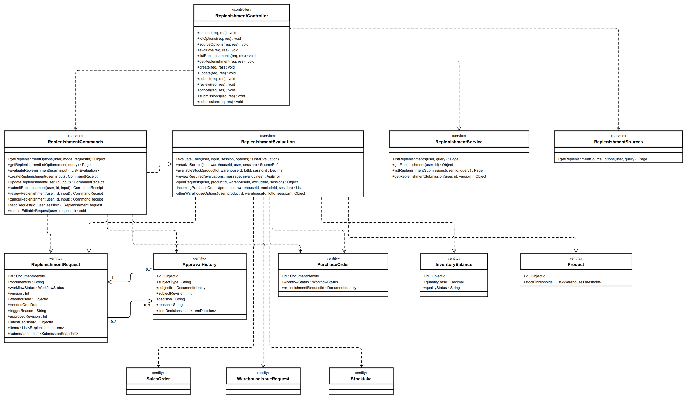](WMSD_BF01_Diagrams_Review_Images/01.png)

**Khớp một phần.** Controller, command, truy vấn và đánh giá khớp cách tổ chức BE. Ba mũi tên tới các model nguồn khớp cách `resolveSource()` đọc chứng từ. Điểm cần làm rõ còn lại là bội số ở chiều ngược của `latestDecisionId`.

| Đường trên hình | Lý do nối và kết quả đối chiếu |
| --- | --- |
| `ReplenishmentController` ⇢ `ReplenishmentCommands`, `ReplenishmentService`, `ReplenishmentSources` | Ba phụ thuộc tương ứng với lệnh ghi/đánh giá và options, truy vấn danh sách/chi tiết/snapshot, và tra nguồn nhu cầu. Controller thật import cả ba. Express router đứng trước controller và được lược khỏi hình. [Controller RR][rr-controller], [router RR][rr-route]. |
| `ReplenishmentCommands` ⇢ `ReplenishmentEvaluation` | Lưu, sửa và gửi lại nháp cần tính lại lượng thiếu và đối chiếu cảnh báo với dữ liệu hiện hành. `commands` gọi `evaluateLines()` và dùng `reviewRequired()` khi cần trả lỗi kèm đánh giá. [Khâu dựng dòng và đánh giá][rr-items]. |
| `ReplenishmentCommands` ⇢ `ReplenishmentRequest`, `ApprovalHistory`, `PurchaseOrder` | RR là đối tượng lưu và đổi trạng thái, ApprovalHistory ghi quyết định duyệt, PO dùng chặn sửa/hủy RR đã liên kết. Mỗi phụ thuộc mô tả thao tác trong code. [Command RR][rr-create], [duyệt và hủy RR][rr-review]. |
| `ReplenishmentEvaluation` ⇢ `ReplenishmentRequest`, `PurchaseOrder`, `InventoryBalance`, `Product` | RR đang mở và PO đang về giải thích phần nhu cầu đã có nguồn; số dư cho biết tồn hiện hành; sản phẩm mang ngưỡng theo kho và đặc tính quy đổi. Truy vấn chi tiết còn đi qua phiếu nhập/giữ chỗ để tính số thực. [Đánh giá RR][rr-eval]. |
| `ReplenishmentEvaluation` ⇢ `SalesOrder`, `WarehouseIssueRequest`, `Stocktake` | Ba mũi tên nét đứt biểu thị phụ thuộc đọc model. Với `SALES_SHORTAGE`, `resolveSource()` đọc thẳng `SalesOrder` khi nguồn là đơn bán. Khi nguồn là yêu cầu xuất kho, hàm đọc `WarehouseIssueRequest` trước rồi lần về `SalesOrder` và dòng hàng nguồn. Với `STOCKTAKE_LOW_STOCK`, hàm đọc `Stocktake` và kiểm kho, trạng thái đã chốt và sản phẩm. [Schema nguồn][rr-val], [resolveSource][rr-source]. |
| `ApprovalHistory` → `ReplenishmentRequest` (`0..*` / `1`) | Mỗi quyết định cho một RR có `subjectType`, `subjectId` và `subjectRevision` chỉ đến phiên bản được xét. Từ phía RR có thể truy ngược lịch sử theo các khóa này. Bội số `1` áp dụng cho phần ApprovalHistory của RR, vì collection còn dùng được cho nhiều loại đối tượng. [Model phê duyệt][approval-model], [ghi quyết định][rr-review]. |
| `ReplenishmentRequest` → `ApprovalHistory` (`0..*` / `0..1`) | `header.latestDecisionId` đưa từ RR sang quyết định gần nhất cho màn hình đọc. `0..1` ở đầu quyết định phù hợp vì RR chưa xét có thể thiếu trường. `0..*` ở đầu RR biểu diễn phía ngược quá rộng so với luồng ghi: mỗi quyết định được tạo cho đúng một RR, rồi gắn về chính RR đó. [Header RR][rr-header], [gắn quyết định][rr-review]. |

**Lý do bố cục.** Controller ở trên, các nhóm hàm ở giữa, chứng từ và nguồn ở dưới giúp phân biệt phụ thuộc gọi hàm với truy vết dữ liệu. `items`, `submissions` và `itemDecisions` được ghi dạng thuộc tính danh sách. Riêng `submissions[]` là snapshot nhúng của lần gửi, có thể đọc lại theo version. [Model RR][rr-model], [model phê duyệt][approval-model].

**Nguồn của từng dòng RR.** Khi có chứng từ nguồn, code lưu dữ liệu chuẩn hóa ở `items[].details.source` và tham chiếu ở `items[].sources[]`. Kiểu chứng từ và ID xác định đích tham chiếu cho từng dòng. Dòng thủ công hoặc theo ngưỡng có thể thiếu chứng từ nguồn. [Ghi nguồn từng dòng][rr-items], [schema nguồn][rr-source-model].

### 02 · 1.1.2.1 Create Replenishment Request (UC-03)

[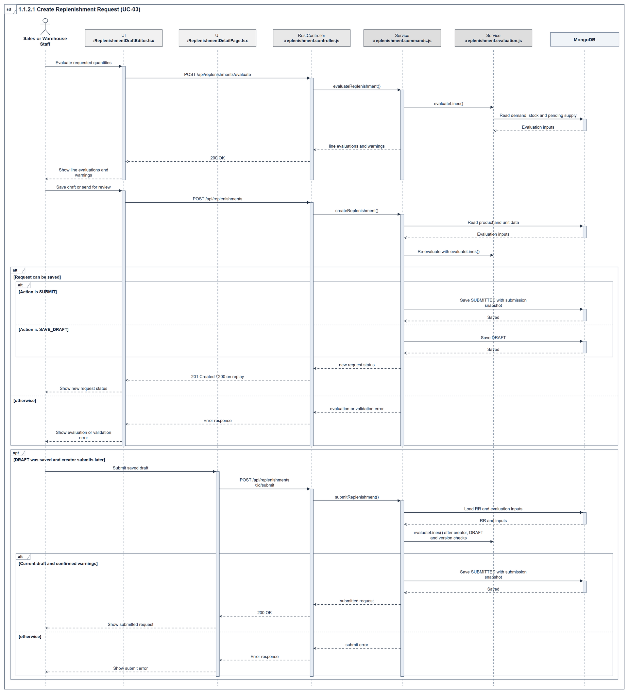](WMSD_BF01_Diagrams_Review_Images/02.png)

**Khớp ở mức thiết kế.** Tách đánh giá, lưu và gửi nháp đã lưu vì chúng có hợp đồng và tác động khác nhau.

- **Đánh giá.** Actor thao tác qua `ReplenishmentDraftEditor.tsx`. UI gửi `POST /api/replenishments/evaluate`, controller gọi command đánh giá, command gọi `evaluateLines()`. Mũi tên evaluation → MongoDB tồn tại vì nhu cầu, tồn và PO đang về được đối chiếu theo source và warehouse. Kết quả/cảnh báo đi ngược trở lại UI. FE tự kích hoạt đánh giá theo input thay đổi khi đủ điều kiện. [Editor RR][rr-fe], [đánh giá][rr-eval].
- **Lưu.** `POST /api/replenishments` đi vào `createReplenishment()`. Hai nhánh nằm trong `alt` vì một request chọn một `action`. `SUBMIT` ghi RR với snapshot; `SAVE_DRAFT` ghi `DRAFT`. Các lỗi validation/đánh giá dùng nhánh lỗi. Controller trả `201` khi tạo, `200` khi replay. [Tạo RR][rr-create], [HTTP create][rr-controller].
- **Gửi sau.** `opt` nối sang `ReplenishmentDetailPage.tsx` vì người lập có thể quay lại nháp. `POST /:id/submit` tải lại RR, kiểm creator, version và `DRAFT`, đánh giá lại dữ liệu đã lưu rồi mới thêm snapshot và đổi `SUBMITTED`. Bước ghi dùng lần gửi mới, tách khỏi request lưu nháp. [Chi tiết RR][rr-detail], [gửi nháp][rr-submit].

Xem 39 thông điệp trên hình theo thứ tự từ trên xuống

| Đầu gửi → đầu nhận | Nét nối | Nhãn trên hình |
| --- | --- | --- |
| Sales or Warehouse Staff → `ReplenishmentDraftEditor.tsx` | Lời gọi | Evaluate requested quantities |
| `ReplenishmentDraftEditor.tsx` → `replenishment.controller.js` | Lời gọi | POST /api/replenishments/evaluate |
| `replenishment.controller.js` → `replenishment.commands.js` | Lời gọi | evaluateReplenishment() |
| `replenishment.commands.js` → `replenishment.evaluation.js` | Lời gọi | evaluateLines() |
| `replenishment.evaluation.js` → MongoDB | Lời gọi | Read demand, stock and pending supply |
| MongoDB → `replenishment.evaluation.js` | Phản hồi | Evaluation inputs |
| `replenishment.commands.js` → `replenishment.controller.js` | Phản hồi | line evaluations and warnings |
| `replenishment.controller.js` → `ReplenishmentDraftEditor.tsx` | Phản hồi | 200 OK |
| `ReplenishmentDraftEditor.tsx` → Sales or Warehouse Staff | Phản hồi | Show line evaluations and warnings |
| Sales or Warehouse Staff → `ReplenishmentDraftEditor.tsx` | Lời gọi | Save draft or send for review |
| `ReplenishmentDraftEditor.tsx` → `replenishment.controller.js` | Lời gọi | POST /api/replenishments |
| `replenishment.controller.js` → `replenishment.commands.js` | Lời gọi | createReplenishment() |
| `replenishment.commands.js` → MongoDB | Lời gọi | Read product and unit data |
| MongoDB → `replenishment.commands.js` | Phản hồi | Evaluation inputs |
| `replenishment.commands.js` → `replenishment.evaluation.js` | Lời gọi | Re-evaluate with evaluateLines() |
| `replenishment.commands.js` → MongoDB | Lời gọi | Save SUBMITTED with submission snapshot |
| MongoDB → `replenishment.commands.js` | Phản hồi | Saved |
| `replenishment.commands.js` → MongoDB | Lời gọi | Save DRAFT |
| MongoDB → `replenishment.commands.js` | Phản hồi | Saved |
| `replenishment.commands.js` → `replenishment.controller.js` | Phản hồi | new request status |
| `replenishment.controller.js` → `ReplenishmentDraftEditor.tsx` | Phản hồi | 201 Created / 200 on replay |
| `ReplenishmentDraftEditor.tsx` → Sales or Warehouse Staff | Phản hồi | Show new request status |
| `replenishment.commands.js` → `replenishment.controller.js` | Phản hồi | evaluation or validation error |
| `replenishment.controller.js` → `ReplenishmentDraftEditor.tsx` | Phản hồi | Error response |
| `ReplenishmentDraftEditor.tsx` → Sales or Warehouse Staff | Phản hồi | Show evaluation or validation error |
| Sales or Warehouse Staff → `ReplenishmentDetailPage.tsx` | Lời gọi | Submit saved draft |
| `ReplenishmentDetailPage.tsx` → `replenishment.controller.js` | Lời gọi | POST /api/replenishments/:id/submit |
| `replenishment.controller.js` → `replenishment.commands.js` | Lời gọi | submitReplenishment() |
| `replenishment.commands.js` → MongoDB | Lời gọi | Load RR and evaluation inputs |
| MongoDB → `replenishment.commands.js` | Phản hồi | RR and inputs |
| `replenishment.commands.js` → `replenishment.evaluation.js` | Lời gọi | evaluateLines() after creator, DRAFT and version checks |
| `replenishment.commands.js` → MongoDB | Lời gọi | Save SUBMITTED with submission snapshot |
| MongoDB → `replenishment.commands.js` | Phản hồi | Saved |
| `replenishment.commands.js` → `replenishment.controller.js` | Phản hồi | submitted request |
| `replenishment.controller.js` → `ReplenishmentDetailPage.tsx` | Phản hồi | 200 OK |
| `ReplenishmentDetailPage.tsx` → Sales or Warehouse Staff | Phản hồi | Show submitted request |
| `replenishment.commands.js` → `replenishment.controller.js` | Phản hồi | submit error |
| `replenishment.controller.js` → `ReplenishmentDetailPage.tsx` | Phản hồi | Error response |
| `ReplenishmentDetailPage.tsx` → Sales or Warehouse Staff | Phản hồi | Show submit error |

### 03 · 1.1.2.2 Update Replenishment Request (UC-04)

[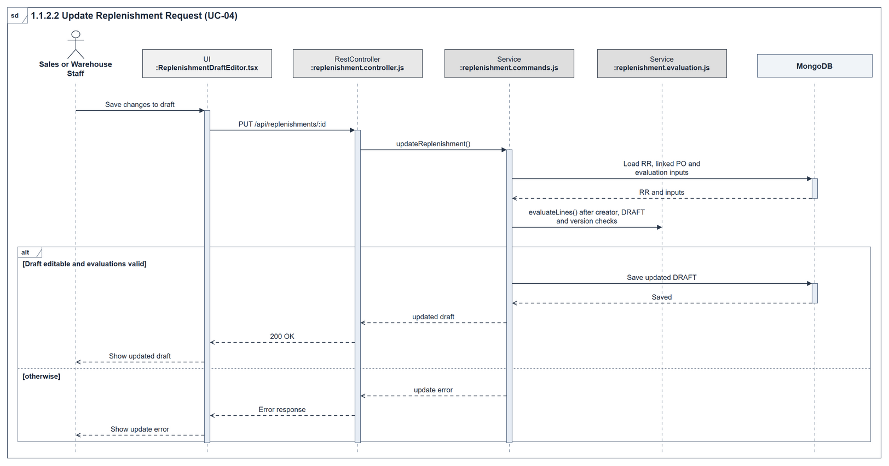](WMSD_BF01_Diagrams_Review_Images/03.png)

**Khớp ở mức thiết kế.** Editor gọi `PUT /api/replenishments/:id` vào `updateReplenishment()`. Service đọc RR và kiểm có PO ngay trước khi thay đổi. Dùng đường riêng sang evaluation vì dòng mới có thể đổi lượng thiếu hoặc xác nhận cảnh báo. Trong `alt` hợp lệ, lưu nội dung và trả nháp mới. Nhánh lỗi chuyển lỗi về editor khi quyền, trạng thái, version hoặc đánh giá bị chặn. Code kiểm người lập, kho của phiếu, nháp và PO liên kết. Trạng thái lưu vẫn là `DRAFT`. [Editor RR][rr-fe], [update RR][rr-update], [guard kho cố định][rr-items].

Xem 14 thông điệp trên hình theo thứ tự từ trên xuống

| Đầu gửi → đầu nhận | Nét nối | Nhãn trên hình |
| --- | --- | --- |
| Sales or Warehouse Staff → `ReplenishmentDraftEditor.tsx` | Lời gọi | Save changes to draft |
| `ReplenishmentDraftEditor.tsx` → `replenishment.controller.js` | Lời gọi | PUT /api/replenishments/:id |
| `replenishment.controller.js` → `replenishment.commands.js` | Lời gọi | updateReplenishment() |
| `replenishment.commands.js` → MongoDB | Lời gọi | Load RR, linked PO and evaluation inputs |
| MongoDB → `replenishment.commands.js` | Phản hồi | RR and inputs |
| `replenishment.commands.js` → `replenishment.evaluation.js` | Lời gọi | evaluateLines() after creator, DRAFT and version checks |
| `replenishment.commands.js` → MongoDB | Lời gọi | Save updated DRAFT |
| MongoDB → `replenishment.commands.js` | Phản hồi | Saved |
| `replenishment.commands.js` → `replenishment.controller.js` | Phản hồi | updated draft |
| `replenishment.controller.js` → `ReplenishmentDraftEditor.tsx` | Phản hồi | 200 OK |
| `ReplenishmentDraftEditor.tsx` → Sales or Warehouse Staff | Phản hồi | Show updated draft |
| `replenishment.commands.js` → `replenishment.controller.js` | Phản hồi | update error |
| `replenishment.controller.js` → `ReplenishmentDraftEditor.tsx` | Phản hồi | Error response |
| `ReplenishmentDraftEditor.tsx` → Sales or Warehouse Staff | Phản hồi | Show update error |

### 04 · 1.1.2.3 Review Replenishment Request (UC-05)

[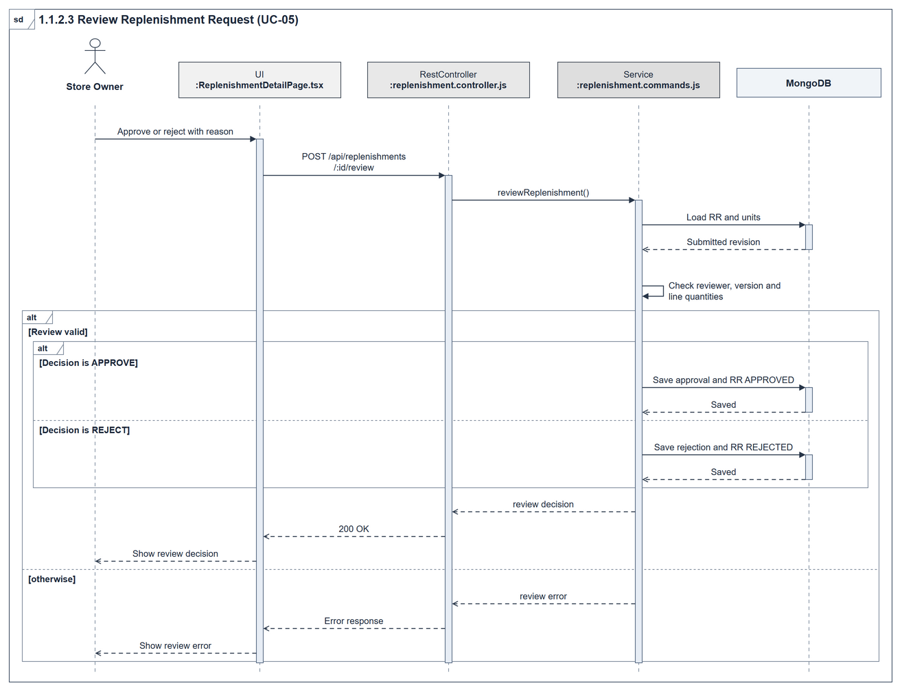](WMSD_BF01_Diagrams_Review_Images/04.png)

**Khớp ở mức thiết kế.** Owner thao tác từ trang RR. `POST /:id/review` vào command kiểm `SUBMITTED`, version, người duyệt khác người lập, lý do và lượng theo đơn vị gốc. DB trả RR và dữ liệu sản phẩm/UOM để tính chính xác. `alt` ngoài chặn quyết định sai. `alt` trong thuận theo hai giá trị của payload, ghi `ApprovalHistory` và chuyển RR sang `APPROVED` hoặc `REJECTED`. Khi duyệt, tất cả dòng phải được xét, phải có ít nhất một lượng dương và có lý do khi giảm lượng. Kết quả đi về detail. [HTTP review][rr-route], [ghi quyết định][rr-review], [trang chi tiết RR][rr-detail].

Xem 16 thông điệp trên hình theo thứ tự từ trên xuống

| Đầu gửi → đầu nhận | Nét nối | Nhãn trên hình |
| --- | --- | --- |
| Store Owner → `ReplenishmentDetailPage.tsx` | Lời gọi | Approve or reject with reason |
| `ReplenishmentDetailPage.tsx` → `replenishment.controller.js` | Lời gọi | POST /api/replenishments/:id/review |
| `replenishment.controller.js` → `replenishment.commands.js` | Lời gọi | reviewReplenishment() |
| `replenishment.commands.js` → MongoDB | Lời gọi | Load RR and units |
| MongoDB → `replenishment.commands.js` | Phản hồi | Submitted revision |
| `replenishment.commands.js` → `replenishment.commands.js` | Tự xử lý | Check reviewer, version and line quantities |
| `replenishment.commands.js` → MongoDB | Lời gọi | Save approval and RR APPROVED |
| MongoDB → `replenishment.commands.js` | Phản hồi | Saved |
| `replenishment.commands.js` → MongoDB | Lời gọi | Save rejection and RR REJECTED |
| MongoDB → `replenishment.commands.js` | Phản hồi | Saved |
| `replenishment.commands.js` → `replenishment.controller.js` | Phản hồi | review decision |
| `replenishment.controller.js` → `ReplenishmentDetailPage.tsx` | Phản hồi | 200 OK |
| `ReplenishmentDetailPage.tsx` → Store Owner | Phản hồi | Show review decision |
| `replenishment.commands.js` → `replenishment.controller.js` | Phản hồi | review error |
| `replenishment.controller.js` → `ReplenishmentDetailPage.tsx` | Phản hồi | Error response |
| `ReplenishmentDetailPage.tsx` → Store Owner | Phản hồi | Show review error |

### 05 · 1.1.2.4 Cancel Replenishment Request (UC-06)

[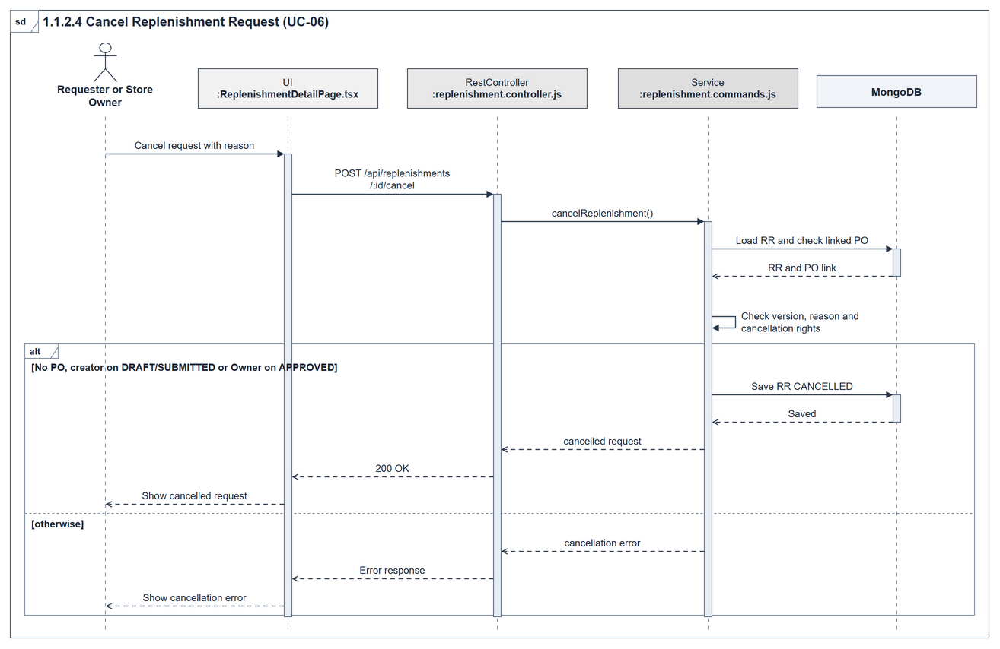](WMSD_BF01_Diagrams_Review_Images/05.png)

**Khớp ở mức thiết kế.** Detail dùng một endpoint `POST /:id/cancel` cho hai trường hợp được vẽ trong cùng điều kiện: người lập hủy `DRAFT`/`SUBMITTED`, Owner hủy `APPROVED`. Command đọc RR, kiểm PO qua trường liên kết, kiểm version và lý do, rồi ghi `CANCELLED` kèm người/thời điểm hủy. Các nhánh trả lỗi vì cùng nút hủy có thể gặp dữ liệu đổi kể từ lúc mở trang. Trong code, Owner dùng quyền `replenishment_request:approve`, các actor khác dùng `replenishment_request:update`. [Hủy RR][rr-cancel], [router RR][rr-route], [trang chi tiết RR][rr-detail].

Xem 14 thông điệp trên hình theo thứ tự từ trên xuống

| Đầu gửi → đầu nhận | Nét nối | Nhãn trên hình |
| --- | --- | --- |
| Requester or Store Owner → `ReplenishmentDetailPage.tsx` | Lời gọi | Cancel request with reason |
| `ReplenishmentDetailPage.tsx` → `replenishment.controller.js` | Lời gọi | POST /api/replenishments/:id/cancel |
| `replenishment.controller.js` → `replenishment.commands.js` | Lời gọi | cancelReplenishment() |
| `replenishment.commands.js` → MongoDB | Lời gọi | Load RR and check linked PO |
| MongoDB → `replenishment.commands.js` | Phản hồi | RR and PO link |
| `replenishment.commands.js` → `replenishment.commands.js` | Tự xử lý | Check version, reason and cancellation rights |
| `replenishment.commands.js` → MongoDB | Lời gọi | Save RR CANCELLED |
| MongoDB → `replenishment.commands.js` | Phản hồi | Saved |
| `replenishment.commands.js` → `replenishment.controller.js` | Phản hồi | cancelled request |
| `replenishment.controller.js` → `ReplenishmentDetailPage.tsx` | Phản hồi | 200 OK |
| `ReplenishmentDetailPage.tsx` → Requester or Store Owner | Phản hồi | Show cancelled request |
| `replenishment.commands.js` → `replenishment.controller.js` | Phản hồi | cancellation error |
| `replenishment.controller.js` → `ReplenishmentDetailPage.tsx` | Phản hồi | Error response |
| `ReplenishmentDetailPage.tsx` → Requester or Store Owner | Phản hồi | Show cancellation error |

## Đơn mua

### 06 · 1.2.1 PO Class

[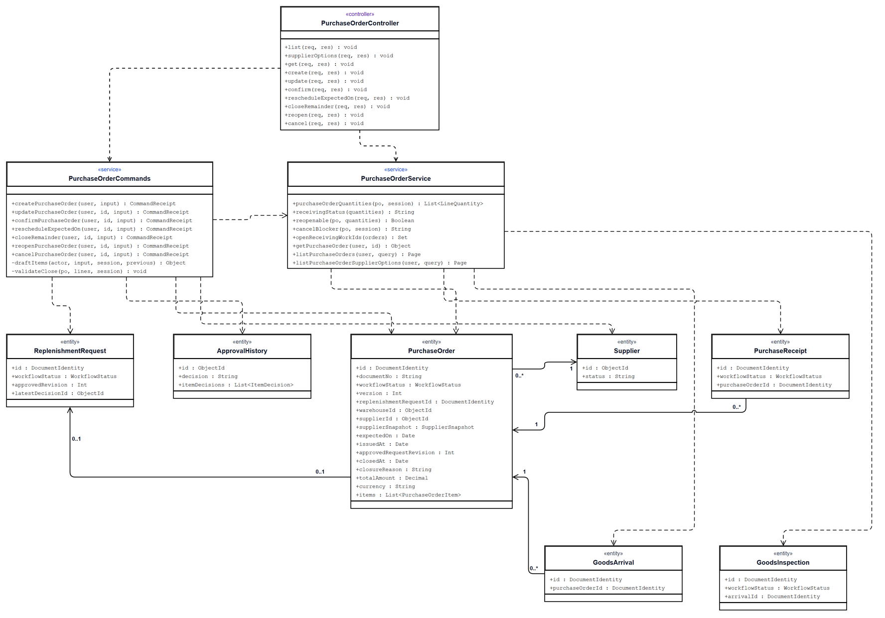](WMSD_BF01_Diagrams_Review_Images/06.png)

**Khớp ở mức thiết kế.** Sơ đồ tách nghiệp vụ ghi khỏi truy vấn và gom quanh PO các tham chiếu ảnh hưởng đến số lượng và khả năng hủy.

| Đường trên hình | Lý do nối và kết quả đối chiếu |
| --- | --- |
| `PurchaseOrderController` ⇢ `PurchaseOrderCommands`, `PurchaseOrderService` | Controller chuyển các thao tác ghi tới command và các yêu cầu danh sách, chi tiết, lựa chọn NCC tới service đọc. Router và validation tồn tại trước controller. [Controller PO][po-controller], [router PO][po-route]. |
| `PurchaseOrderCommands` ⇢ `PurchaseOrderService` | Các lệnh gọi lại cách tính lượng PO, điều kiện mở lại và cản trở hủy. Dùng chung phép tính giữa ghi và đọc giúp điều kiện hiển thị tương ứng với kiểm tra khi ghi. [Imports và lệnh PO][po-close]. |
| `PurchaseOrderCommands` ⇢ `ReplenishmentRequest`, `ApprovalHistory`, `PurchaseOrder`, `Supplier` | RR và lịch sử duyệt cấp nguồn/lượng cho dòng PO; NCC phải đang hoạt động; PO là đối tượng tạo hoặc cập nhật. Kho, sản phẩm và quy đổi cũng được đọc trong các helper, hình tập trung vào chứng từ chính. [Dựng PO từ nguồn duyệt][po-draft], [tạo PO][po-create]. |
| `PurchaseOrderService` ⇢ `PurchaseOrder`, `PurchaseReceipt`, `GoodsArrival`, `GoodsInspection` | Service đọc PO, tính lượng từ phiếu nhập `DRAFT`/`POSTED`, tìm dấu vết hàng đến và kiểm nhận đang mở. Nhờ đó PO có thể trả lượng nhận, lượng giữ chỗ nhận và hành động tương ứng. [Truy vấn nhận mua][po-qty]. |
| `PurchaseOrder` → `ReplenishmentRequest` (`0..1` / `0..1`) | Đường mô tả `replenishmentRequestId` đang tồn tại. PO mới lấy đúng một RR duyệt, index unique một phần chặn hai PO cùng giữ liên kết. Khi hủy PO, trường liên kết được gỡ để lập PO mới; `sources[]` vẫn cho phép lần lại nguồn cũ. Vì vậy một RR có thể có nhiều PO qua lịch sử. [Schema PO][po-model], [hủy PO][po-cancel]. |
| `PurchaseOrder` → `Supplier` (`0..*` / `1`) | Đơn mua hiện hành có một NCC, nhiều đơn có thể dùng cùng NCC. `header.supplierId` mang liên kết, `supplierSnapshot` giữ thông tin tại thời điểm ghi. [Header PO][po-header], [kiểm NCC][po-draft]. |
| `PurchaseReceipt` → `PurchaseOrder`; `GoodsArrival` → `PurchaseOrder` (mỗi đường `0..*` / `1`) | Một PO có thể nhận nhiều đợt. Lệnh BF-01 tạo ARR và GR với `header.purchaseOrderId` của PO. `1` ở phía PO áp dụng cho nhánh nhập mua đang xét. Schema dùng thuộc tính tùy chọn trong ngữ cảnh dùng chung hoặc dữ liệu lịch sử. [Lập ARR][inspection-create], [lập GR][inspection-confirm], [header ARR][arrival-header], [header GR][gr-header]. |

**Lý do bố cục.** Lớp PO là tâm của các đường dữ liệu. GR và ARR nằm thấp hơn để thể hiện chứng từ phát sinh, còn INS ảnh hưởng phép đọc thông qua ARR. Liên kết INS → ARR được mở rộng ở [trang 13](#trang-13-131-inspection-class).

### 07 · 1.2.2.1 Create Purchase Order (UC-09)

[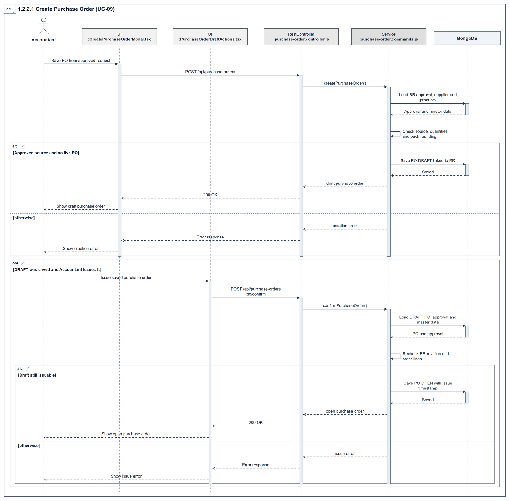](WMSD_BF01_Diagrams_Review_Images/07.png)

**Khớp ở mức thiết kế.** Kế toán lưu nháp qua `CreatePurchaseOrderModal.tsx` và có thể phát hành sau qua `PurchaseOrderDraftActions.tsx`. `POST /api/purchase-orders` kiểm RR đã duyệt, revision, kho/NCC, sản phẩm/quy đổi và giới hạn lượng. Dùng nhánh lỗi trước khi ghi vì chỉ một PO được giữ liên kết hoạt động. Lệnh `POST /:id/confirm` nằm trong `opt` vì nháp đã là kết quả hợp lệ của lệnh đầu. Phát hành kiểm lại dữ liệu rồi ghi `OPEN` và `issuedAt`, từ đó kho mới có thể tiếp nhận. Hai endpoint thành công trả `200`. Quy tắc vượt lượng duyệt chỉ áp dụng với số thùng nguyên tối thiểu đủ phủ lượng duyệt còn lại. [Modal tạo PO][po-fe-create], [thao tác phát hành][po-fe-actions], [lệnh tạo][po-create], [lệnh phát hành][po-confirm].

Xem 28 thông điệp trên hình theo thứ tự từ trên xuống

| Đầu gửi → đầu nhận | Nét nối | Nhãn trên hình |
| --- | --- | --- |
| Accountant → `CreatePurchaseOrderModal.tsx` | Lời gọi | Save PO from approved request |
| `CreatePurchaseOrderModal.tsx` → `purchase-order.controller.js` | Lời gọi | POST /api/purchase-orders |
| `purchase-order.controller.js` → `purchase-order.commands.js` | Lời gọi | createPurchaseOrder() |
| `purchase-order.commands.js` → MongoDB | Lời gọi | Load RR approval, supplier and products |
| MongoDB → `purchase-order.commands.js` | Phản hồi | Approval and master data |
| `purchase-order.commands.js` → `purchase-order.commands.js` | Tự xử lý | Check source, quantities and pack rounding |
| `purchase-order.commands.js` → MongoDB | Lời gọi | Save PO DRAFT linked to RR |
| MongoDB → `purchase-order.commands.js` | Phản hồi | Saved |
| `purchase-order.commands.js` → `purchase-order.controller.js` | Phản hồi | draft purchase order |
| `purchase-order.controller.js` → `CreatePurchaseOrderModal.tsx` | Phản hồi | 200 OK |
| `CreatePurchaseOrderModal.tsx` → Accountant | Phản hồi | Show draft purchase order |
| `purchase-order.commands.js` → `purchase-order.controller.js` | Phản hồi | creation error |
| `purchase-order.controller.js` → `CreatePurchaseOrderModal.tsx` | Phản hồi | Error response |
| `CreatePurchaseOrderModal.tsx` → Accountant | Phản hồi | Show creation error |
| Accountant → `PurchaseOrderDraftActions.tsx` | Lời gọi | Issue saved purchase order |
| `PurchaseOrderDraftActions.tsx` → `purchase-order.controller.js` | Lời gọi | POST /api/purchase-orders/:id/confirm |
| `purchase-order.controller.js` → `purchase-order.commands.js` | Lời gọi | confirmPurchaseOrder() |
| `purchase-order.commands.js` → MongoDB | Lời gọi | Load DRAFT PO, approval and master data |
| MongoDB → `purchase-order.commands.js` | Phản hồi | PO and approval |
| `purchase-order.commands.js` → `purchase-order.commands.js` | Tự xử lý | Recheck RR revision and order lines |
| `purchase-order.commands.js` → MongoDB | Lời gọi | Save PO OPEN with issue timestamp |
| MongoDB → `purchase-order.commands.js` | Phản hồi | Saved |
| `purchase-order.commands.js` → `purchase-order.controller.js` | Phản hồi | open purchase order |
| `purchase-order.controller.js` → `PurchaseOrderDraftActions.tsx` | Phản hồi | 200 OK |
| `PurchaseOrderDraftActions.tsx` → Accountant | Phản hồi | Show open purchase order |
| `purchase-order.commands.js` → `purchase-order.controller.js` | Phản hồi | issue error |
| `purchase-order.controller.js` → `PurchaseOrderDraftActions.tsx` | Phản hồi | Error response |
| `PurchaseOrderDraftActions.tsx` → Accountant | Phản hồi | Show issue error |

### 08 · 1.2.2.2 Update Purchase Order (UC-10)

[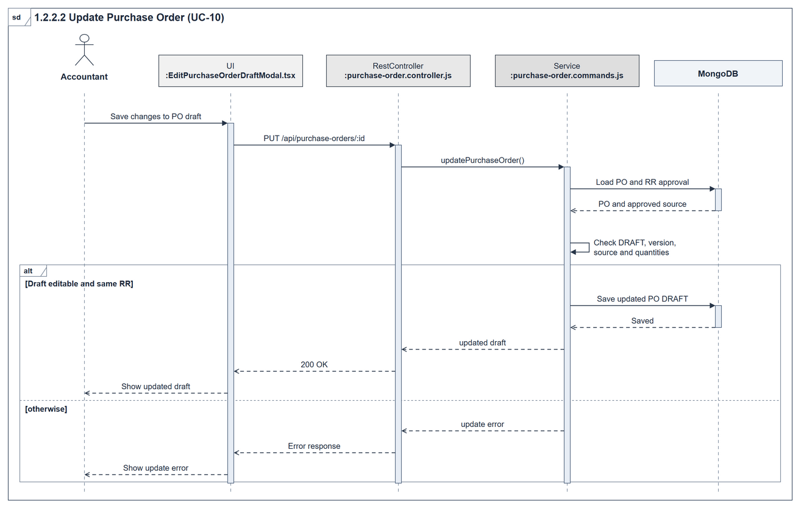](WMSD_BF01_Diagrams_Review_Images/08.png)

**Khớp ở mức thiết kế.** `EditPurchaseOrderDraftModal.tsx` gọi `PUT /:id` để lưu nháp. Command nối tới DB để đọc phiên bản PO và dựng lại dòng từ RR đã duyệt, NCC, sản phẩm và quy đổi. `alt` cho thấy chỉ ghi khi `DRAFT`, version đúng và giữ cùng RR. Code chỉ cho giữ kho hiện tại, cho sửa NCC/ngày hợp lệ, và ghép giữ ID các dòng còn tương ứng. Lỗi được trả về modal vì nguồn duyệt hay trạng thái có thể đã đổi. [Sửa PO][po-update], [modal sửa PO][po-fe-edit].

Xem 14 thông điệp trên hình theo thứ tự từ trên xuống

| Đầu gửi → đầu nhận | Nét nối | Nhãn trên hình |
| --- | --- | --- |
| Accountant → `EditPurchaseOrderDraftModal.tsx` | Lời gọi | Save changes to PO draft |
| `EditPurchaseOrderDraftModal.tsx` → `purchase-order.controller.js` | Lời gọi | PUT /api/purchase-orders/:id |
| `purchase-order.controller.js` → `purchase-order.commands.js` | Lời gọi | updatePurchaseOrder() |
| `purchase-order.commands.js` → MongoDB | Lời gọi | Load PO and RR approval |
| MongoDB → `purchase-order.commands.js` | Phản hồi | PO and approved source |
| `purchase-order.commands.js` → `purchase-order.commands.js` | Tự xử lý | Check DRAFT, version, source and quantities |
| `purchase-order.commands.js` → MongoDB | Lời gọi | Save updated PO DRAFT |
| MongoDB → `purchase-order.commands.js` | Phản hồi | Saved |
| `purchase-order.commands.js` → `purchase-order.controller.js` | Phản hồi | updated draft |
| `purchase-order.controller.js` → `EditPurchaseOrderDraftModal.tsx` | Phản hồi | 200 OK |
| `EditPurchaseOrderDraftModal.tsx` → Accountant | Phản hồi | Show updated draft |
| `purchase-order.commands.js` → `purchase-order.controller.js` | Phản hồi | update error |
| `purchase-order.controller.js` → `EditPurchaseOrderDraftModal.tsx` | Phản hồi | Error response |
| `EditPurchaseOrderDraftModal.tsx` → Accountant | Phản hồi | Show update error |

### 09 · 1.2.2.3 Reschedule Purchase Order Expected Date (UC-11)

[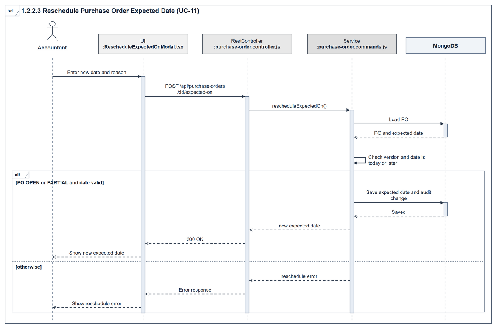](WMSD_BF01_Diagrams_Review_Images/09.png)

**Khớp ở mức thiết kế.** Modal nhận ngày mới và lý do. Endpoint `POST /:id/expected-on` đọc PO, kiểm version, `OPEN`/`PARTIAL` và ngày theo lịch Asia/Saigon. Nhánh hợp lệ ghi `header.expectedOn` và audit giá trị trước/sau. Vì là thay đổi kế hoạch phần chưa nhận, hình chỉ nối tới PO và dòng audit, lịch sử từng đợt nhận vẫn nằm ở các chứng từ của đợt đó. [Đổi ngày PO][po-reschedule], [modal đổi ngày][po-fe-reschedule].

Xem 14 thông điệp trên hình theo thứ tự từ trên xuống

| Đầu gửi → đầu nhận | Nét nối | Nhãn trên hình |
| --- | --- | --- |
| Accountant → `RescheduleExpectedOnModal.tsx` | Lời gọi | Enter new date and reason |
| `RescheduleExpectedOnModal.tsx` → `purchase-order.controller.js` | Lời gọi | POST /api/purchase-orders/:id/expected-on |
| `purchase-order.controller.js` → `purchase-order.commands.js` | Lời gọi | rescheduleExpectedOn() |
| `purchase-order.commands.js` → MongoDB | Lời gọi | Load PO |
| MongoDB → `purchase-order.commands.js` | Phản hồi | PO and expected date |
| `purchase-order.commands.js` → `purchase-order.commands.js` | Tự xử lý | Check version and date is today or later |
| `purchase-order.commands.js` → MongoDB | Lời gọi | Save expected date and audit change |
| MongoDB → `purchase-order.commands.js` | Phản hồi | Saved |
| `purchase-order.commands.js` → `purchase-order.controller.js` | Phản hồi | new expected date |
| `purchase-order.controller.js` → `RescheduleExpectedOnModal.tsx` | Phản hồi | 200 OK |
| `RescheduleExpectedOnModal.tsx` → Accountant | Phản hồi | Show new expected date |
| `purchase-order.commands.js` → `purchase-order.controller.js` | Phản hồi | reschedule error |
| `purchase-order.controller.js` → `RescheduleExpectedOnModal.tsx` | Phản hồi | Error response |
| `RescheduleExpectedOnModal.tsx` → Accountant | Phản hồi | Show reschedule error |

### 10 · 1.2.2.4 Close Purchase Order Remainder (UC-12)

[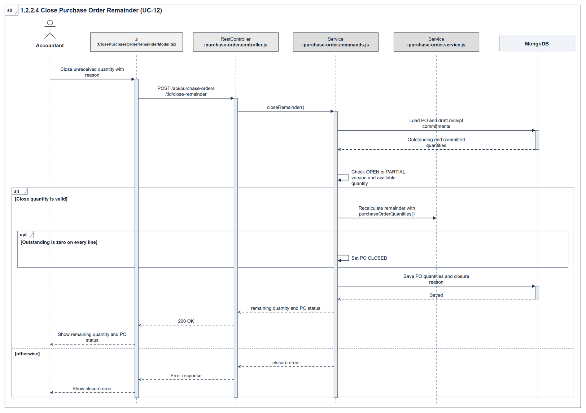](WMSD_BF01_Diagrams_Review_Images/10.png)

**Khớp ở mức thiết kế.** `POST /:id/close-remainder` lấy PO và các phiếu nhập ảnh hưởng lượng. `purchaseOrderQuantities()` tính lượng đặt trừ lượng `POSTED` và lượng đã chốt, còn lượng nháp chiếm một phần khả năng chốt. Command kiểm lượng từng dòng không vượt `outstandingQtyBase - openDraftCommitmentQtyBase`, kiểm đơn vị gốc và evidence nếu có, rồi cộng `cancelledRemainderQtyBase`. Hình dùng `opt` cho `CLOSED` vì chỉ đổi trạng thái khi toàn bộ dòng hết lượng chưa nhận. Code gọi phép tính cả trước khi chốt và sau khi cộng lượng, hữu ích khi đọc hai nhóm mũi tên tải và tính lại. Đây là một lệnh trực tiếp của kế toán. [Tính lượng PO][po-qty], [chốt phần chưa nhận][po-close], [modal chốt thiếu][po-fe-close].

Xem 16 thông điệp trên hình theo thứ tự từ trên xuống

| Đầu gửi → đầu nhận | Nét nối | Nhãn trên hình |
| --- | --- | --- |
| Accountant → `ClosePurchaseOrderRemainderModal.tsx` | Lời gọi | Close unreceived quantity with reason |
| `ClosePurchaseOrderRemainderModal.tsx` → `purchase-order.controller.js` | Lời gọi | POST /api/purchase-orders/:id/close-remainder |
| `purchase-order.controller.js` → `purchase-order.commands.js` | Lời gọi | closeRemainder() |
| `purchase-order.commands.js` → MongoDB | Lời gọi | Load PO and draft receipt commitments |
| MongoDB → `purchase-order.commands.js` | Phản hồi | Outstanding and committed quantities |
| `purchase-order.commands.js` → `purchase-order.commands.js` | Tự xử lý | Check OPEN or PARTIAL, version and available quantity |
| `purchase-order.commands.js` → `purchase-order.service.js` | Lời gọi | Recalculate remainder with purchaseOrderQuantities() |
| `purchase-order.commands.js` → `purchase-order.commands.js` | Tự xử lý | Set PO CLOSED |
| `purchase-order.commands.js` → MongoDB | Lời gọi | Save PO quantities and closure reason |
| MongoDB → `purchase-order.commands.js` | Phản hồi | Saved |
| `purchase-order.commands.js` → `purchase-order.controller.js` | Phản hồi | remaining quantity and PO status |
| `purchase-order.controller.js` → `ClosePurchaseOrderRemainderModal.tsx` | Phản hồi | 200 OK |
| `ClosePurchaseOrderRemainderModal.tsx` → Accountant | Phản hồi | Show remaining quantity and PO status |
| `purchase-order.commands.js` → `purchase-order.controller.js` | Phản hồi | closure error |
| `purchase-order.controller.js` → `ClosePurchaseOrderRemainderModal.tsx` | Phản hồi | Error response |
| `ClosePurchaseOrderRemainderModal.tsx` → Accountant | Phản hồi | Show closure error |

### 11 · 1.2.2.5 Reopen Purchase Order (UC-13)

[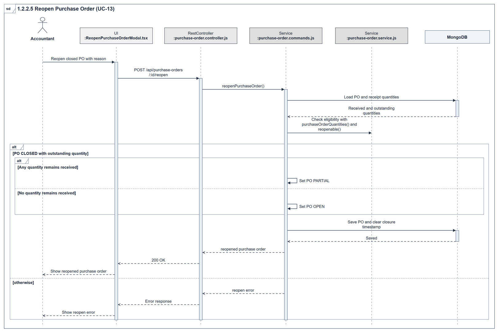](WMSD_BF01_Diagrams_Review_Images/11.png)

**Khớp ở mức thiết kế.** `POST /:id/reopen` đi từ modal đến command rồi dùng service tính lượng thực nhận và lượng còn mở. `alt` ngoài yêu cầu PO `CLOSED` còn lượng chưa nhận, tình huống điển hình là đảo một GR. `alt` trong chọn `PARTIAL` nếu còn lượng nhận, hoặc `OPEN` nếu lượng nhận còn bằng 0. Lệnh xóa `closedAt`, giữ phần đã chốt thiếu. Vì vậy luồng mở lại PO và luồng đảo GR được vẽ ở hai hình riêng. [Tính điều kiện mở lại][po-qty], [mở lại PO][po-reopen], [modal mở lại][po-fe-reopen].

Xem 16 thông điệp trên hình theo thứ tự từ trên xuống

| Đầu gửi → đầu nhận | Nét nối | Nhãn trên hình |
| --- | --- | --- |
| Accountant → `ReopenPurchaseOrderModal.tsx` | Lời gọi | Reopen closed PO with reason |
| `ReopenPurchaseOrderModal.tsx` → `purchase-order.controller.js` | Lời gọi | POST /api/purchase-orders/:id/reopen |
| `purchase-order.controller.js` → `purchase-order.commands.js` | Lời gọi | reopenPurchaseOrder() |
| `purchase-order.commands.js` → MongoDB | Lời gọi | Load PO and receipt quantities |
| MongoDB → `purchase-order.commands.js` | Phản hồi | Received and outstanding quantities |
| `purchase-order.commands.js` → `purchase-order.service.js` | Lời gọi | Check eligibility with purchaseOrderQuantities() and reopenable() |
| `purchase-order.commands.js` → `purchase-order.commands.js` | Tự xử lý | Set PO PARTIAL |
| `purchase-order.commands.js` → `purchase-order.commands.js` | Tự xử lý | Set PO OPEN |
| `purchase-order.commands.js` → MongoDB | Lời gọi | Save PO and clear closure timestamp |
| MongoDB → `purchase-order.commands.js` | Phản hồi | Saved |
| `purchase-order.commands.js` → `purchase-order.controller.js` | Phản hồi | reopened purchase order |
| `purchase-order.controller.js` → `ReopenPurchaseOrderModal.tsx` | Phản hồi | 200 OK |
| `ReopenPurchaseOrderModal.tsx` → Accountant | Phản hồi | Show reopened purchase order |
| `purchase-order.commands.js` → `purchase-order.controller.js` | Phản hồi | reopen error |
| `purchase-order.controller.js` → `ReopenPurchaseOrderModal.tsx` | Phản hồi | Error response |
| `ReopenPurchaseOrderModal.tsx` → Accountant | Phản hồi | Show reopen error |

### 12 · 1.2.2.6 Cancel Purchase Order (UC-14)

[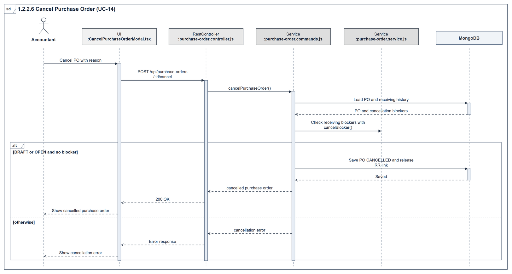](WMSD_BF01_Diagrams_Review_Images/12.png)

**Khớp ở mức thiết kế.** Modal gọi `POST /:id/cancel`; command tải và kiểm version PO, gọi `cancelBlocker()` vì điều kiện phụ thuộc dữ liệu nhận hàng bên ngoài PO. `DRAFT` hoặc `OPEN` có thể hủy khi chưa chốt thiếu và chưa có ARR hay GR liên kết. Hủy lưu `CANCELLED` và gỡ `replenishmentRequestId`. Code chạm bản ghi RR để phối hợp các lệnh đồng thời và giữ `sources[]` làm lịch sử. Đường `Saved` chỉ biểu thị sau khi chuỗi ghi hợp lệ, nên tránh đọc hình thành việc xóa PO hoặc xóa mọi quan hệ với RR. [Cản trở hủy][po-qty], [hủy PO][po-cancel], [modal hủy][po-fe-cancel].

Xem 14 thông điệp trên hình theo thứ tự từ trên xuống

| Đầu gửi → đầu nhận | Nét nối | Nhãn trên hình |
| --- | --- | --- |
| Accountant → `CancelPurchaseOrderModal.tsx` | Lời gọi | Cancel PO with reason |
| `CancelPurchaseOrderModal.tsx` → `purchase-order.controller.js` | Lời gọi | POST /api/purchase-orders/:id/cancel |
| `purchase-order.controller.js` → `purchase-order.commands.js` | Lời gọi | cancelPurchaseOrder() |
| `purchase-order.commands.js` → MongoDB | Lời gọi | Load PO and receiving history |
| MongoDB → `purchase-order.commands.js` | Phản hồi | PO and cancellation blockers |
| `purchase-order.commands.js` → `purchase-order.service.js` | Lời gọi | Check receiving blockers with cancelBlocker() |
| `purchase-order.commands.js` → MongoDB | Lời gọi | Save PO CANCELLED and release RR link |
| MongoDB → `purchase-order.commands.js` | Phản hồi | Saved |
| `purchase-order.commands.js` → `purchase-order.controller.js` | Phản hồi | cancelled purchase order |
| `purchase-order.controller.js` → `CancelPurchaseOrderModal.tsx` | Phản hồi | 200 OK |
| `CancelPurchaseOrderModal.tsx` → Accountant | Phản hồi | Show cancelled purchase order |
| `purchase-order.commands.js` → `purchase-order.controller.js` | Phản hồi | cancellation error |
| `purchase-order.controller.js` → `CancelPurchaseOrderModal.tsx` | Phản hồi | Error response |
| `CancelPurchaseOrderModal.tsx` → Accountant | Phản hồi | Show cancellation error |

## Hàng đến và kiểm nhận

### 13 · 1.3.1 Inspection Class

[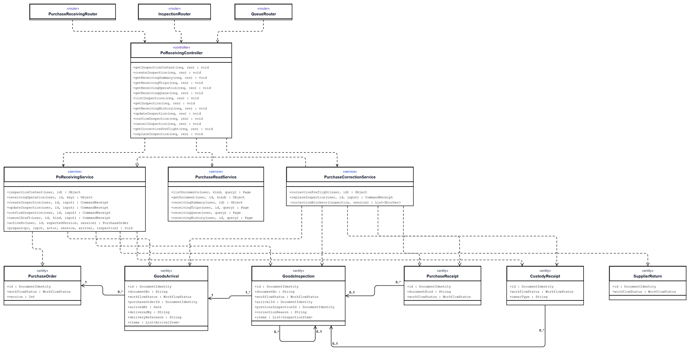](WMSD_BF01_Diagrams_Review_Images/13.png)

**Khớp một phần.** Các điểm vào, nhóm service và chuỗi PO → ARR → INS → phiếu dự thảo đều có thật. Cần phân biệt tham chiếu trên header, tham chiếu theo dòng và bội số của hồ sơ thay thế.

| Đường trên hình | Lý do nối và kết quả đối chiếu |
| --- | --- |
| `PurchaseReceivingRouter`, `InspectionRouter`, `QueueRouter` ⇢ `PoReceivingController` | Ba nhóm điểm vào phục vụ nhận theo PO, thao tác INS và đọc hàng chờ. Router nhận mua gắn dưới PO, router INS và queue gắn ở prefix riêng. Mỗi router chuyển vào handler tương ứng trong cùng controller. [Gắn router][mount], [route nhận hàng và INS][rec-route]. |
| `PoReceivingController` ⇢ `PoReceivingService`, `PurchaseReadService`, `PurchaseCorrectionService` | Tách thao tác nhận hàng, truy vấn danh sách/chi tiết/lịch sử và sửa kết quả đã xác nhận. Cả ba là module controller gọi trực tiếp. [Controller nhận mua][rec-controller]. |
| `PurchaseCorrectionService` ⇢ `PoReceivingService` | Lệnh thay INS dùng lại `inspectionSource()`, `activePo()` và `prepare()` để giải quyết nguồn, PO và dòng hàng theo cùng nguyên tắc với lập phiếu. [Lệnh thay INS][inspection-replace]. |
| `PoReceivingService` ⇢ `PurchaseOrder`, `GoodsArrival`, `GoodsInspection`, `PurchaseReceipt`, `CustodyReceipt` | Service kiểm PO còn tiếp nhận, ghi ARR/INS theo đợt, sinh GR và giữ hộ dự thảo theo kết quả từng dòng. Hai phụ thuộc sau chỉ xuất hiện khi có dòng tương ứng. [Lập ARR/INS][inspection-create], [xác nhận và sinh phiếu][inspection-confirm]. |
| `PurchaseCorrectionService` ⇢ `GoodsArrival`, `GoodsInspection`, `PurchaseReceipt`, `CustodyReceipt`, `SupplierReturn` | Khi sửa, service đọc ARR gốc, kiểm INS và dò các phiếu phụ thuộc. GR/giữ hộ có thể cần hủy hoặc đảo trước, hồ sơ trả NCC hoặc bản sửa đang hiệu lực có thể chặn. Nếu đủ điều kiện, tạo ARR/INS mới. Một số truy vấn model đi qua helper gián tiếp. [Blocker sửa kết quả][inspection-blockers], [ghi bản thay thế][inspection-replace]. |
| `GoodsArrival` → `PurchaseOrder` (`0..*` / `1`) | Một PO nhận nhiều đợt. ARR mua lưu `header.purchaseOrderId` để mỗi đợt truy lại đơn mua. `1` mô tả luồng BF-01. [Header ARR][arrival-header], [lập ARR][inspection-create]. |
| `GoodsInspection` → `GoodsArrival` (`1..*` / `1`) | INS ghi kết quả cho ARR, nối qua `header.arrivalId`. Trong luồng mua, mỗi lần tạo hoặc thay tạo một cặp mới. `1..*` có thể hiểu là khả năng mô hình chung, nhưng dễ gây hiểu nhầm rằng sửa kết quả sẽ thêm nhiều INS vào cùng ARR gốc. Cơ chế hiện hành tạo ARR thay thế. `arrivalId` cũng là tùy chọn trong schema INS dùng chung. [Header INS][inspection-header], [lập cặp mới][inspection-create], [thay INS][inspection-replace]. |
| `GoodsInspection` → `GoodsInspection` (`0..*` / `0..1`) | Phiếu thay thế lưu `header.previousInspectionId`, phiếu đầu tiên có thể thiếu trường này. Bội số lịch sử có thể gồm các bản thay thế đã hủy. Preflight chặn thêm bản thay khi còn bản liên kết chưa hủy. [Header INS][inspection-header], [kiểm bản thay đang hiệu lực][inspection-blockers]. |
| `PurchaseReceipt` → `GoodsInspection` và `CustodyReceipt` → `GoodsInspection` (mỗi đường `0..*` / `0..1`) | Lúc xác nhận một INS, code sinh tối đa một GR mua trực tiếp và một phiếu giữ hộ nếu có dòng tương ứng. GR lưu `inspectionId`, `inspectionResultId` và nguồn ở cấp dòng. Phiếu giữ hộ ban đầu dùng `sources[]` trên chứng từ và từng dòng, không có `header.inspectionId` riêng. Bội số `0..1` phù hợp khi nói về từng dòng nguồn hoặc phiếu sinh thẳng từ một INS. Khi nhận sở hữu từ giữ hộ, các dòng có thể tham chiếu lần kiểm lại khác nhau; hình chưa thể hiện cấp dòng này. [Tạo phiếu từ INS][inspection-confirm], [nhận từ giữ hộ][custody-service], [schema giữ hộ][custody-model]. |

**Lý do bố cục.** Router/controller đi từ trên xuống để phân biệt trách nhiệm HTTP với nghiệp vụ. Ở hàng dữ liệu, PO/ARR/INS thể hiện chuỗi truy nguồn, GR/giữ hộ thể hiện kết quả có thể xảy ra song song, và vòng tự tham chiếu giữ lịch sử hiệu chỉnh ngay tại INS.

### 14 · 1.3.2.1 Create Goods Inspection (UC-37)

[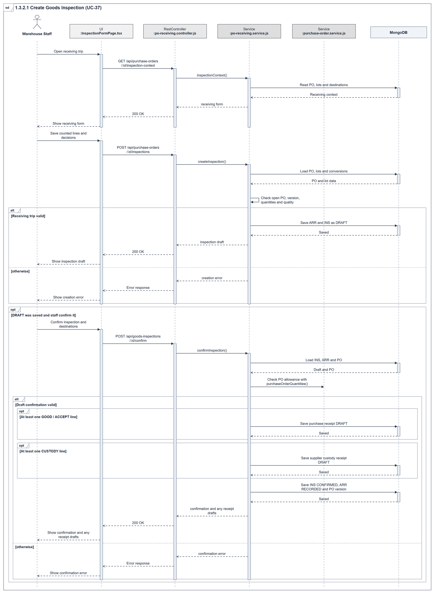](WMSD_BF01_Diagrams_Review_Images/14.png)

**Khớp ở mức thiết kế.** Một hình chứa ba request vì cả ba cùng phục vụ một đợt kiểm nhận.

- **Mở form.** `InspectionFormPage.tsx` dùng `GET /api/purchase-orders/:id/inspection-context` để lấy PO, số lượng và lựa chọn lô/vị trí. Đây là đường đọc nên có thể gọi trước bước nhập liệu. [API INS phía FE][inspection-api], [inspection context][inspection-context].
- **Tạo nháp.** `POST /:id/inspections` kiểm PO `OPEN`/`PARTIAL`, `expectedPoVersion`, lô và dòng; lưu ARR và INS `DRAFT` cùng nhau. Code chạm `updatedAt` của PO để xung đột với lệnh hủy đồng thời, giữ nguyên version công khai ở bước tạo nháp. [Tạo kiểm nhận][inspection-create].
- **Xác nhận.** `POST /api/goods-inspections/:id/confirm` dùng INS đã lưu, kiểm version INS và PO, yêu cầu ít nhất một dòng và kiểm lượng còn được nhận. Hai `opt` độc lập vì `GOOD/ACCEPT` tạo GR nháp và `CUSTODY` tạo phiếu giữ hộ NCC nháp, cùng một đợt có thể sinh cả hai. Với mua được chấp nhận, vị trí tiếp nhận bắt buộc theo dòng. Xác nhận lưu INS `CONFIRMED`, ARR `RECORDED`, tăng version PO và trả tham chiếu phiếu mới. Ghi tồn thực hiện ở các lệnh post riêng. [Xác nhận kiểm nhận][inspection-confirm], [validation nhận mua][rec-val], [form INS][inspection-fe].

Xem 40 thông điệp trên hình theo thứ tự từ trên xuống

| Đầu gửi → đầu nhận | Nét nối | Nhãn trên hình |
| --- | --- | --- |
| Warehouse Staff → `InspectionFormPage.tsx` | Lời gọi | Open receiving trip |
| `InspectionFormPage.tsx` → `po-receiving.controller.js` | Lời gọi | GET /api/purchase-orders/:id/inspection-context |
| `po-receiving.controller.js` → `po-receiving.service.js` | Lời gọi | inspectionContext() |
| `po-receiving.service.js` → MongoDB | Lời gọi | Read PO, lots and destinations |
| MongoDB → `po-receiving.service.js` | Phản hồi | Receiving context |
| `po-receiving.service.js` → `po-receiving.controller.js` | Phản hồi | receiving form |
| `po-receiving.controller.js` → `InspectionFormPage.tsx` | Phản hồi | 200 OK |
| `InspectionFormPage.tsx` → Warehouse Staff | Phản hồi | Show receiving form |
| Warehouse Staff → `InspectionFormPage.tsx` | Lời gọi | Save counted lines and decisions |
| `InspectionFormPage.tsx` → `po-receiving.controller.js` | Lời gọi | POST /api/purchase-orders/:id/inspections |
| `po-receiving.controller.js` → `po-receiving.service.js` | Lời gọi | createInspection() |
| `po-receiving.service.js` → MongoDB | Lời gọi | Load PO, lots and conversions |
| MongoDB → `po-receiving.service.js` | Phản hồi | PO and lot data |
| `po-receiving.service.js` → `po-receiving.service.js` | Tự xử lý | Check open PO, version, quantities and quality |
| `po-receiving.service.js` → MongoDB | Lời gọi | Save ARR and INS as DRAFT |
| MongoDB → `po-receiving.service.js` | Phản hồi | Saved |
| `po-receiving.service.js` → `po-receiving.controller.js` | Phản hồi | inspection draft |
| `po-receiving.controller.js` → `InspectionFormPage.tsx` | Phản hồi | 200 OK |
| `InspectionFormPage.tsx` → Warehouse Staff | Phản hồi | Show inspection draft |
| `po-receiving.service.js` → `po-receiving.controller.js` | Phản hồi | creation error |
| `po-receiving.controller.js` → `InspectionFormPage.tsx` | Phản hồi | Error response |
| `InspectionFormPage.tsx` → Warehouse Staff | Phản hồi | Show creation error |
| Warehouse Staff → `InspectionFormPage.tsx` | Lời gọi | Confirm inspection and destinations |
| `InspectionFormPage.tsx` → `po-receiving.controller.js` | Lời gọi | POST /api/goods-inspections/:id/confirm |
| `po-receiving.controller.js` → `po-receiving.service.js` | Lời gọi | confirmInspection() |
| `po-receiving.service.js` → MongoDB | Lời gọi | Load INS, ARR and PO |
| MongoDB → `po-receiving.service.js` | Phản hồi | Draft and PO |
| `po-receiving.service.js` → `purchase-order.service.js` | Lời gọi | Check PO allowance with purchaseOrderQuantities() |
| `po-receiving.service.js` → MongoDB | Lời gọi | Save purchase receipt DRAFT |
| MongoDB → `po-receiving.service.js` | Phản hồi | Saved |
| `po-receiving.service.js` → MongoDB | Lời gọi | Save supplier custody receipt DRAFT |
| MongoDB → `po-receiving.service.js` | Phản hồi | Saved |
| `po-receiving.service.js` → MongoDB | Lời gọi | Save INS CONFIRMED, ARR RECORDED and PO version |
| MongoDB → `po-receiving.service.js` | Phản hồi | Saved |
| `po-receiving.service.js` → `po-receiving.controller.js` | Phản hồi | confirmation and any receipt drafts |
| `po-receiving.controller.js` → `InspectionFormPage.tsx` | Phản hồi | 200 OK |
| `InspectionFormPage.tsx` → Warehouse Staff | Phản hồi | Show confirmation and any receipt drafts |
| `po-receiving.service.js` → `po-receiving.controller.js` | Phản hồi | confirmation error |
| `po-receiving.controller.js` → `InspectionFormPage.tsx` | Phản hồi | Error response |
| `InspectionFormPage.tsx` → Warehouse Staff | Phản hồi | Show confirmation error |

### 15 · 1.3.2.2 Update Goods Inspection (UC-38)

[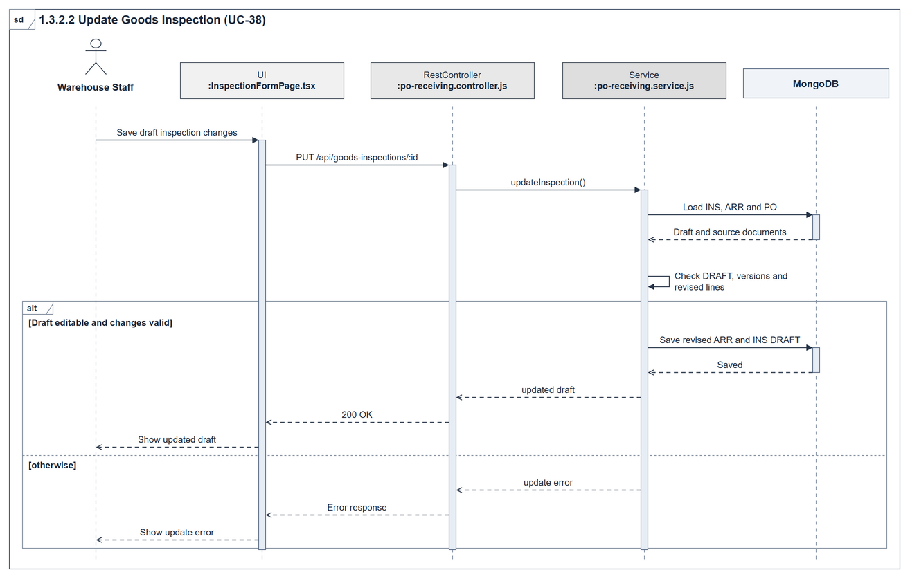](WMSD_BF01_Diagrams_Review_Images/15.png)

**Khớp ở mức thiết kế.** Form gọi `PUT /api/goods-inspections/:id`. Service tải INS và ARR vì chỉnh đếm có thể đi kèm sửa ngày, người giao hoặc tham chiếu giao hàng. Phải kiểm cả INS và ARR đang `DRAFT`, version của INS và PO, cùng PO còn tiếp nhận. Nhánh hợp lệ gọi `prepare()`, lưu lại cả hai với version tăng và trả INS cập nhật. Nhánh lỗi bảo vệ đợt nhận trước khi ghi. Chưa có giao dịch tồn tại bước này. [Sửa INS][inspection-update], [form INS][inspection-fe], [API INS][inspection-api].

Xem 14 thông điệp trên hình theo thứ tự từ trên xuống

| Đầu gửi → đầu nhận | Nét nối | Nhãn trên hình |
| --- | --- | --- |
| Warehouse Staff → `InspectionFormPage.tsx` | Lời gọi | Save draft inspection changes |
| `InspectionFormPage.tsx` → `po-receiving.controller.js` | Lời gọi | PUT /api/goods-inspections/:id |
| `po-receiving.controller.js` → `po-receiving.service.js` | Lời gọi | updateInspection() |
| `po-receiving.service.js` → MongoDB | Lời gọi | Load INS, ARR and PO |
| MongoDB → `po-receiving.service.js` | Phản hồi | Draft and source documents |
| `po-receiving.service.js` → `po-receiving.service.js` | Tự xử lý | Check DRAFT, versions and revised lines |
| `po-receiving.service.js` → MongoDB | Lời gọi | Save revised ARR and INS DRAFT |
| MongoDB → `po-receiving.service.js` | Phản hồi | Saved |
| `po-receiving.service.js` → `po-receiving.controller.js` | Phản hồi | updated draft |
| `po-receiving.controller.js` → `InspectionFormPage.tsx` | Phản hồi | 200 OK |
| `InspectionFormPage.tsx` → Warehouse Staff | Phản hồi | Show updated draft |
| `po-receiving.service.js` → `po-receiving.controller.js` | Phản hồi | update error |
| `po-receiving.controller.js` → `InspectionFormPage.tsx` | Phản hồi | Error response |
| `InspectionFormPage.tsx` → Warehouse Staff | Phản hồi | Show update error |

### 16 · 1.3.2.3 Cancel Goods Inspection (UC-39)

[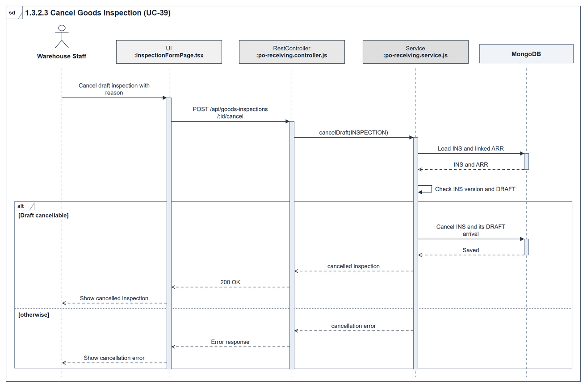](WMSD_BF01_Diagrams_Review_Images/16.png)

**Khớp ở mức thiết kế.** `POST /:id/cancel` gọi `cancelDraft(..., 'INSPECTION', ...)`. Hình nối đến ARR vì INS và hồ sơ hàng đến được tạo thành cặp. Khi INS cho phép hủy, service ghi `CANCELLED` trên INS và hủy ARR nếu tìm được ARR đang `DRAFT`. Điều kiện trên ARR áp dụng riêng, tránh đọc hình thành hủy mọi ARR liên kết. UI lấy lý do qua modal, ghi nhận kết quả hoặc chuyển lỗi về form. [Hủy nháp nhận mua][receiving-cancel], [form INS][inspection-fe], [validation lý do][rec-val].

Xem 14 thông điệp trên hình theo thứ tự từ trên xuống

| Đầu gửi → đầu nhận | Nét nối | Nhãn trên hình |
| --- | --- | --- |
| Warehouse Staff → `InspectionFormPage.tsx` | Lời gọi | Cancel draft inspection with reason |
| `InspectionFormPage.tsx` → `po-receiving.controller.js` | Lời gọi | POST /api/goods-inspections/:id/cancel |
| `po-receiving.controller.js` → `po-receiving.service.js` | Lời gọi | cancelDraft(INSPECTION) |
| `po-receiving.service.js` → MongoDB | Lời gọi | Load INS and linked ARR |
| MongoDB → `po-receiving.service.js` | Phản hồi | INS and ARR |
| `po-receiving.service.js` → `po-receiving.service.js` | Tự xử lý | Check INS version and DRAFT |
| `po-receiving.service.js` → MongoDB | Lời gọi | Cancel INS and its DRAFT arrival |
| MongoDB → `po-receiving.service.js` | Phản hồi | Saved |
| `po-receiving.service.js` → `po-receiving.controller.js` | Phản hồi | cancelled inspection |
| `po-receiving.controller.js` → `InspectionFormPage.tsx` | Phản hồi | 200 OK |
| `InspectionFormPage.tsx` → Warehouse Staff | Phản hồi | Show cancelled inspection |
| `po-receiving.service.js` → `po-receiving.controller.js` | Phản hồi | cancellation error |
| `po-receiving.controller.js` → `InspectionFormPage.tsx` | Phản hồi | Error response |
| `InspectionFormPage.tsx` → Warehouse Staff | Phản hồi | Show cancellation error |

### 17 · 1.3.2.4 Correct Goods Inspection (UC-41)

[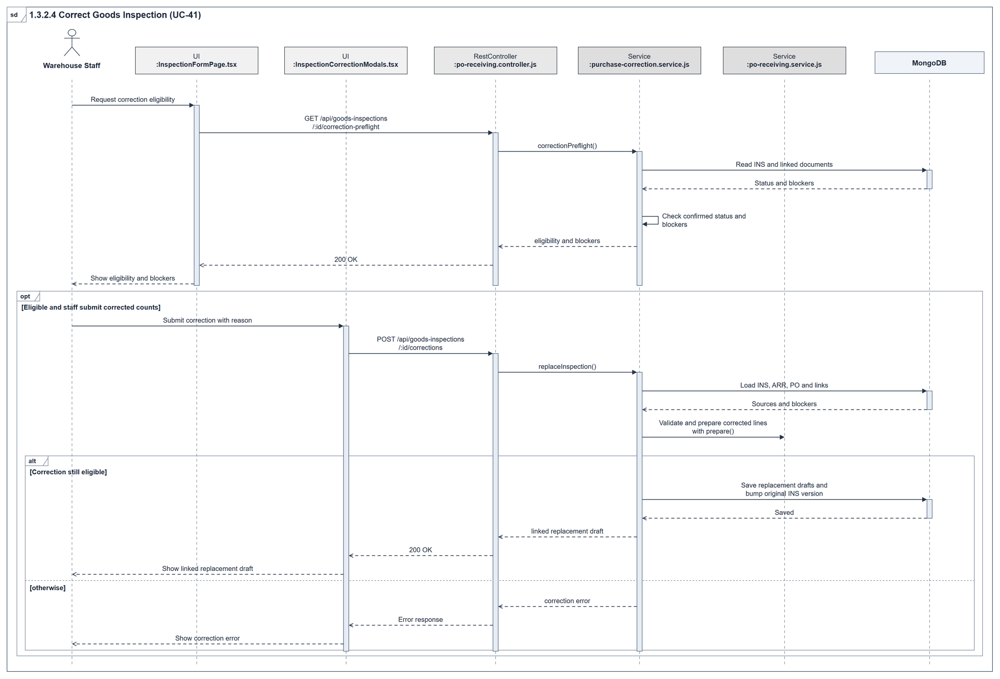](WMSD_BF01_Diagrams_Review_Images/17.png)

**Khớp ở mức thiết kế.** Form gọi `GET /:id/correction-preflight` để hỏi tình trạng INS đã `CONFIRMED`, ARR có tồn tại và hồ sơ nào cản. `opt` dùng modal riêng vì sau khi đủ điều kiện người dùng còn phải nhập số liệu sửa và xác nhận. `POST /:id/corrections` kiểm lại blocker, version INS, PO `OPEN`/`PARTIAL`, version PO và evidence nếu có. Nối sang `po-receiving.service.js` để dùng lại `prepare()`. Service tạo cặp ARR/INS nháp mới, gắn `previousInspectionId`, lưu liên kết nguồn và tăng version INS gốc. Kết quả cũ vẫn có trạng thái `CONFIRMED`; nháp mới đi qua luồng xác nhận riêng. [Preflight và thay INS][inspection-preflight], [blocker][inspection-blockers], [form INS][inspection-fe], [modal sửa][correction-fe].

Xem 23 thông điệp trên hình theo thứ tự từ trên xuống

| Đầu gửi → đầu nhận | Nét nối | Nhãn trên hình |
| --- | --- | --- |
| Warehouse Staff → `InspectionFormPage.tsx` | Lời gọi | Request correction eligibility |
| `InspectionFormPage.tsx` → `po-receiving.controller.js` | Lời gọi | GET /api/goods-inspections/:id/correction-preflight |
| `po-receiving.controller.js` → `purchase-correction.service.js` | Lời gọi | correctionPreflight() |
| `purchase-correction.service.js` → MongoDB | Lời gọi | Read INS and linked documents |
| MongoDB → `purchase-correction.service.js` | Phản hồi | Status and blockers |
| `purchase-correction.service.js` → `purchase-correction.service.js` | Tự xử lý | Check confirmed status and blockers |
| `purchase-correction.service.js` → `po-receiving.controller.js` | Phản hồi | eligibility and blockers |
| `po-receiving.controller.js` → `InspectionFormPage.tsx` | Phản hồi | 200 OK |
| `InspectionFormPage.tsx` → Warehouse Staff | Phản hồi | Show eligibility and blockers |
| Warehouse Staff → `InspectionCorrectionModals.tsx` | Lời gọi | Submit correction with reason |
| `InspectionCorrectionModals.tsx` → `po-receiving.controller.js` | Lời gọi | POST /api/goods-inspections/:id/corrections |
| `po-receiving.controller.js` → `purchase-correction.service.js` | Lời gọi | replaceInspection() |
| `purchase-correction.service.js` → MongoDB | Lời gọi | Load INS, ARR, PO and links |
| MongoDB → `purchase-correction.service.js` | Phản hồi | Sources and blockers |
| `purchase-correction.service.js` → `po-receiving.service.js` | Lời gọi | Validate and prepare corrected lines with prepare() |
| `purchase-correction.service.js` → MongoDB | Lời gọi | Save replacement drafts and bump original INS version |
| MongoDB → `purchase-correction.service.js` | Phản hồi | Saved |
| `purchase-correction.service.js` → `po-receiving.controller.js` | Phản hồi | linked replacement draft |
| `po-receiving.controller.js` → `InspectionCorrectionModals.tsx` | Phản hồi | 200 OK |
| `InspectionCorrectionModals.tsx` → Warehouse Staff | Phản hồi | Show linked replacement draft |
| `purchase-correction.service.js` → `po-receiving.controller.js` | Phản hồi | correction error |
| `po-receiving.controller.js` → `InspectionCorrectionModals.tsx` | Phản hồi | Error response |
| `InspectionCorrectionModals.tsx` → Warehouse Staff | Phản hồi | Show correction error |

## Nhập mua, giữ hộ và ghi tồn

### 18 · 1.4.1 Receipt Class

[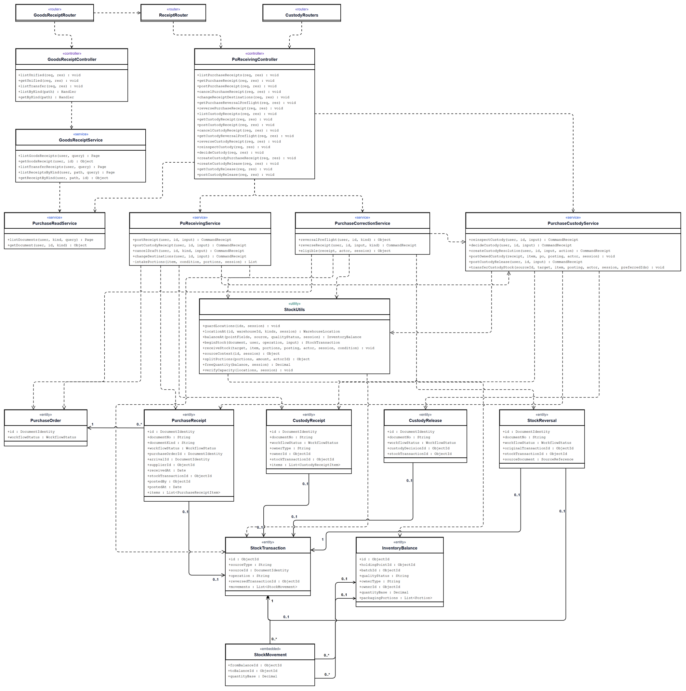](WMSD_BF01_Diagrams_Review_Images/18.png)

**Khớp một phần.** Hình mô tả đúng luồng định tuyến và cách chứng từ ghi vào sổ tồn. Các đường thiếu nhãn dễ lẫn vai trò. Khi dùng hình như bản đồ schema, còn thiếu đường tới ARR, phiếu giữ hộ nguồn, chứng từ gốc của phiếu đảo và quyết định giữ hộ.

| Đường trên hình | Lý do nối và kết quả đối chiếu |
| --- | --- |
| `GoodsReceiptRouter` ⇢ `GoodsReceiptController`, `ReceiptRouter`; `ReceiptRouter` ⇢ `PoReceivingController`; `CustodyRouters` ⇢ `PoReceivingController` | Router chung phục vụ API đọc hợp nhất và gắn router mua dưới `/purchase`. Router mua và các router giữ hộ riêng chuyển vào nhóm handler tương ứng. Hộp `CustodyRouters` gom các router receipt và release vì chúng dùng cùng controller. [Router phiếu nhập][gr-route], [router mua và giữ hộ][rec-route], [gắn router][mount]. |
| `GoodsReceiptController` ⇢ `GoodsReceiptService` ⇢ `PurchaseReadService` | API nhập hợp nhất gom dữ liệu nhiều loại. Khi đọc chi tiết nhập mua, service gọi `getDocument()` để tái sử dụng chi tiết và quyền của nhánh mua. [Service phiếu nhập][gr-read], [đọc chứng từ mua][purchase-read]. |
| `PoReceivingController` ⇢ `PurchaseReadService`, `PoReceivingService`, `PurchaseCorrectionService`, `PurchaseCustodyService` | Controller tách đọc, ghi/hủy/đổi đích, đảo phiếu, và xử lý quyết định giữ hộ/giải phóng. Các đường thể hiện các lời gọi theo handler, nên một request chỉ đi những nhánh cần. [Controller nhận mua][rec-controller]. |
| `PoReceivingService` ⇢ `PurchaseCustodyService`, `StockUtils`; `PurchaseCorrectionService` ⇢ `StockUtils`, `PurchaseCustodyService`; `PurchaseCustodyService` ⇢ `StockUtils` | Post GR từ giữ hộ gọi `postOwnedCustody()` để đổi chủ. Đảo dùng `transferCustodyStock()` để chuyển về số dư nguồn hoặc trừ khỏi số dư. Các luồng gọi helper tồn để kiểm vị trí, số lượng, sức chứa và tạo biến động. [Post GR][gr-post], [đảo][gr-reverse], [giữ hộ][custody-service], [helper tồn][stock-utils]. |
| `PoReceivingService` ⇢ `PurchaseOrder`, `PurchaseReceipt`, `CustodyReceipt` | Service dùng PO để kiểm lượng và trạng thái; GR và giữ hộ là hai loại chứng từ được tạo/ghi với hậu quả tồn khác nhau. `findPurchase()` phân giải kind sang model. [Ánh xạ model mua][purchase-core], [luồng tạo phiếu][inspection-confirm], [post GR][gr-post]. |
| `PurchaseCorrectionService` ⇢ `PurchaseOrder`, `StockReversal`, `StockTransaction` | Đảo nhập mua phối hợp PO, đọc giao dịch gốc và ghi phiếu đảo cùng giao dịch bù. Đảo giữ hộ dùng chung service nhưng đi nhánh không đọc PO. [Điều kiện đảo][reverse-eligible], [lệnh đảo][gr-reverse]. |
| `PurchaseCustodyService` ⇢ `CustodyReceipt`, `PurchaseReceipt`, `CustodyRelease` | Đọc tồn giữ hộ nguồn, rồi dùng quyết định để lập phiếu nhận sở hữu hoặc phiếu giải phóng. Các chứng từ đích giữ đường truy ngược nguồn. [Xử lý giữ hộ][custody-service]. |
| `StockUtils` ⇢ `StockTransaction`, `InventoryBalance` | Helper định vị/tạo số dư và gắn các movement vào giao dịch. Số dư biểu diễn lượng đang có, giao dịch biểu diễn sự kiện làm thay đổi lượng. [Helper tồn][stock-utils], [model số dư][balance-model]. |
| `PurchaseReceipt` → `PurchaseOrder` (`0..*` / `1`) | Lệnh mua ghi PO trong `header.purchaseOrderId`, cho phép một PO nhiều lần nhận. `PurchaseReceipt` là discriminator `PURCHASE` trong `goods_receipts`, không phải collection riêng. [Header GR][gr-header], [model và discriminator][gr-model]. |
| `PurchaseReceipt`, `CustodyReceipt`, `CustodyRelease` → `StockTransaction` (mỗi đường `0..1` / `0..1`) | `stockTransactionId` được gắn khi ghi tồn hoặc ghi xuất giải phóng. Nháp có thể chưa có; một giao dịch do một chứng từ nguồn sinh trong các lệnh này. [Post GR][gr-post], [post giữ hộ][custody-post], [post giải phóng][custody-service]. |
| Hai đường `StockReversal` → `StockTransaction` (`0..1` / `1` và `0..1` / `0..1`) | Đường có `1` ở đích là `header.originalTransactionId`; đường còn lại là `stockTransactionId` của giao dịch bù. Cả hai cùng trỏ lớp StockTransaction nhưng khác vai trò. Schema cho phép thiếu cả hai ở mức khai báo; lệnh đảo cần giao dịch gốc và ghi đủ cả hai khi kết thúc. Giao dịch bù còn lưu `reversedTransactionId` và unique index chặn hai giao dịch bù cùng nguồn. [Header phiếu đảo][reversal-header], [lệnh đảo][gr-reverse], [model giao dịch][transaction-model]. |
| `StockTransaction` ◆ `StockMovement` (`1` / `0..*`) | Hình thoi nằm phía giao dịch vì `movements[]` được nhúng. Một movement thuộc giao dịch chứa nó. Bội số danh sách là mô tả cấu trúc; giao dịch gốc đủ điều kiện đảo phải có biến động. [Model giao dịch][transaction-model], [điều kiện đảo][reverse-eligible]. |
| Hai đường `StockMovement` → `InventoryBalance` (`0..*` / `0..1` mỗi đường) | Hai vai trò là `fromBalanceId` và `toBalanceId`. Nhập thuần dùng đích; đảo nhập thuần dùng nguồn; đổi chủ có cả hai. Schema kiểm ít nhất một đầu và chặn cùng ID hai đầu. Một số dư có thể xuất hiện ở nhiều biến động. [Schema movement][movement-model], [tạo biến động][stock-utils]. |

**Lý do bố cục.** Router và controller ở trên cho thấy điểm vào HTTP. Ở đáy, cặp giao dịch và movement nằm nối tiếp trước số dư để truy được biến động cụ thể, dù nhiều chứng từ dùng chung hạ tầng. Để dùng hình tra dữ liệu, nên làm rõ nhãn của các đường song song và bổ sung `header.arrivalId`, nguồn giữ hộ ở dòng GR, `StockReversal.header.sourceDocument` và `CustodyRelease.custodyDecisionId`. Các field đó có trong code và ảnh hưởng việc truy vết. [Header GR][gr-header], [nguồn giữ hộ][custody-service], [header phiếu đảo][reversal-header], [model phiếu giải phóng][release-model].

### 19 · 1.4.2.1 Change Purchase Receipt Destinations

[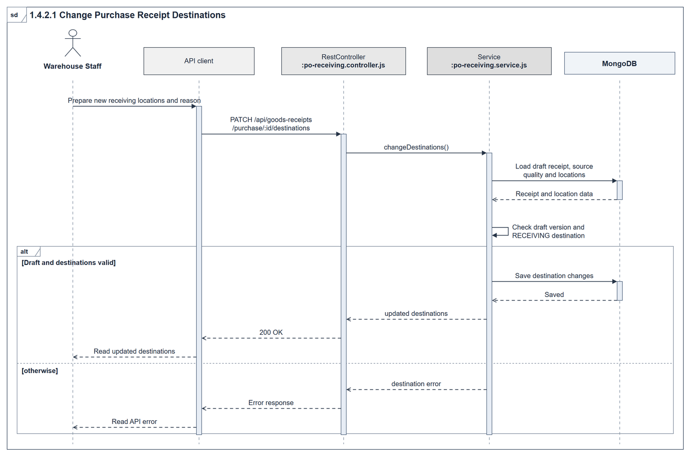](WMSD_BF01_Diagrams_Review_Images/19.png)

**Cần chỉnh điều kiện vị trí.** Đường gọi `Warehouse Staff → API client → PATCH /api/goods-receipts/purchase/:id/destinations → changeDestinations()` đúng. Rà phía FE hiện tại chỉ thấy hiển thị vị trí và các thao tác post/hủy/đảo của GR, phù hợp với việc hình dùng API client. Service đọc phiếu và INS nguồn ở từng dòng vì loại vị trí phụ thuộc `source.details.qualityCode`. Hình chỉ ghi `RECEIVING`. Code chọn `RECEIVING` cho `GOOD` và `QUARANTINE` cho mã khác khi có dòng nguồn tương ứng. Luồng xác nhận INS mua mới chỉ sinh dòng nhận sở hữu cho `GOOD/ACCEPT`, nên nhánh `QUARANTINE` của PATCH phải đọc theo điều kiện riêng của endpoint. Lệnh chỉ đổi vị trí đã chọn của GR nháp, tăng version và ghi audit có lý do. [Route PATCH][rec-route], [điều kiện đổi đích][gr-dest], [luồng xác nhận INS][inspection-confirm], [màn phiếu nhập][gr-fe].

Xem 14 thông điệp trên hình theo thứ tự từ trên xuống

| Đầu gửi → đầu nhận | Nét nối | Nhãn trên hình |
| --- | --- | --- |
| Warehouse Staff → API client | Lời gọi | Prepare new receiving locations and reason |
| API client → `po-receiving.controller.js` | Lời gọi | PATCH /api/goods-receipts/purchase/:id/destinations |
| `po-receiving.controller.js` → `po-receiving.service.js` | Lời gọi | changeDestinations() |
| `po-receiving.service.js` → MongoDB | Lời gọi | Load draft receipt, source quality and locations |
| MongoDB → `po-receiving.service.js` | Phản hồi | Receipt and location data |
| `po-receiving.service.js` → `po-receiving.service.js` | Tự xử lý | Check draft version and RECEIVING destination |
| `po-receiving.service.js` → MongoDB | Lời gọi | Save destination changes |
| MongoDB → `po-receiving.service.js` | Phản hồi | Saved |
| `po-receiving.service.js` → `po-receiving.controller.js` | Phản hồi | updated destinations |
| `po-receiving.controller.js` → API client | Phản hồi | 200 OK |
| API client → Warehouse Staff | Phản hồi | Read updated destinations |
| `po-receiving.service.js` → `po-receiving.controller.js` | Phản hồi | destination error |
| `po-receiving.controller.js` → API client | Phản hồi | Error response |
| API client → Warehouse Staff | Phản hồi | Read API error |

### 20 · 1.4.2.2 Cancel Purchase Receipt

[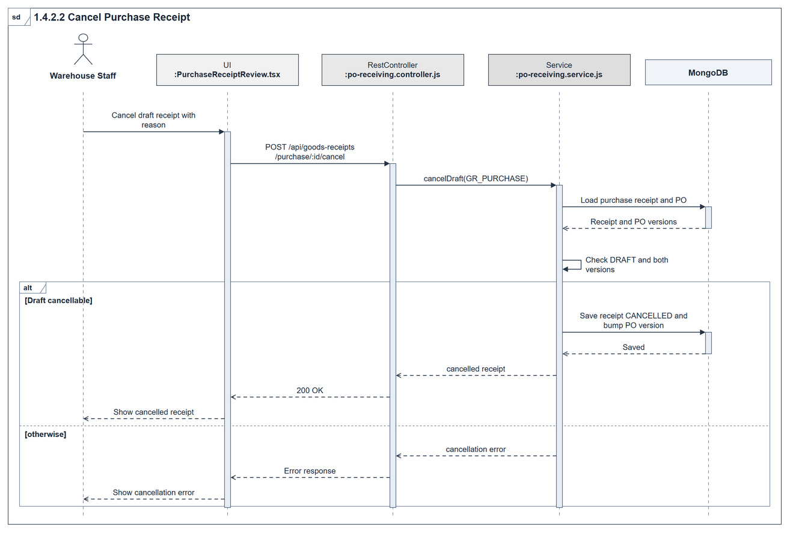](WMSD_BF01_Diagrams_Review_Images/20.png)

**Khớp ở mức thiết kế.** `PurchaseReceiptReview.tsx` gửi `POST /purchase/:id/cancel`; controller chọn `cancelDraft(..., 'GR_PURCHASE', ...)`. Hình đọc cả PO vì hủy GR nháp bỏ lượng cam kết nhận ở phép tính PO. Nhánh hợp lệ kiểm version GR và PO, `DRAFT` và lý do, ghi `CANCELLED` rồi trả kết quả. Trong transaction thực tế, code cập nhật version PO trước lúc lưu GR. Không phát sinh giao dịch trừ hàng vì phiếu chưa post. [Hủy nháp][receiving-cancel], [validation hai version][rec-val], [tính lượng PO][po-qty], [màn GR][gr-fe].

Xem 14 thông điệp trên hình theo thứ tự từ trên xuống

| Đầu gửi → đầu nhận | Nét nối | Nhãn trên hình |
| --- | --- | --- |
| Warehouse Staff → `PurchaseReceiptReview.tsx` | Lời gọi | Cancel draft receipt with reason |
| `PurchaseReceiptReview.tsx` → `po-receiving.controller.js` | Lời gọi | POST /api/goods-receipts/purchase/:id/cancel |
| `po-receiving.controller.js` → `po-receiving.service.js` | Lời gọi | cancelDraft(GR_PURCHASE) |
| `po-receiving.service.js` → MongoDB | Lời gọi | Load purchase receipt and PO |
| MongoDB → `po-receiving.service.js` | Phản hồi | Receipt and PO versions |
| `po-receiving.service.js` → `po-receiving.service.js` | Tự xử lý | Check DRAFT and both versions |
| `po-receiving.service.js` → MongoDB | Lời gọi | Save receipt CANCELLED and bump PO version |
| MongoDB → `po-receiving.service.js` | Phản hồi | Saved |
| `po-receiving.service.js` → `po-receiving.controller.js` | Phản hồi | cancelled receipt |
| `po-receiving.controller.js` → `PurchaseReceiptReview.tsx` | Phản hồi | 200 OK |
| `PurchaseReceiptReview.tsx` → Warehouse Staff | Phản hồi | Show cancelled receipt |
| `po-receiving.service.js` → `po-receiving.controller.js` | Phản hồi | cancellation error |
| `po-receiving.controller.js` → `PurchaseReceiptReview.tsx` | Phản hồi | Error response |
| `PurchaseReceiptReview.tsx` → Warehouse Staff | Phản hồi | Show cancellation error |

### 21 · 1.4.2.3 Post Purchase Receipt (UC-40)

[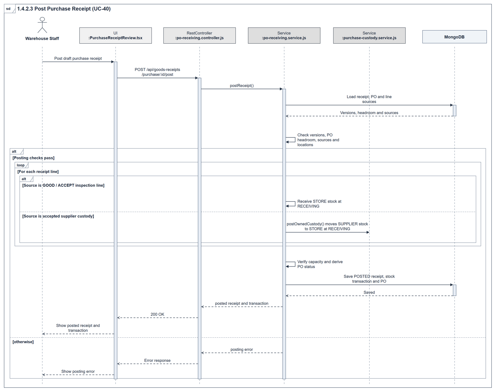](WMSD_BF01_Diagrams_Review_Images/21.png)

**Khớp ở mức thiết kế.** `POST /purchase/:id/post` đọc nháp, PO, lượng sẵn cho nhận, nguồn từng dòng và vị trí. `loop` là cần thiết vì một phiếu có nhiều dòng và mỗi dòng phải dùng đúng nguồn. `alt` trong vòng lặp thể hiện hai cách ghi tồn: từ INS `GOOD/ACCEPT` thì nhập `STORE` tại `RECEIVING`; dòng có `custodyBalanceId` gọi `postOwnedCustody()` để chuyển tồn `SUPPLIER` sang `STORE`. Mũi tên sang service giữ hộ có ý nghĩa riêng vì cần truy quyết định và lượng còn giữ của NCC. Sau các bước kiểm hàng, quy cách và sức chứa, transaction ghi giao dịch, GR `POSTED` và PO. PO thành `PARTIAL` nếu còn lượng chờ, `COMPLETED` nếu đã đủ, `CLOSED` nếu hết phần chờ có lượng đã chốt thiếu. Cụm `Verify capacity and derive PO status` là cách nhóm logic: code tính lại PO sau khi lưu GR `POSTED` trong cùng transaction để phép tính thấy lần nhập này. [Ghi nhập mua][gr-post], [đổi chủ tồn][custody-service], [màn GR][gr-fe].

Xem 17 thông điệp trên hình theo thứ tự từ trên xuống

| Đầu gửi → đầu nhận | Nét nối | Nhãn trên hình |
| --- | --- | --- |
| Warehouse Staff → `PurchaseReceiptReview.tsx` | Lời gọi | Post draft purchase receipt |
| `PurchaseReceiptReview.tsx` → `po-receiving.controller.js` | Lời gọi | POST /api/goods-receipts/purchase/:id/post |
| `po-receiving.controller.js` → `po-receiving.service.js` | Lời gọi | postReceipt() |
| `po-receiving.service.js` → MongoDB | Lời gọi | Load receipt, PO and line sources |
| MongoDB → `po-receiving.service.js` | Phản hồi | Versions, headroom and sources |
| `po-receiving.service.js` → `po-receiving.service.js` | Tự xử lý | Check versions, PO headroom, sources and locations |
| `po-receiving.service.js` → `po-receiving.service.js` | Tự xử lý | Receive STORE stock at RECEIVING |
| `po-receiving.service.js` → `purchase-custody.service.js` | Lời gọi | postOwnedCustody() moves SUPPLIER stock to STORE at RECEIVING |
| `po-receiving.service.js` → `po-receiving.service.js` | Tự xử lý | Verify capacity and derive PO status |
| `po-receiving.service.js` → MongoDB | Lời gọi | Save POSTED receipt, stock transaction and PO |
| MongoDB → `po-receiving.service.js` | Phản hồi | Saved |
| `po-receiving.service.js` → `po-receiving.controller.js` | Phản hồi | posted receipt and transaction |
| `po-receiving.controller.js` → `PurchaseReceiptReview.tsx` | Phản hồi | 200 OK |
| `PurchaseReceiptReview.tsx` → Warehouse Staff | Phản hồi | Show posted receipt and transaction |
| `po-receiving.service.js` → `po-receiving.controller.js` | Phản hồi | posting error |
| `po-receiving.controller.js` → `PurchaseReceiptReview.tsx` | Phản hồi | Error response |
| `PurchaseReceiptReview.tsx` → Warehouse Staff | Phản hồi | Show posting error |

### 22 · 1.4.2.4 Reverse Purchase Receipt (UC-42)

[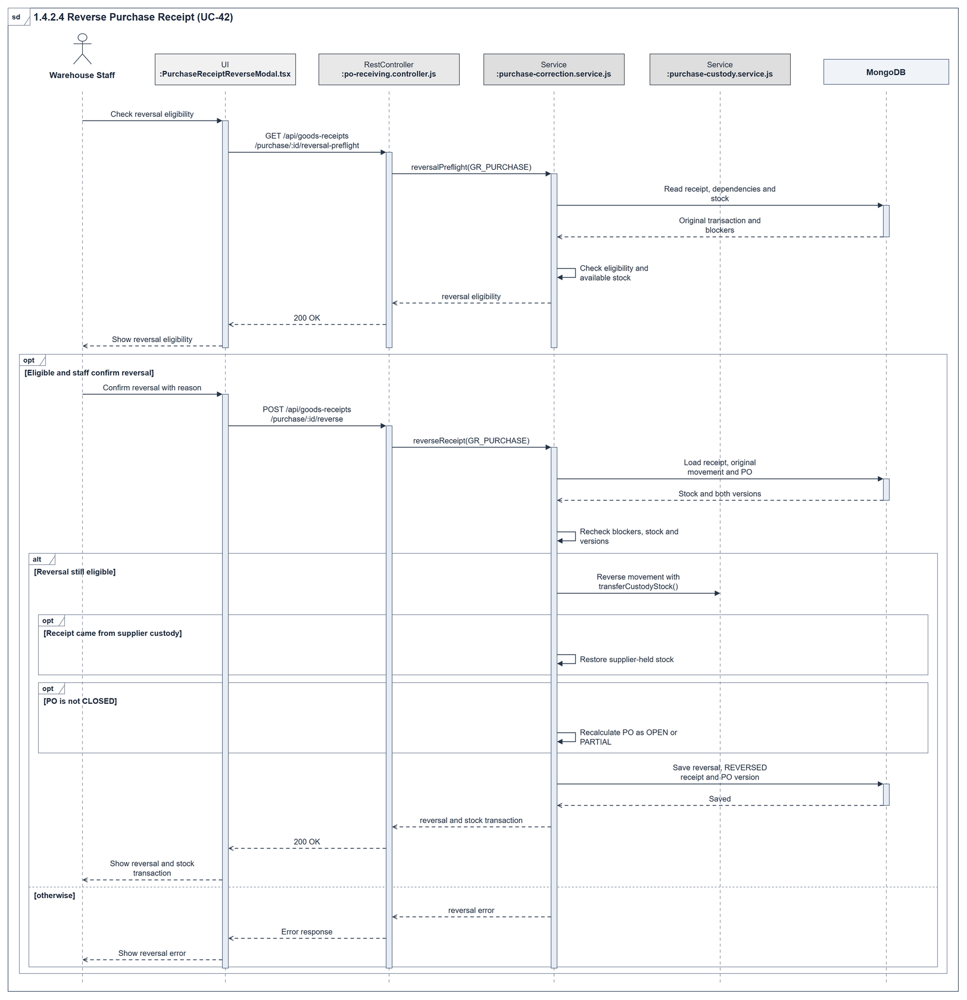](WMSD_BF01_Diagrams_Review_Images/22.png)

**Khớp một phần.** Hai endpoint, hai phiên bản và nhánh cập nhật PO khớp. Biểu diễn đoạn hoàn tồn giữ hộ cần rõ hơn vì `transferCustodyStock()` thực hiện cả trừ và hoàn cho từng movement có đích.

- `GET /reversal-preflight` đọc giao dịch gốc, kiểm phụ thuộc, tồn khả dụng và quy cách còn lại. Trả `200` kèm `eligible`; bị chặn nghiệp vụ có thể là `eligible: false`. `opt` dành cho thao tác xác nhận và gửi lý do qua modal. [Preflight][reverse-preflight], [guard đảo][reverse-eligible], [modal đảo nhập][gr-reverse-fe].
- `POST /reverse` kiểm lại quyền `reverse` và `post`, version GR/PO, evidence nếu có, vị trí và tồn. Code lặp các movement theo thứ tự ngược. Nhập thuần truyền `target = null`; dòng xuất phát từ giữ hộ chọn số dư NCC làm `target` rồi gọi **một lần cho movement đó** để chuyển ngược. Hình vẽ lời gọi trước rồi thêm `opt Restore supplier-held stock`, dễ được đọc thành một lần ghi tồn khác. Nhánh chọn đích đặt bên trong vòng lặp sẽ mô tả đúng bản chất. [Lệnh đảo][gr-reverse], [helper chuyển giữ hộ][custody-service].
- `opt` về PO đúng về kết quả. PO `CLOSED` giữ trạng thái; PO khác tính `OPEN`/`PARTIAL` theo phần thực nhận. Cả hai đều tăng version PO. Transaction lưu phiếu đảo `POSTED`, giao dịch bù và GR `REVERSED`. Lệnh mở lại là thao tác riêng tại trang 11. [Lệnh đảo][gr-reverse], [mở lại PO][po-reopen].

Xem 26 thông điệp trên hình theo thứ tự từ trên xuống

| Đầu gửi → đầu nhận | Nét nối | Nhãn trên hình |
| --- | --- | --- |
| Warehouse Staff → `PurchaseReceiptReverseModal.tsx` | Lời gọi | Check reversal eligibility |
| `PurchaseReceiptReverseModal.tsx` → `po-receiving.controller.js` | Lời gọi | GET /api/goods-receipts/purchase/:id/reversal-preflight |
| `po-receiving.controller.js` → `purchase-correction.service.js` | Lời gọi | reversalPreflight(GR_PURCHASE) |
| `purchase-correction.service.js` → MongoDB | Lời gọi | Read receipt, dependencies and stock |
| MongoDB → `purchase-correction.service.js` | Phản hồi | Original transaction and blockers |
| `purchase-correction.service.js` → `purchase-correction.service.js` | Tự xử lý | Check eligibility and available stock |
| `purchase-correction.service.js` → `po-receiving.controller.js` | Phản hồi | reversal eligibility |
| `po-receiving.controller.js` → `PurchaseReceiptReverseModal.tsx` | Phản hồi | 200 OK |
| `PurchaseReceiptReverseModal.tsx` → Warehouse Staff | Phản hồi | Show reversal eligibility |
| Warehouse Staff → `PurchaseReceiptReverseModal.tsx` | Lời gọi | Confirm reversal with reason |
| `PurchaseReceiptReverseModal.tsx` → `po-receiving.controller.js` | Lời gọi | POST /api/goods-receipts/purchase/:id/reverse |
| `po-receiving.controller.js` → `purchase-correction.service.js` | Lời gọi | reverseReceipt(GR_PURCHASE) |
| `purchase-correction.service.js` → MongoDB | Lời gọi | Load receipt, original movement and PO |
| MongoDB → `purchase-correction.service.js` | Phản hồi | Stock and both versions |
| `purchase-correction.service.js` → `purchase-correction.service.js` | Tự xử lý | Recheck blockers, stock and versions |
| `purchase-correction.service.js` → `purchase-custody.service.js` | Lời gọi | Reverse movement with transferCustodyStock() |
| `purchase-correction.service.js` → `purchase-correction.service.js` | Tự xử lý | Restore supplier-held stock |
| `purchase-correction.service.js` → `purchase-correction.service.js` | Tự xử lý | Recalculate PO as OPEN or PARTIAL |
| `purchase-correction.service.js` → MongoDB | Lời gọi | Save reversal, REVERSED receipt and PO version |
| MongoDB → `purchase-correction.service.js` | Phản hồi | Saved |
| `purchase-correction.service.js` → `po-receiving.controller.js` | Phản hồi | reversal and stock transaction |
| `po-receiving.controller.js` → `PurchaseReceiptReverseModal.tsx` | Phản hồi | 200 OK |
| `PurchaseReceiptReverseModal.tsx` → Warehouse Staff | Phản hồi | Show reversal and stock transaction |
| `purchase-correction.service.js` → `po-receiving.controller.js` | Phản hồi | reversal error |
| `po-receiving.controller.js` → `PurchaseReceiptReverseModal.tsx` | Phản hồi | Error response |
| `PurchaseReceiptReverseModal.tsx` → Warehouse Staff | Phản hồi | Show reversal error |

### 23 · 1.4.2.5 Cancel Custody Receipt

[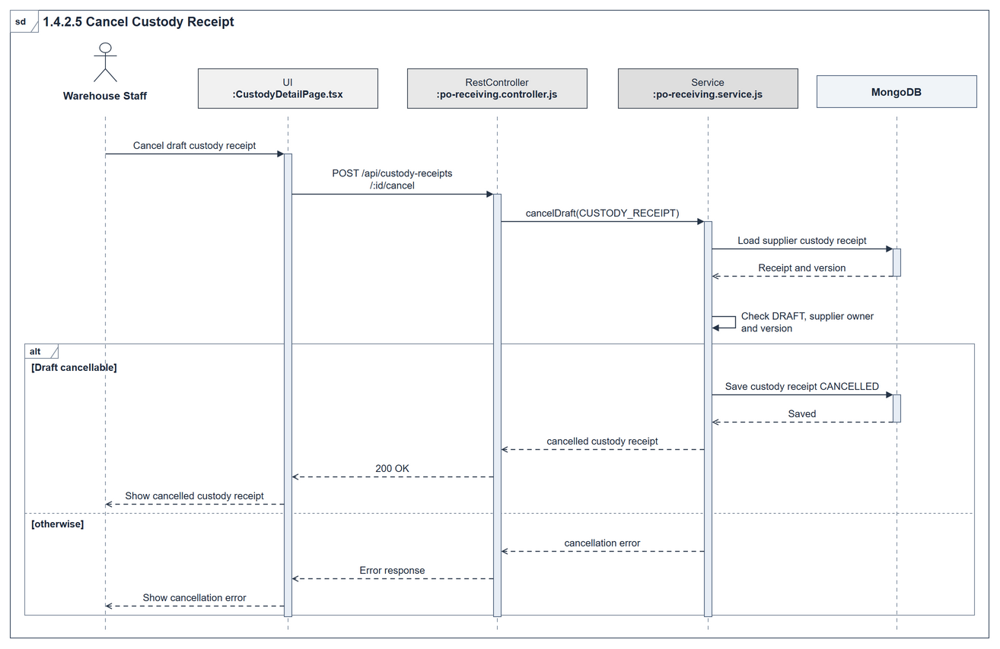](WMSD_BF01_Diagrams_Review_Images/23.png)

**Khớp ở mức thiết kế.** `CustodyDetailPage.tsx` mở modal hủy rồi gọi `POST /api/custody-receipts/:id/cancel`. Controller chọn `CUSTODY_RECEIPT` để cùng dùng `cancelDraft()` nhưng kiểm owner `SUPPLIER`. `alt` thể hiện đã kiểm đúng version và nháp thì lưu `CANCELLED`. Payload có lý do bắt buộc và dấu vết người hủy/thời điểm. Nhánh này chỉ lưu phiếu, khác nhánh hủy GR mua còn tăng version PO vì có cam kết nhận. [Hủy nháp nhận mua][receiving-cancel], [validation giữ hộ][rec-val], [màn giữ hộ][custody-fe], [API giữ hộ][custody-api].

Xem 14 thông điệp trên hình theo thứ tự từ trên xuống

| Đầu gửi → đầu nhận | Nét nối | Nhãn trên hình |
| --- | --- | --- |
| Warehouse Staff → `CustodyDetailPage.tsx` | Lời gọi | Cancel draft custody receipt |
| `CustodyDetailPage.tsx` → `po-receiving.controller.js` | Lời gọi | POST /api/custody-receipts/:id/cancel |
| `po-receiving.controller.js` → `po-receiving.service.js` | Lời gọi | cancelDraft(CUSTODY_RECEIPT) |
| `po-receiving.service.js` → MongoDB | Lời gọi | Load supplier custody receipt |
| MongoDB → `po-receiving.service.js` | Phản hồi | Receipt and version |
| `po-receiving.service.js` → `po-receiving.service.js` | Tự xử lý | Check DRAFT, supplier owner and version |
| `po-receiving.service.js` → MongoDB | Lời gọi | Save custody receipt CANCELLED |
| MongoDB → `po-receiving.service.js` | Phản hồi | Saved |
| `po-receiving.service.js` → `po-receiving.controller.js` | Phản hồi | cancelled custody receipt |
| `po-receiving.controller.js` → `CustodyDetailPage.tsx` | Phản hồi | 200 OK |
| `CustodyDetailPage.tsx` → Warehouse Staff | Phản hồi | Show cancelled custody receipt |
| `po-receiving.service.js` → `po-receiving.controller.js` | Phản hồi | cancellation error |
| `po-receiving.controller.js` → `CustodyDetailPage.tsx` | Phản hồi | Error response |
| `CustodyDetailPage.tsx` → Warehouse Staff | Phản hồi | Show cancellation error |

### 24 · 1.4.2.6 Post Custody Receipt (UC-50)

[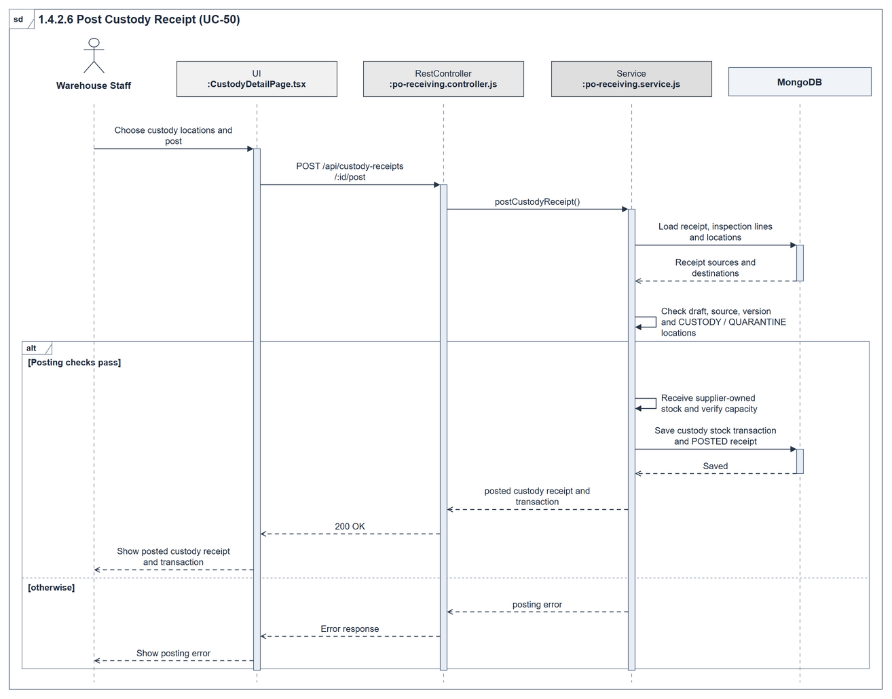](WMSD_BF01_Diagrams_Review_Images/24.png)

**Khớp ở mức thiết kế.** Màn giữ hộ chọn đủ một vị trí cho từng dòng rồi gửi `POST /:id/post`. Service kiểm phiếu `DRAFT` thuộc NCC, version, nguồn kỳ kiểm `CONFIRMED` có quyết định `CUSTODY`, đúng NCC/lô/sản phẩm/lượng, cùng đích trong kho là `CUSTODY` hoặc `QUARANTINE`. Đường ghi tồn gộp trong một bước vì ảnh mô tả lúc post: service xử lý từng dòng, giữ chủ `SUPPLIER`, xác minh sức chứa, lưu movement và phiếu `POSTED`. PO chỉ tăng lượng thực nhận khi tồn được nhận sở hữu qua GR mua tương ứng. [Post giữ hộ][custody-post], [màn giữ hộ][custody-fe], [tính lượng PO][po-qty].

Xem 15 thông điệp trên hình theo thứ tự từ trên xuống

| Đầu gửi → đầu nhận | Nét nối | Nhãn trên hình |
| --- | --- | --- |
| Warehouse Staff → `CustodyDetailPage.tsx` | Lời gọi | Choose custody locations and post |
| `CustodyDetailPage.tsx` → `po-receiving.controller.js` | Lời gọi | POST /api/custody-receipts/:id/post |
| `po-receiving.controller.js` → `po-receiving.service.js` | Lời gọi | postCustodyReceipt() |
| `po-receiving.service.js` → MongoDB | Lời gọi | Load receipt, inspection lines and locations |
| MongoDB → `po-receiving.service.js` | Phản hồi | Receipt sources and destinations |
| `po-receiving.service.js` → `po-receiving.service.js` | Tự xử lý | Check draft, source, version and CUSTODY / QUARANTINE locations |
| `po-receiving.service.js` → `po-receiving.service.js` | Tự xử lý | Receive supplier-owned stock and verify capacity |
| `po-receiving.service.js` → MongoDB | Lời gọi | Save custody stock transaction and POSTED receipt |
| MongoDB → `po-receiving.service.js` | Phản hồi | Saved |
| `po-receiving.service.js` → `po-receiving.controller.js` | Phản hồi | posted custody receipt and transaction |
| `po-receiving.controller.js` → `CustodyDetailPage.tsx` | Phản hồi | 200 OK |
| `CustodyDetailPage.tsx` → Warehouse Staff | Phản hồi | Show posted custody receipt and transaction |
| `po-receiving.service.js` → `po-receiving.controller.js` | Phản hồi | posting error |
| `po-receiving.controller.js` → `CustodyDetailPage.tsx` | Phản hồi | Error response |
| `CustodyDetailPage.tsx` → Warehouse Staff | Phản hồi | Show posting error |

### 25 · 1.4.2.7 Reverse Custody Receipt

[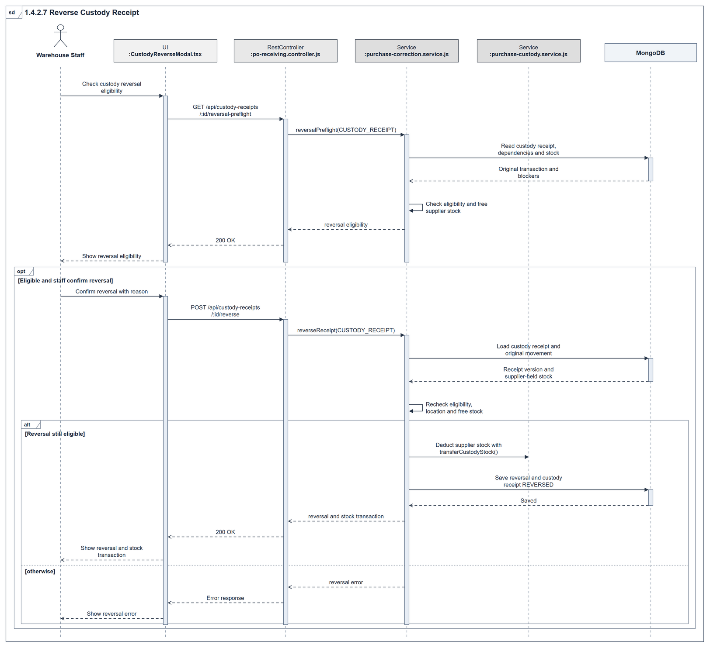](WMSD_BF01_Diagrams_Review_Images/25.png)

**Khớp ở mức thiết kế.** `CustodyReverseModal.tsx` gọi preflight rồi `POST /reverse` khi đủ điều kiện và người dùng xác nhận lý do. `opt` phân biệt kiểm tra và ghi thật. Controller truyền `CUSTODY_RECEIPT` để chọn nhánh `SUPPLIER` của cùng lệnh đảo. Service rà phiếu còn `POSTED`, giao dịch gốc, hồ sơ xử lý giữ hộ phụ thuộc, vị trí, phiên bản, lượng tự do và quy cách. Mũi tên sang `transferCustodyStock()` mô tả thao tác trừ khỏi số dư NCC gốc với đích `null`, lặp theo các movement gốc theo thứ tự ngược. Phần cuối lưu giao dịch bù, phiếu đảo và đổi phiếu giữ hộ sang `REVERSED`. Luồng dùng version phiếu giữ hộ, không cập nhật PO. [Điều kiện đảo][reverse-eligible], [lệnh đảo][gr-reverse], [modal đảo giữ hộ][custody-reverse-fe], [API giữ hộ][custody-api].

Xem 24 thông điệp trên hình theo thứ tự từ trên xuống

| Đầu gửi → đầu nhận | Nét nối | Nhãn trên hình |
| --- | --- | --- |
| Warehouse Staff → `CustodyReverseModal.tsx` | Lời gọi | Check custody reversal eligibility |
| `CustodyReverseModal.tsx` → `po-receiving.controller.js` | Lời gọi | GET /api/custody-receipts/:id/reversal-preflight |
| `po-receiving.controller.js` → `purchase-correction.service.js` | Lời gọi | reversalPreflight(CUSTODY_RECEIPT) |
| `purchase-correction.service.js` → MongoDB | Lời gọi | Read custody receipt, dependencies and stock |
| MongoDB → `purchase-correction.service.js` | Phản hồi | Original transaction and blockers |
| `purchase-correction.service.js` → `purchase-correction.service.js` | Tự xử lý | Check eligibility and free supplier stock |
| `purchase-correction.service.js` → `po-receiving.controller.js` | Phản hồi | reversal eligibility |
| `po-receiving.controller.js` → `CustodyReverseModal.tsx` | Phản hồi | 200 OK |
| `CustodyReverseModal.tsx` → Warehouse Staff | Phản hồi | Show reversal eligibility |
| Warehouse Staff → `CustodyReverseModal.tsx` | Lời gọi | Confirm reversal with reason |
| `CustodyReverseModal.tsx` → `po-receiving.controller.js` | Lời gọi | POST /api/custody-receipts/:id/reverse |
| `po-receiving.controller.js` → `purchase-correction.service.js` | Lời gọi | reverseReceipt(CUSTODY_RECEIPT) |
| `purchase-correction.service.js` → MongoDB | Lời gọi | Load custody receipt and original movement |
| MongoDB → `purchase-correction.service.js` | Phản hồi | Receipt version and supplier-held stock |
| `purchase-correction.service.js` → `purchase-correction.service.js` | Tự xử lý | Recheck eligibility, location and free stock |
| `purchase-correction.service.js` → `purchase-custody.service.js` | Lời gọi | Deduct supplier stock with transferCustodyStock() |
| `purchase-correction.service.js` → MongoDB | Lời gọi | Save reversal and custody receipt REVERSED |
| MongoDB → `purchase-correction.service.js` | Phản hồi | Saved |
| `purchase-correction.service.js` → `po-receiving.controller.js` | Phản hồi | reversal and stock transaction |
| `po-receiving.controller.js` → `CustodyReverseModal.tsx` | Phản hồi | 200 OK |
| `CustodyReverseModal.tsx` → Warehouse Staff | Phản hồi | Show reversal and stock transaction |
| `purchase-correction.service.js` → `po-receiving.controller.js` | Phản hồi | reversal error |
| `po-receiving.controller.js` → `CustodyReverseModal.tsx` | Phản hồi | Error response |
| `CustodyReverseModal.tsx` → Warehouse Staff | Phản hồi | Show reversal error |

## Kiểm chứng

- Đối chiếu 25 trang theo tên và thứ tự XML, 88 đường nối UML trên 4 sơ đồ lớp và 400 thông điệp ngang trên 21 sơ đồ tuần tự. Kiểm đủ ảnh và bố cục tổng thể của từng trang đã xuất. Các bảng dưới từng hình chép thông điệp từ trên xuống, gồm cả các nhánh thay thế. Điều kiện trong khung `alt` và `opt` quyết định các thông điệp được chạy trong một lượt.
- BE qua 27 kiểm thử đã chọn. 9 test kiểm quyết định RR, điều kiện giữ hộ và file minh chứng. 1 test HTTP kiểm quyền/validation với dữ liệu giả. 17 test tích hợp mua/nhận kho dùng cơ sở dữ liệu tạm trên MongoDB replica set `rs0` ở localhost, gồm vòng đời PO, sửa INS, post và đảo nhập mua/giữ hộ, version, retry và cạnh tranh. Nhánh `QUARANTINE` của PATCH ở trang 19 được đối chiếu qua mã nguồn. [Test quyết định RR](../../../test/replenishment-review-decision.test.js), [test điều kiện giữ hộ](../../../test/receiving-custody-policy.test.js), [test minh chứng](../../../test/purchase-evidence.test.js), [test HTTP](../../../test/refactor-regression.integration.test.js#L29), [test tích hợp](../../../test/native-api.integration.test.js).
- FE qua 78 test trong 5 file Vitest cho chi tiết RR, lập và phát hành PO, form INS và chi tiết giữ hộ. Vitest có cảnh báo jsdom về `getComputedStyle()` với pseudo-element. Phạm vi kiểm thử là các phần liên quan đến hình. Browser, toàn bộ test suite và môi trường triển khai nằm ngoài lần kiểm này. [Chi tiết RR](../../../../fe/src/features/replenishments/detail/ReplenishmentDetailPage.test.tsx), [lập PO](../../../../fe/src/features/purchase-orders/components/CreatePurchaseOrderModal.test.tsx), [thao tác PO](../../../../fe/src/features/purchase-orders/detail/PurchaseOrderDraftActions.test.tsx), [form INS](../../../../fe/src/features/inspections/detail/InspectionFormPage.test.tsx), [giữ hộ](../../../../fe/src/features/custody/detail/CustodyDetailPage.test.tsx).
- Căn cứ nghiệp vụ và báo cáo dùng khi giải thích bố cục gồm [Report 4 §II · BF-01](../01_bao_cao/WMSD_Report4_Draft.md#L407), [phiếu duyệt RR/PO](../03_thiet_ke/DB_Rebuild_Review/13_Duyet_yeu_cau_bo_sung_va_don_mua.md), [phiếu duyệt hàng đến/kiểm nhận/nhập](../03_thiet_ke/DB_Rebuild_Review/15_Duyet_hang_den_kiem_nhan_va_phieu_nhap.md) và [hướng dẫn đọc code mua/nhập](../09_phat_trien/HUONG_DAN_CODE_RR_NHAP_CAT_HANG.md). Lý do bố cục trong tài liệu là diễn giải từ ký hiệu, nội dung hình và nghiệp vụ mà code thể hiện.

[mount]: ../../../src/routes.js#L58
[permissions]: ../../../src/seeds/data/permissions.data.js#L43
[command]: ../../../src/shared/utils/document-command.js#L64
[transaction]: ../../../src/shared/utils/persistence.js#L10
[rr-controller]: ../../../src/modules/replenishments/replenishment.controller.js#L7
[rr-route]: ../../../src/modules/replenishments/replenishment.routes.js#L10
[rr-val]: ../../../src/modules/replenishments/replenishment.validation.js#L136
[rr-items]: ../../../src/modules/replenishments/replenishment.commands.js#L57
[rr-source]: ../../../src/modules/replenishments/replenishment.evaluation.js#L49
[rr-eval]: ../../../src/modules/replenishments/replenishment.evaluation.js#L147
[rr-create]: ../../../src/modules/replenishments/replenishment.commands.js#L379
[rr-update]: ../../../src/modules/replenishments/replenishment.commands.js#L406
[rr-submit]: ../../../src/modules/replenishments/replenishment.commands.js#L438
[rr-review]: ../../../src/modules/replenishments/replenishment.commands.js#L463
[rr-cancel]: ../../../src/modules/replenishments/replenishment.commands.js#L568
[rr-model]: ../../../src/models/replenishment-request.model.js#L23
[rr-header]: ../../../src/models/replenishment-request-header.schema.js#L26
[rr-source-model]: ../../../src/models/replenishment-source.schema.js#L5
[approval-model]: ../../../src/models/approval-history.model.js#L10
[rr-fe]: ../../../../fe/src/features/replenishments/components/ReplenishmentDraftEditor.tsx#L301
[rr-detail]: ../../../../fe/src/features/replenishments/detail/ReplenishmentDetailPage.tsx#L185
[po-controller]: ../../../src/modules/purchase-orders/purchase-order.controller.js#L1
[po-route]: ../../../src/modules/purchase-orders/purchase-order.routes.js#L27
[po-draft]: ../../../src/modules/purchase-orders/purchase-order.commands.js#L37
[po-create]: ../../../src/modules/purchase-orders/purchase-order.commands.js#L142
[po-update]: ../../../src/modules/purchase-orders/purchase-order.commands.js#L195
[po-confirm]: ../../../src/modules/purchase-orders/purchase-order.commands.js#L230
[po-reschedule]: ../../../src/modules/purchase-orders/purchase-order.commands.js#L307
[po-close]: ../../../src/modules/purchase-orders/purchase-order.commands.js#L339
[po-reopen]: ../../../src/modules/purchase-orders/purchase-order.commands.js#L408
[po-cancel]: ../../../src/modules/purchase-orders/purchase-order.commands.js#L437
[po-qty]: ../../../src/modules/purchase-orders/purchase-order.service.js#L11
[po-model]: ../../../src/models/purchase-order.model.js#L57
[po-header]: ../../../src/models/purchase-order-header.schema.js#L8
[po-fe-create]: ../../../../fe/src/features/purchase-orders/components/CreatePurchaseOrderModal.tsx
[po-fe-actions]: ../../../../fe/src/features/purchase-orders/detail/components/PurchaseOrderDraftActions.tsx
[po-fe-edit]: ../../../../fe/src/features/purchase-orders/detail/components/EditPurchaseOrderDraftModal.tsx
[po-fe-reschedule]: ../../../../fe/src/features/purchase-orders/detail/components/RescheduleExpectedOnModal.tsx
[po-fe-close]: ../../../../fe/src/features/purchase-orders/detail/components/ClosePurchaseOrderRemainderModal.tsx
[po-fe-reopen]: ../../../../fe/src/features/purchase-orders/detail/components/ReopenPurchaseOrderModal.tsx
[po-fe-cancel]: ../../../../fe/src/features/purchase-orders/detail/components/CancelPurchaseOrderModal.tsx
[rec-route]: ../../../src/modules/po-receiving/po-receiving.routes.js#L18
[rec-controller]: ../../../src/modules/po-receiving/po-receiving.controller.js#L5
[rec-val]: ../../../src/modules/po-receiving/po-receiving.validation.js#L11
[purchase-core]: ../../../src/shared/utils/purchase-core.js#L18
[purchase-read]: ../../../src/modules/po-receiving/purchase-read.service.js#L136
[arrival-header]: ../../../src/models/goods-arrival-header.schema.js#L9
[inspection-header]: ../../../src/models/goods-inspection-header.schema.js#L5
[inspection-context]: ../../../src/modules/goods-inspections/goods-inspection.service.js#L283
[inspection-create]: ../../../src/modules/goods-inspections/goods-inspection.service.js#L116
[inspection-update]: ../../../src/modules/goods-inspections/goods-inspection.service.js#L160
[inspection-confirm]: ../../../src/modules/goods-inspections/goods-inspection.service.js#L186
[inspection-blockers]: ../../../src/modules/goods-inspections/goods-inspection.correction.js#L26
[inspection-preflight]: ../../../src/modules/goods-inspections/goods-inspection.correction.js#L67
[inspection-replace]: ../../../src/modules/goods-inspections/goods-inspection.correction.js#L81
[inspection-fe]: ../../../../fe/src/features/inspections/detail/InspectionFormPage.tsx#L146
[inspection-api]: ../../../../fe/src/features/inspections/api/inspectionsApi.ts
[correction-fe]: ../../../../fe/src/features/inspections/components/InspectionCorrectionModals.tsx#L224
[gr-route]: ../../../src/modules/goods-receipts/goods-receipt.routes.js#L5
[gr-read]: ../../../src/modules/goods-receipts/goods-receipt.service.js#L244
[gr-model]: ../../../src/models/goods-receipt.model.js#L78
[gr-header]: ../../../src/models/purchase-receipt-header.schema.js#L5
[gr-dest]: ../../../src/modules/goods-receipts/purchase-receipt.service.js#L101
[receiving-cancel]: ../../../src/shared/utils/purchase-core.js#L86
[gr-post]: ../../../src/modules/goods-receipts/purchase-receipt.service.js#L18
[gr-reverse]: ../../../src/modules/stock-reversals/stock-reversal.service.js#L126
[reverse-preflight]: ../../../src/modules/stock-reversals/stock-reversal.service.js#L101
[reverse-eligible]: ../../../src/modules/stock-reversals/stock-reversal.service.js#L34
[gr-fe]: ../../../../fe/src/features/receipts/detail/PurchaseReceiptReview.tsx#L74
[gr-reverse-fe]: ../../../../fe/src/features/receipts/detail/PurchaseReceiptReverseModal.tsx#L20
[custody-model]: ../../../src/models/custody-receipt.model.js#L22
[custody-service]: ../../../src/modules/custody/custody.service.js#L206
[custody-post]: ../../../src/modules/custody/custody.service.js#L49
[custody-fe]: ../../../../fe/src/features/custody/detail/CustodyDetailPage.tsx
[custody-api]: ../../../../fe/src/features/custody/api/custodyApi.ts#L21
[custody-reverse-fe]: ../../../../fe/src/features/custody/detail/CustodyReverseModal.tsx
[release-model]: ../../../src/models/custody-release.model.js#L47
[reversal-header]: ../../../src/models/stock-reversal-header.schema.js#L7
[transaction-model]: ../../../src/models/stock-transaction.model.js#L8
[movement-model]: ../../../src/models/stock-movement.schema.js#L16
[balance-model]: ../../../src/models/inventory-balance.model.js#L11
[stock-utils]: ../../../src/shared/utils/stock.js#L51
