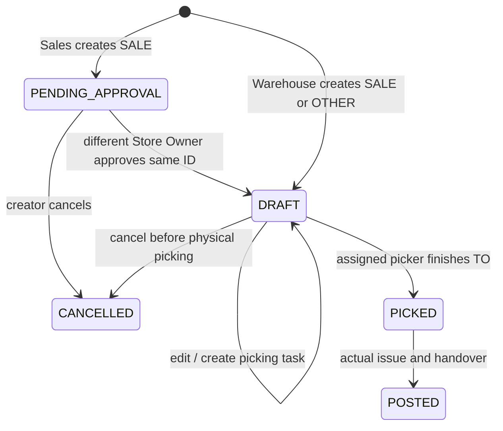
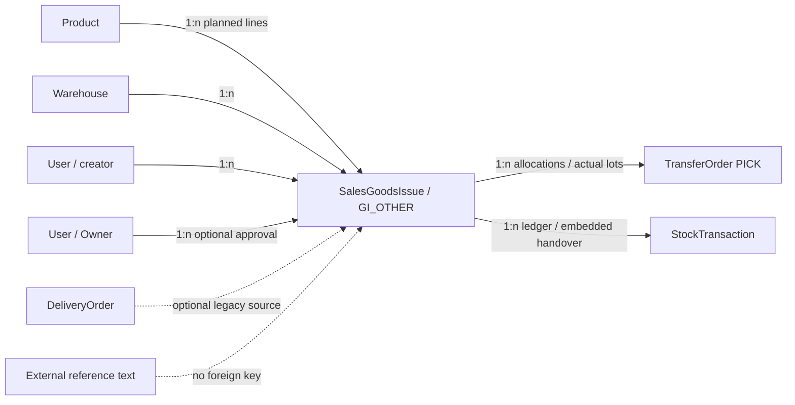

# Goods Issue — UC-69–72

Decision source: user confirmation on 16/11/2026. UC-71 creates a goods issue;
UC-72 updates its information and supported workflow states. The latest decision
replaces the mandatory SO → WIR → OD prerequisite for new sale issues.

## One create form, five reasons

`/goods-issues/create` first selects the issue reason and its reference. Sales
(the existing `SALES` role, called Sale Order by the user) sees only **Xuất bán**.
Warehouse Staff sees other reasons only with the matching execution permission.

| Reason | Reference and input | Existing execution contract |
|---|---|---|
| SALE / Xuất bán | Manually entered MISA eShop order code; warehouse; products, base quantities, per-line/general notes | New independent Goods Issue |
| TRANSFER / Xuất điều chuyển | Select an approved TR; enter the quantities for this dispatch | Native TransferDispatch, then PICK TO and dispatch confirmation |
| SUPPLIER_RETURN / Trả NCC | Select a READY/PARTIAL supplier-return agreement; quantity, handover/evidence | Native supplier-return dispatch/custody release |
| SCRAP / Hủy hàng | Select a defect report and its approved SCRAP plan portions; actual execution/evidence | Native StockScrapRecord; no REGRADE/RELEASE lines in this form |
| OTHER / Xuất khác | Manually entered reference and reason text; warehouse/products/quantities/notes | Independent GI_OTHER |

The last three established business flows retain their native documents, source
caps, permissions and stock effects; the common form embeds their existing
execution commands rather than creating an extra stock posting. Results open the
corresponding source detail. `/goods-issues` lists GI_SALE/GI_OTHER; native transfer,
supplier-return and defect records remain in their existing lists.

For SALE, `header.referenceNo` is a recorded external order code, not a foreign
key to SalesOrder or a unique import key. The user checks the external order and
its quantities manually. Repeated shipments may record the same code. Creating
this issue does not create an SO/WIR/OD, validate a MISA order, require source
verification/evidence, or call MISA. Product/quantity validity is still checked.
Lines accept base quantities or an entered quantity with a current verified
product conversion (carton/pallet/area). The item retains entered unit, quantity,
factor and optional carton snapshot. Lots/bins are selected
by Warehouse Staff when planning physical picking, not by Sales on this form.

## Approval and stock milestones

Approval is a versioned status update on the same issue, with `approvedBy` and
`approvedAt`. It creates no replacement issue, reservation, stock transaction or
commercial order. Warehouse cannot pick/post pending requests. Sales can edit or
cancel only their own PENDING_APPROVAL issue; after approval, Warehouse handles it.
Sales cannot create OTHER or use the legacy OD-backed endpoint to bypass approval.
Store Owner must differ from the creator and must have `goods_issue:approve`.

Creating/editing an independent draft or approving it does not reserve or change
stock. Warehouse allocates exact quantities across active STORAGE balances and
STAGING locations within the issue warehouse; allocations may split a product
across lots/bins. Creation of the PICK TO reserves the selected stock. TO confirm
moves storage → staging, supports partial actuals, preserves lot/owner/packaging
and reservations, and keeps total stock unchanged. PGI consumes staged
reservations, deducts stock once, appends one handover and sets POSTED atomically.
OTHER uses `OTHER_ISSUE` ledger operation. Neither posting completes an order.

Cancellation releases an independent draft's unstarted reservations and cancels
its OPEN task. Physical/partial picking blocks this cancellation. Old OD-backed
issues continue restoring their root OD allowance on edit/cancel. Posted history
is immutable. Freeze, availability and whole-base-unit rules still apply;
manual external-order quantity checks never bypass physical stock validation.

The user also permits outbound carton opening and fractional cartons. For example,
1.5 cartons × 4 pieces = 6 pieces is valid; 0.1 × 4 is invalid for a whole-piece
product. Picking and posting may split cartons, reuse OPEN/LOOSE stock first, and
retain an OPEN remainder without a sealed-pack count. If a partial portion has no
known dimensions, measured volume or existing volume bound, splitting is rejected.
Opened portions store a conservative `volumeUpperBoundMm3`, never an invented
measurement. Each fragment retains a safe bound (possibly overestimating occupied
space); capacity checks use it until a real measurement is recorded. This outbound
opt-in also covers BF04 picking/dispatch, supplier dispatch and SCRAP execution.
Ordinary BF03 relocation and receiving retain their existing packaging rules.

## API, permissions and DTO

| Action | API | Permission |
|---|---|---|
| List/detail | GET /api/goods-issues, GET /api/goods-issues/:id | goods_issue:read |
| Create catalogue | GET /api/goods-issues/options | goods_issue:create |
| Create | POST /api/goods-issues | goods_issue:create |
| Edit/cancel | PUT /api/goods-issues/:id, POST /api/goods-issues/:id/cancel | goods_issue:update |
| Approve | POST /api/goods-issues/:id/approve | goods_issue:approve + OWNER |
| Create picking | POST /api/goods-issues/:id/picking-tasks | picking_task:create + warehouse scope |
| Confirm picking | POST /api/picking-tasks/:id/confirm | picking_task:confirm + assignee/scope |
| Post | POST /api/goods-issues/:id/post | goods_issue:post + warehouse scope |

Manual create body: `{idempotencyKey,expectedVersion:1,issueKind:'SALE'|'OTHER',
warehouseId,referenceNo,reasonText?,note?,lines:[{productId,quantity,conversionId?,note?}]}`.
OTHER requires reasonText. Every product appears once; quantities are positive
six-place decimal strings. Without conversionId, quantity is in the base unit;
with it, the server loads the effective verified conversion and snapshots it.
The alternative legacy manual input `qtyBase` cannot be combined with quantity or
conversionId. Whole-base products require integer converted quantities; area
conversions follow the shared ceiling-to-piece contract. Options returns active
units and effective conversions, not a client-supplied factor. New manual
picking body uses `{idempotencyKey,expectedVersion,allocations:[{lineId,
sourceBalanceId,locationId,qtyBase}]}`; totals must equal every planned line.
Approval accepts only `{idempotencyKey,expectedVersion}`; arbitrary status writes
are rejected. Updates supply each existing line once. Post requires
`recipientName` with optional `vehiclePlate`; cancel requires a reason.

Default permissions: Sales gains create/update; Warehouse retains create/update/
post and picking permissions; Owner gains approve. Read remains permission-based:
Sales sees only their own manual SALE requests (and previously scoped SO issues),
Warehouse/custom operators see assigned warehouses, Owner/Accountant read across
the store. Sales may select an active warehouse for a pending request even without
warehouse assignments; this grants no physical stock access. ADMIN receives no
business grants. Live actor, permissions and scope are rechecked in transactions.

DTO adds `manualReference`, nullable `deliveryOrder`/`issueRequest`/`salesOrder`,
header reference/reason, optional approval metadata, and `canApprove`. Detail
supplies product/notes, lot/bin labels, plan/prepared/issued quantities, tasks and
handover history. `stockSources` appears only for scoped physical pick operators
on manual drafts, never for Sales. Actual lot identity is derived from task and
ledger source references; same-product picking lines remain distinct.

Filters: literal q (issue number), sourceRequest (external reference or old WIR),
status including PENDING_APPROVAL, warehouse and legacy source IDs, inclusive ISO
from/to actual issue dates, page/limit (20 default, max100). Scope precedes counts
and paging. DTO omits prices. Dates in FE use Vietnam time.

## Persistence, compatibility and rollout

Collection remains `sales_goods_issues`, model SalesGoodsIssue. It now supports
GI_SALE and GI_OTHER; header.issueKind is SALE/OTHER (default SALE). Optional
header.referenceNo (max160), reasonText (max500), approvedBy(User), approvedAt(Date)
have no backfill/default for historical documents. Item details remain embedded;
outboundDeliveryLineId is optional for manual issues, mandatory at the legacy
command boundary. Manual planned rows have no invented lot or SO price snapshot.
Inventory packaging portions add optional Decimal128 `volumeUpperBoundMm3` (mm³)
for OPEN/LOOSE portions produced by outbound splitting. Existing documents remain
valid without it; capacity reads measured volume first, then this bound. No backfill
is needed and no quantity is reconstructed from a volume.
New codes: PXB-[warehouse]-[YYMMDD]-[sequence] for SALE and PXK-... for OTHER.
No collection/index is added; no stored ID is changed.

Old issues missing header.deliveryOrderId resolve a unique OD from item links.
Legacy POST /outbound-deliveries/:id/picking-tasks and OD-backed GI create remain
compatible for their authorized warehouse callers. New UI defaults to manual
references. Confirmed historical tasks without SALES_PICK ledger use confirmed
quantities; POSTED issues without picking history return null prepared quantity.
Issued quantity uses effective ledger after reversals. Manual-reference issues do
not fabricate SO/POD/financial completion or the old SO-based return source chain.

Existing DBs need `npm run seed:goods-issue-permissions` with MONGODB_URI deliberately
selected. The additive command inserts missing create/update/approve codes and adds
only their new default grants; it preserves all other/custom grants. This change
requires no schema migration or data rewrite. Remote rollout needs explicit approval.
All commands retain exact replay payloads/keys, optimistic versions, audit/outbox
and transaction rollback. The UI preserves uncertain writes, including query
refresh failures, and confirms approval/picking/posting/cancellation explicitly.

## Validation

Run `RUN_GOODS_ISSUE_TESTS=1 node --test test/goods-issues.integration.test.js
 test/goods-issue-validation.test.js` using only loopback27018/hieudt-test and random
`goods_issue_test_<ObjectId>` databases with guarded teardown. Tests cover legacy
source caps, standalone external codes, same-ID approval without reservations or
SO creation, unauthorized roles/other Sales, pending physical guards, picking,
freeze/rollback, once-only posting, OTHER codes/cancel and concurrent drafts.
Component tests cover manual form/retry, Sales-only reasons, owner approval,
field validation and existing detail behavior. See the dated local-test evidence
for actual final results and known repository-wide failures.
