# Luồng kiểm kho end-to-end — hướng dẫn từng bước có ảnh (22/11/2026)

**Mục đích.** Chạy trọn một luồng kiểm kho trên giao diện thật với API thật, chụp từng thao tác, và đối chiếu với góp ý của cô giáo ngày 22/11/2026 (tách "kế hoạch" và "phiếu", bảng đếm nhập trực tiếp, số lượng kèm đơn vị tính, đơn giá kèm tiền tệ, đối chiếu đơn giản, bỏ "Lý do chốt"). Hợp đồng API: [STOCKTAKE_PLANS](../08_api/STOCKTAKE_PLANS.md), [STOCKTAKE_LIFECYCLE](../08_api/STOCKTAKE_LIFECYCLE.md).

**Loại bằng chứng.** Chạy thủ công trên trình duyệt (agent-browser, Chrome headless, rộng 1440 px) với frontend dev server chạy trên backend này. Chỉ dùng dữ liệu tổng hợp của bộ seed cửa hàng gạch. Đây không phải CI, không phải DB dùng chung/remote và không phải test tự động.

## Môi trường chạy

| Mục | Giá trị |
|---|---|
| Cơ sở dữ liệu | Bản sao cô lập `wmsd_e2e_stocktake_20261122` trên replica set test local (`127.0.0.1:27018`, `hieudt-test`), sao từ DB seed local `wmsd_demo_fe_stocktake`. Không đụng DB dùng chung hay remote. |
| Backend | `node src/index.js`, cổng 3011, `MONGODB_URI` trỏ vào DB cô lập, `SEED_ON_STARTUP=false`. |
| Frontend | `pnpm dev --port 5190`, `VITE_API_PROXY_TARGET=http://127.0.0.1:3011`. |
| Tài khoản | `chucuahang` (Chủ cửa hàng) và `thukho01` (Nhân viên kho, "Phạm Văn Hùng"). Mật khẩu trong bản sao cô lập được đặt lại thành giá trị chỉ dùng local; không lưu trong Git. |
| Dữ liệu | Kho `K-GACH-01`, vị trí `STORAGE-02` và `STORAGE-16`, sản phẩm `AP6601` lô `AP6601-261001-A`, tồn sổ ban đầu 61 và 8 `Viên`. |

**Kịch bản.** Chủ cửa hàng lập kế hoạch **hằng quý** → tạo phiếu từ kế hoạch → Nhân viên kho kích hoạt và đếm (dòng 1 đếm 63, dư 2; dòng 2 đếm 7, thiếu 1) → gửi đối chiếu → Chủ cửa hàng nghi ngờ dòng thiếu nên **yêu cầu đếm lại** → Nhân viên kho đếm lại được 8 (khớp) → Chủ cửa hàng **duyệt chênh lệch** dòng dư → phiếu Hoàn tất, tồn kho 61 → 63.

## Các bước

### Phần A — Chủ cửa hàng lập kế hoạch kiểm kê

#### Bước 1. Danh sách kế hoạch kiểm kê

Màn "Kế hoạch kiểm kê" tách riêng khỏi màn "Phiếu kiểm kho"; menu "Kiểm kê & điều chỉnh" có hai mục riêng. Mỗi kế hoạch hiển thị mã (`KHKK-…`), tiêu đề, kho, tần suất và kỳ tiếp theo. Nút "Lập kế hoạch kiểm kê" mở form tạo mới.

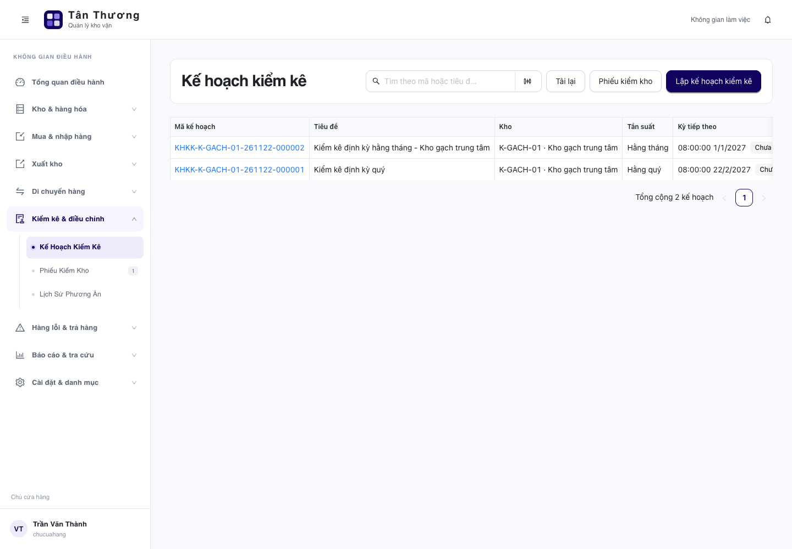

#### Bước 2. Mở form lập kế hoạch

Form trống. Dòng thông báo phía trên nhắc: kế hoạch chỉ ghi nhớ kiểm cái gì, bao lâu một lần và ai đếm; **kế hoạch không khóa vị trí và không đổi tồn kho**; phiếu kiểm kho được tạo từ kế hoạch khi đến hạn.

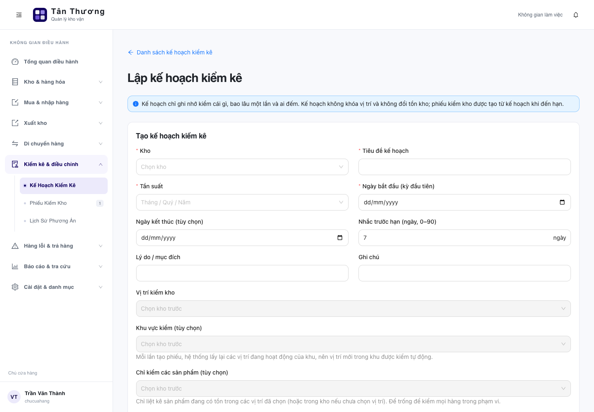

#### Bước 3. Chọn kho

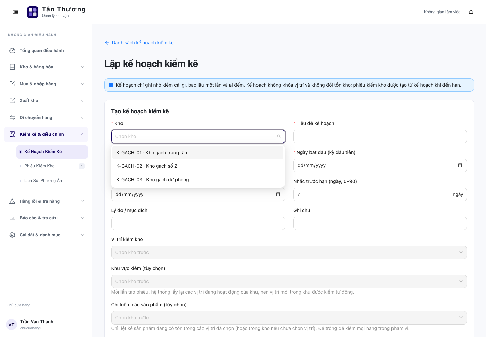

#### Bước 4. Chọn tần suất — Hằng tháng / Hằng quý / Hằng năm

Đây là chỗ thể hiện yêu cầu "lập kế hoạch phải có kỳ hạn định kỳ rõ ràng theo tháng, quý, năm". Lần này chọn **Hằng quý**.

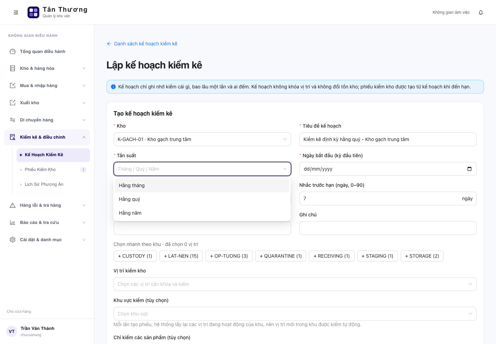

#### Bước 5. Chọn ngày bắt đầu và khu vực kiểm

Ngày bắt đầu kỳ đầu tiên là 25/11/2026. Dùng nút chọn nhanh theo khu (`STORAGE (2)`) để chọn cả hai vị trí của khu; ô "Vị trí kiểm kho" tự điền `STORAGE-02` và `STORAGE-16`.

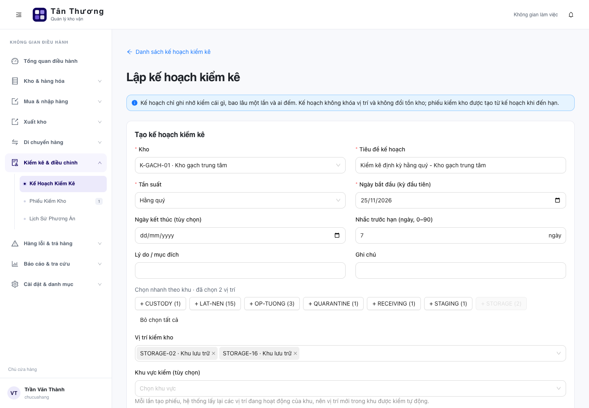

#### Bước 6. Form đã điền đầy đủ

Kho `K-GACH-01`, hằng quý, bắt đầu 25/11/2026, nhắc trước 7 ngày, hai vị trí, nhân viên đếm Phạm Văn Hùng. Bấm "Tạo kế hoạch kiểm kê".

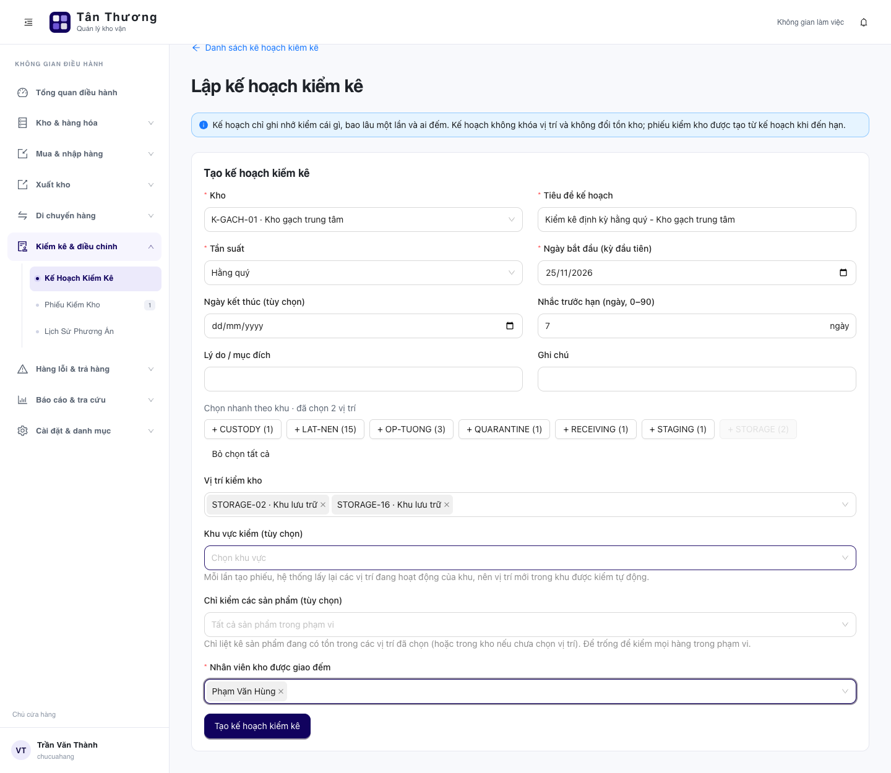

#### Bước 7. Kế hoạch đã tạo

Mã `KHKK-K-GACH-01-261122-000003`, trạng thái "Đang áp dụng", nhãn "Sắp đến hạn · còn 3 ngày". Vì kỳ 1 (25/11) nằm trong 7 ngày nhắc trước nên nút **"Tạo phiếu kiểm kho từ kế hoạch"** đã bật. Chưa có phiếu nào được tạo (bảng bên dưới trống).

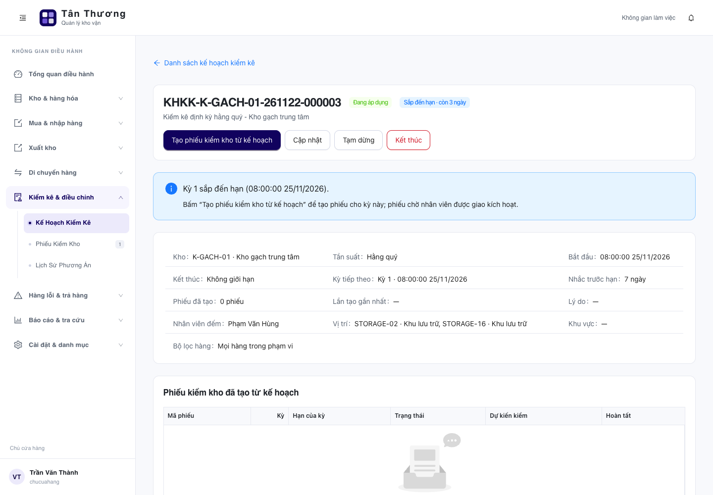

#### Bước 8. Tạo phiếu kiểm kho từ kế hoạch

Bấm nút tạo phiếu → hệ thống chuyển sang phiếu `KK-K-GACH-01-261122-000051`, trạng thái "Chờ kích hoạt". Phiếu ghi "Thuộc kế hoạch `KHKK-K-GACH-01-261122-000003` · kỳ 1". **Vị trí chỉ chọn một lần** ở khối thông tin chung (hai thẻ `STORAGE-02`, `STORAGE-16`), và **không có ô "Lý do chốt"** ở bất kỳ đâu trên phiếu.

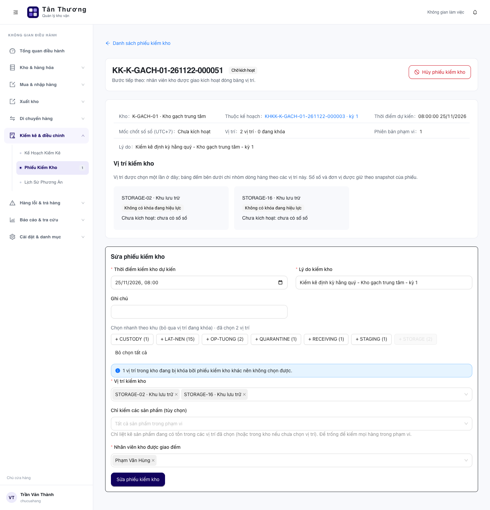

### Phần B — Nhân viên kho đếm hàng

#### Bước 9. Nhân viên kho thấy phiếu trong danh sách

Đăng nhập bằng `thukho01`. Danh sách "Phiếu kiểm kho" hiển thị các phiếu thuộc kho được giao.

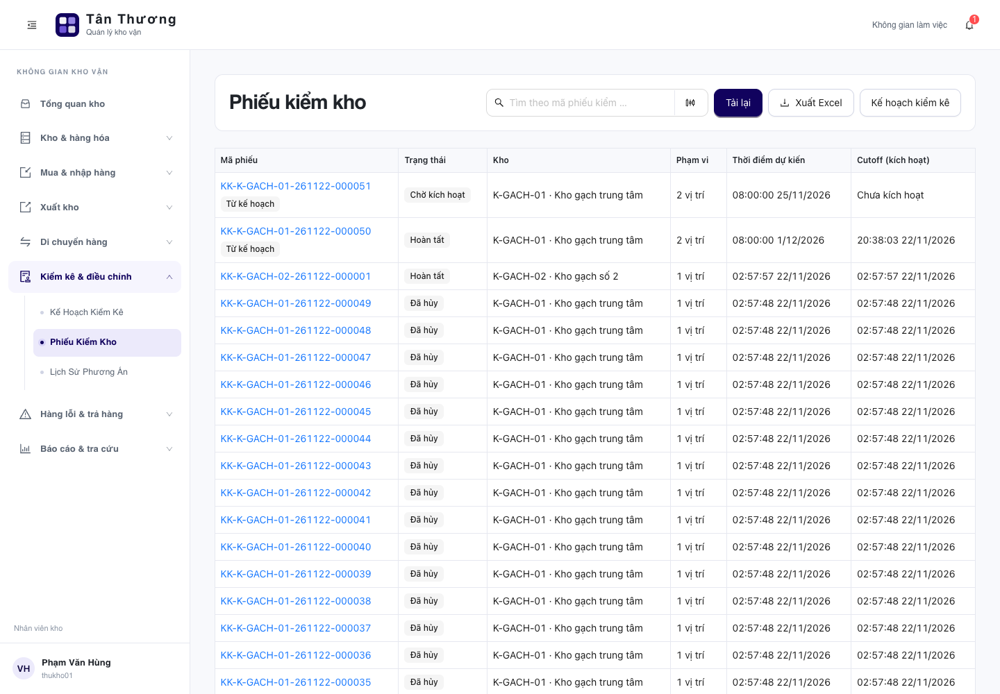

#### Bước 10. Mở phiếu chưa kích hoạt

Phiếu "Chờ kích hoạt", mỗi vị trí ghi "Chưa kích hoạt: chưa có số sổ". Khối "Kích hoạt đóng băng vị trí" nằm cuối trang; cảnh báo cho biết hệ thống chụp nhanh số sổ và khóa các vị trí.

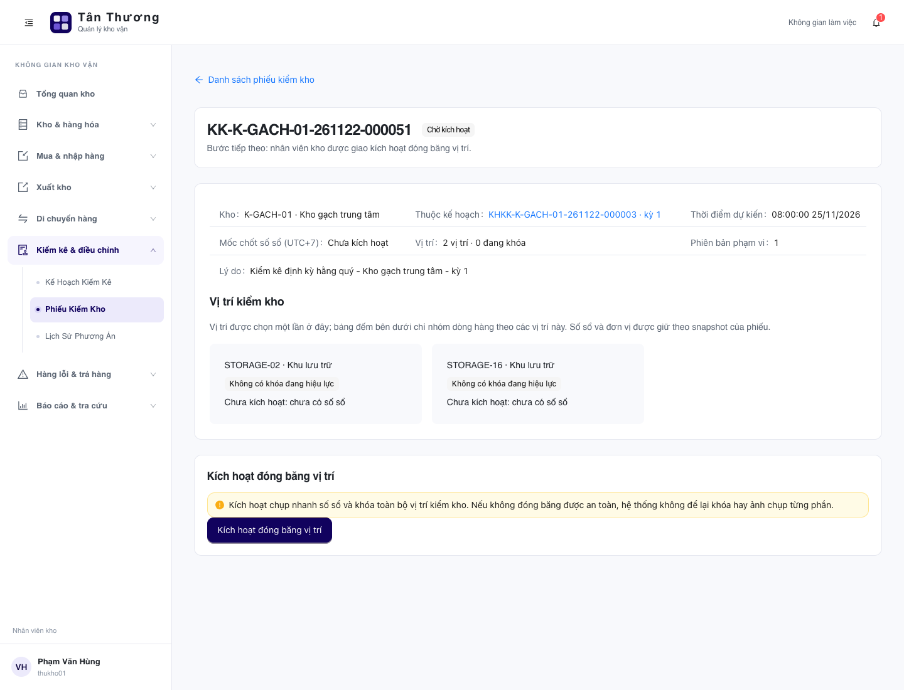

#### Bước 11. Kích hoạt — bảng đếm hiện ra ngay

Sau khi bấm "Kích hoạt đóng băng vị trí", hai vị trí chuyển "Đang khóa" và **bảng đếm hiện trực tiếp trên màn hình, không đếm mù, không popup**. Cột: Mã hàng / Tên mặt hàng, Số lô, **Số lượng tồn (kèm đơn vị: 61 Viên, 8 Viên)**, **Số lượng thực tế (ô nhập sẵn có bộ chọn đơn vị)**, Chênh lệch. Dòng hàng được nhóm dưới tiêu đề từng vị trí ("đã đếm 0/1"), **không lặp lại cột/ô chọn vị trí** ở từng dòng.

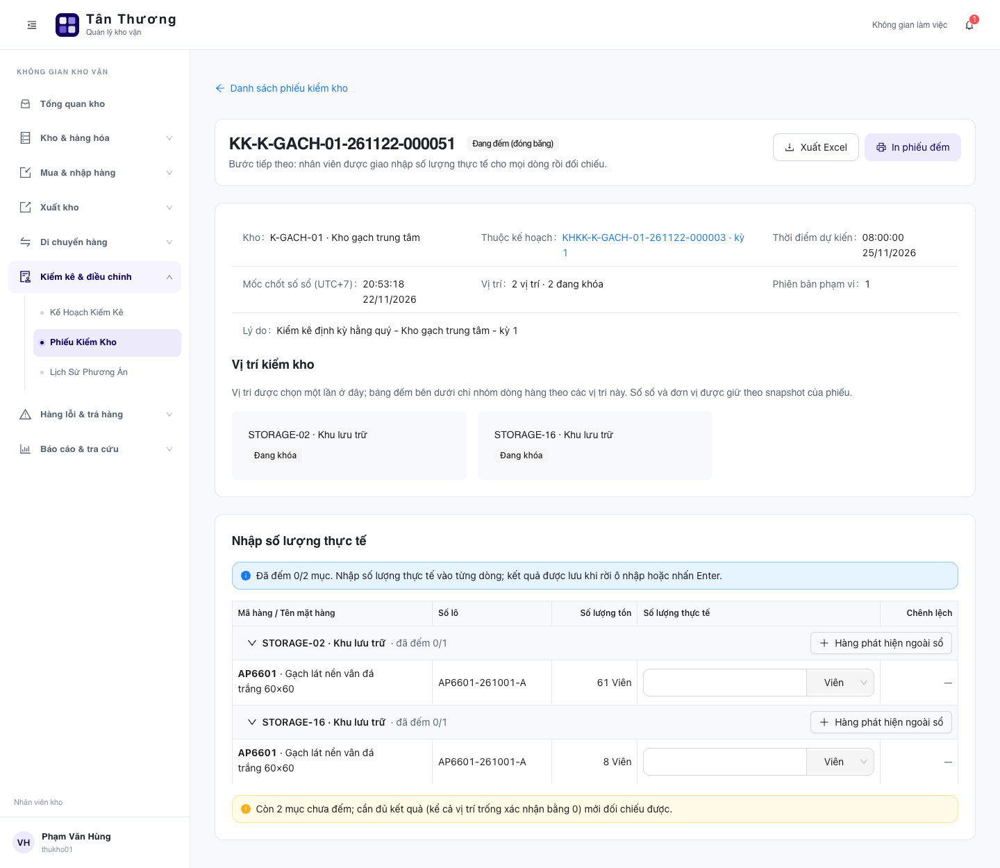

#### Bước 12. Nhập số thực tế dòng 1

Gõ `63` vào ô của dòng `STORAGE-02`. Cột "Chênh lệch" tính ngay `+2 Viên`.

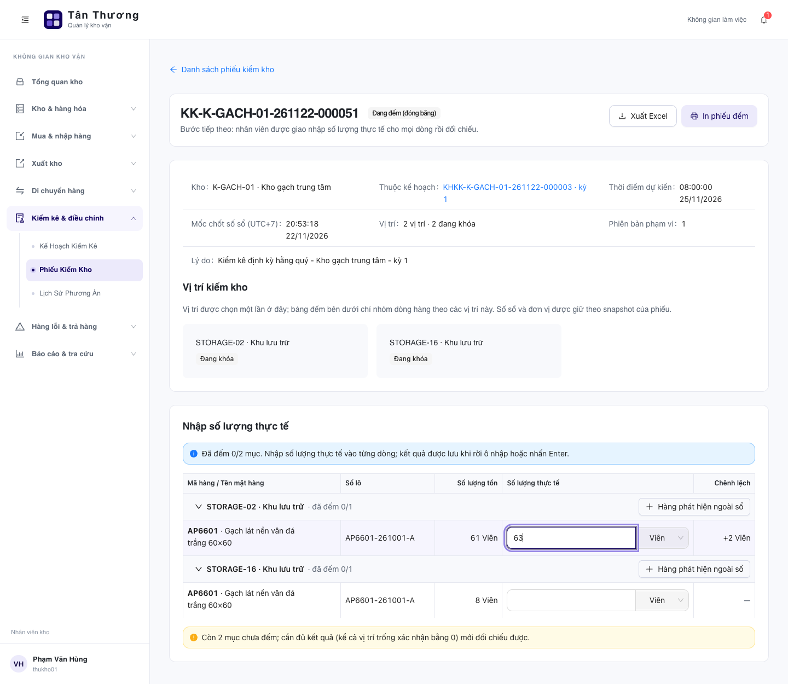

#### Bước 13. Dòng 1 đã lưu

Nhấn Enter (hoặc rời ô nhập) thì giá trị được lưu; dưới ô hiện "Đã lưu · lần 1". Thông báo đầu bảng đổi thành "Đã đếm 1/2 mục" — mỗi dòng được lưu bằng một yêu cầu riêng, không cần bấm lưu từng dòng.

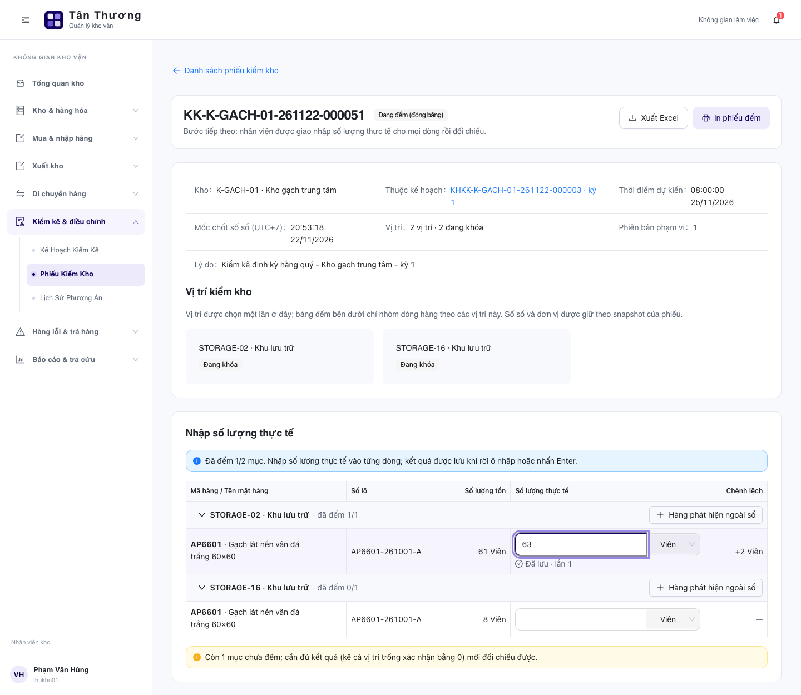

#### Bước 14. Đếm xong cả hai dòng

Dòng 2 nhập `7` (sổ 8) → `−1 Viên`. Thông báo "Đã đếm 2/2 mục" và xuất hiện nút gửi đối chiếu ở cuối bảng. Mọi số lượng và chênh lệch đều kèm đơn vị **Viên**.

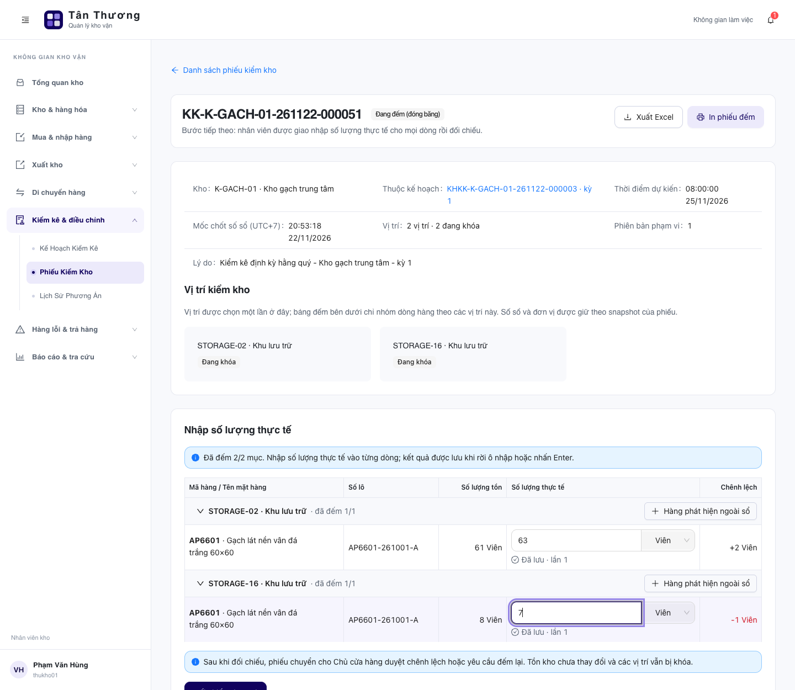

#### Bước 15. Gửi đối chiếu

Bấm "Đối chiếu phạm vi": phiếu chuyển sang "Chờ duyệt chênh lệch", bảng đếm chuyển thành bảng đối chiếu chỉ đọc đối với nhân viên kho; thông báo "Đã đối chiếu. Chủ cửa hàng sẽ duyệt chênh lệch hoặc yêu cầu đếm lại." Tồn kho **chưa** thay đổi và hai vị trí vẫn bị khóa.

### Phần C — Chủ cửa hàng đối chiếu chênh lệch

#### Bước 16. Màn đối chiếu

Chủ cửa hàng mở cùng phiếu. Màn "Đối chiếu chênh lệch" có **hai hành động chính**: "Yêu cầu đếm lại" và "Duyệt chênh lệch", cộng thêm "Duyệt tất cả". Cả ba bị khóa cho đến khi tick dòng chênh lệch bằng **checkbox** (từng dòng, theo nhóm vị trí hoặc chọn tất cả). Hai dòng đang "Chênh lệch": `+2 Viên` và `−1 Viên`.

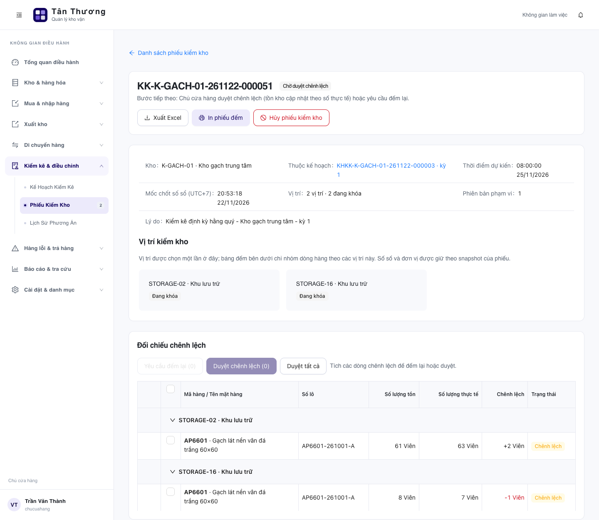

#### Bước 17. Tick dòng nghi ngờ

Tick dòng `−1 Viên` (STORAGE-16). Hai nút đổi thành "Yêu cầu đếm lại (1)" và "Duyệt chênh lệch (1)". Mỗi dòng chênh lệch còn có ô "Lý do (tùy chọn)".

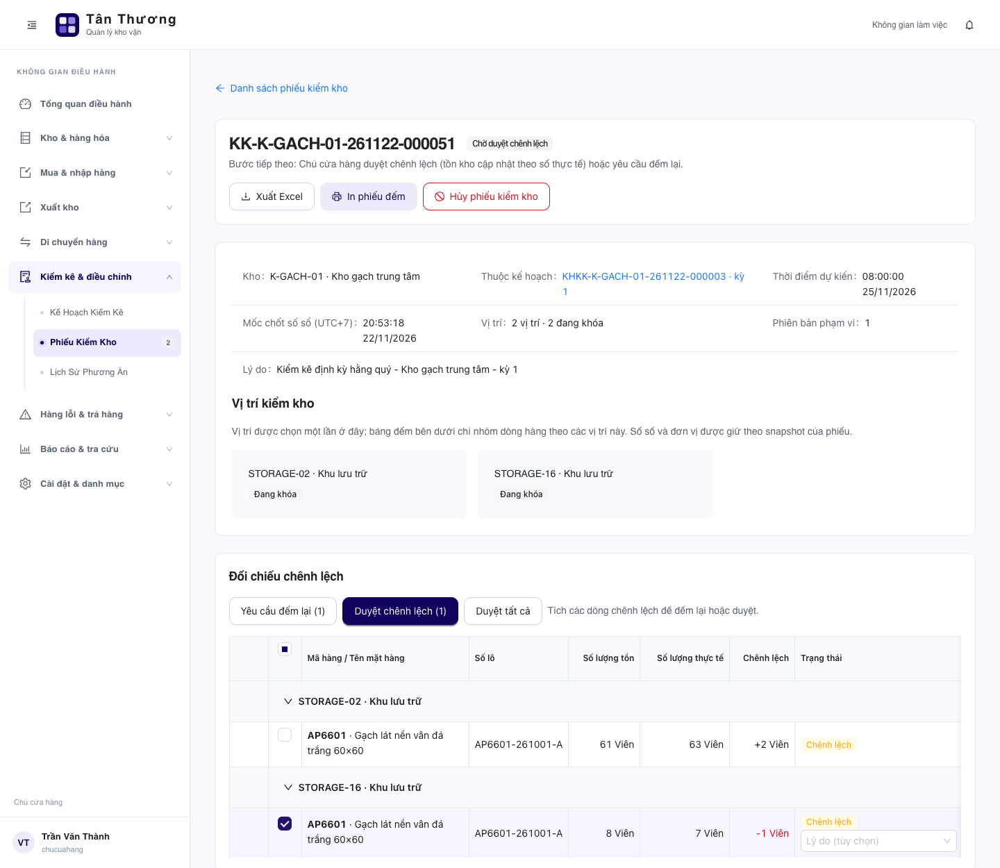

#### Bước 18. Hộp thoại "Yêu cầu đếm lại"

Hộp thoại giải thích: phiếu quay về bước đếm với 1 dòng được chọn, các lần đếm trước và khóa vị trí được giữ, tồn kho không đổi; có ô ghi chú tùy chọn. Bấm "Yêu cầu đếm lại".

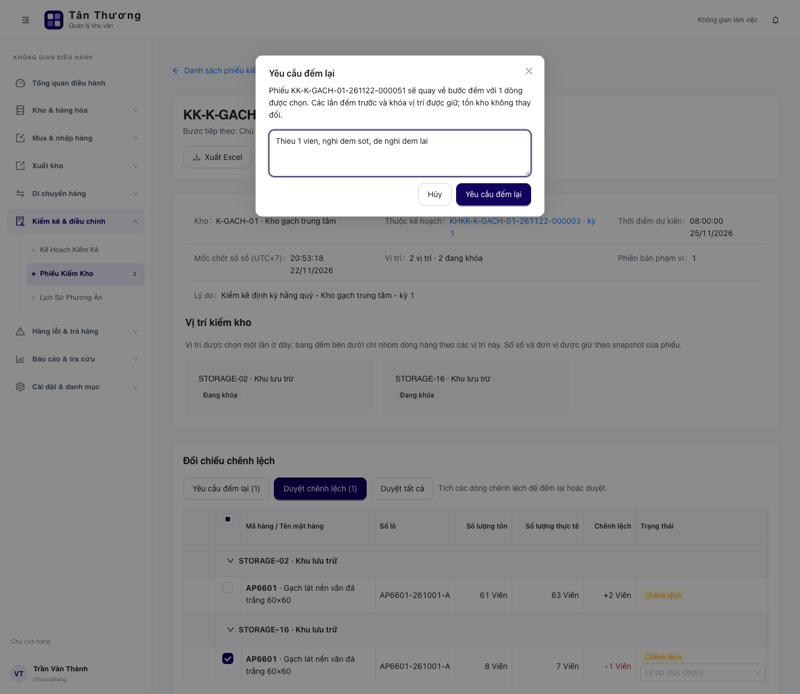

#### Bước 19. Yêu cầu đếm lại đã được gửi

Bấm "Yêu cầu đếm lại" trong hộp thoại → backend nhận `POST /api/stocktakes/KK-K-GACH-01-261122-000051/recount` (200). Phiếu quay về "Đang đếm (đóng băng)"; tồn kho và khóa vị trí không đổi. (Không có ảnh riêng cho bước này; kết quả nhìn thấy ở ảnh bước 20.)

### Phần D — Đếm lại

#### Bước 20. Nhân viên kho thấy yêu cầu đếm lại

Phiếu quay về "Đang đếm (đóng băng)". Thông báo: "Đang đếm lại 1 dòng theo yêu cầu của chủ cửa hàng. Chỉ các dòng này nhận kết quả mới." Dòng 1 (đã chốt lần đếm) bị khóa; chỉ dòng 2 nhập được lại.

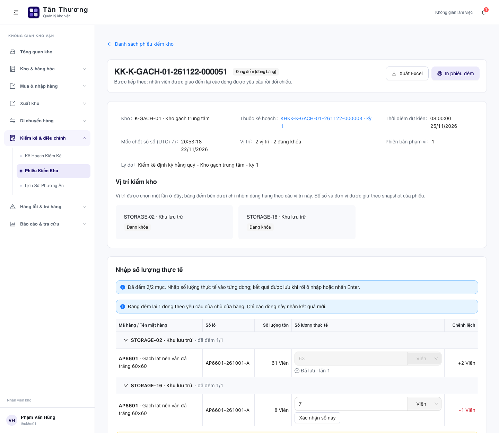

#### Bước 21. Nhập số đếm lại

Đếm lại thực tế được 8 viên → xóa `7`, gõ `8`; chênh lệch đổi thành "Khớp".

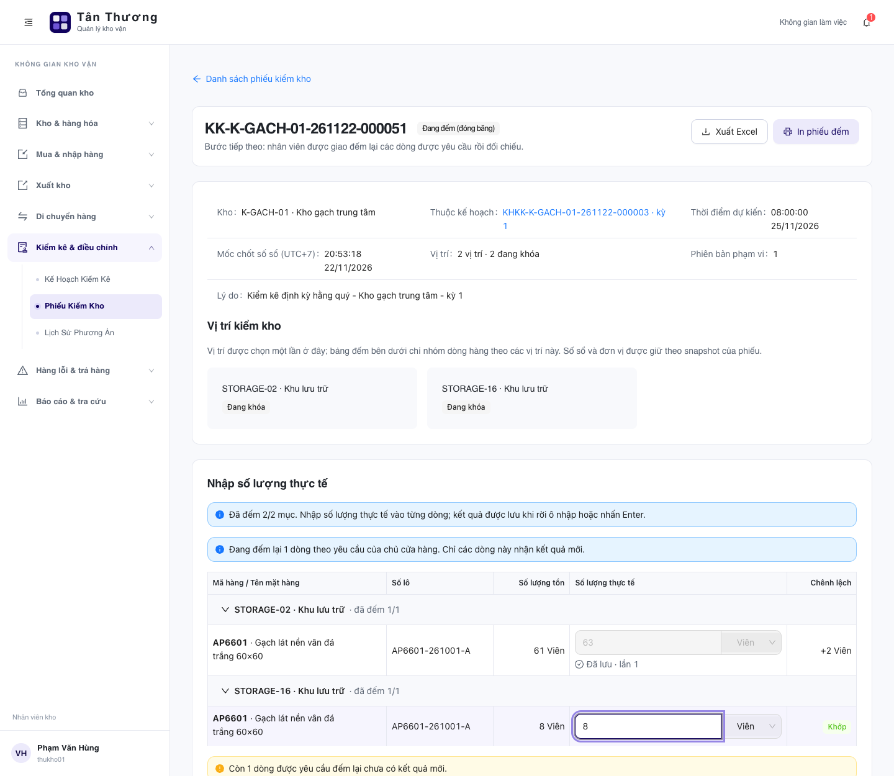

#### Bước 22. Số đếm lại đã lưu

"Đã lưu · lần 2" (lần đếm thứ hai của dòng này).

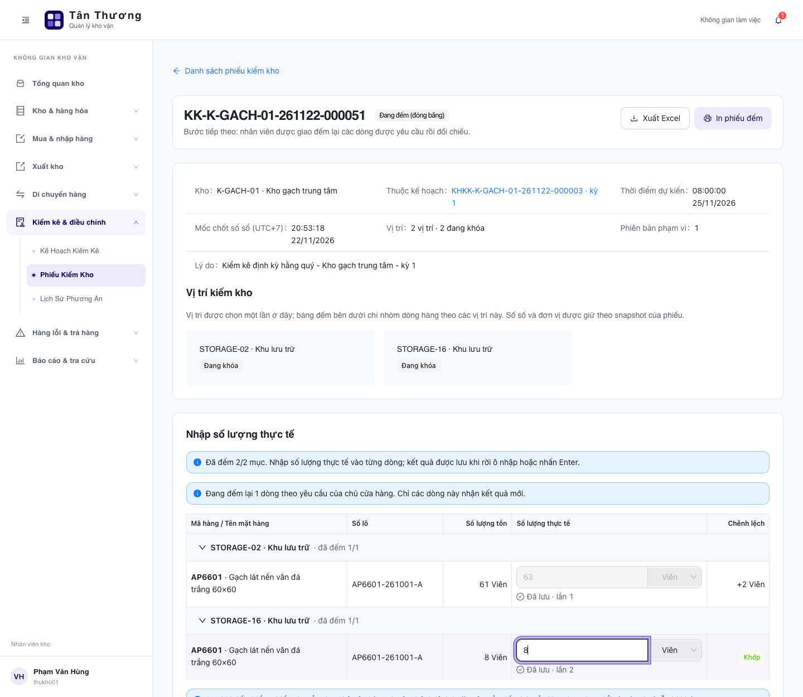

#### Bước 23. Gửi đối chiếu lần 2

Bấm "Đối chiếu phạm vi" lần nữa; phiếu trở lại "Chờ duyệt chênh lệch".

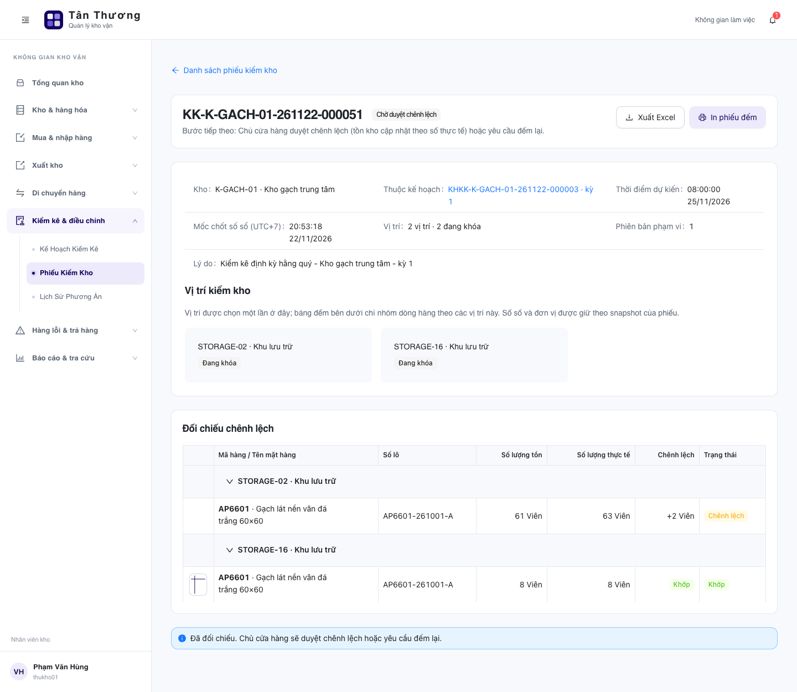

### Phần E — Chủ cửa hàng duyệt (Clear difference)

#### Bước 24. Màn đối chiếu sau khi đếm lại

Dòng `STORAGE-16` nay là 8/8 "Khớp"; còn dòng `STORAGE-02` `+2 Viên` "Chênh lệch".

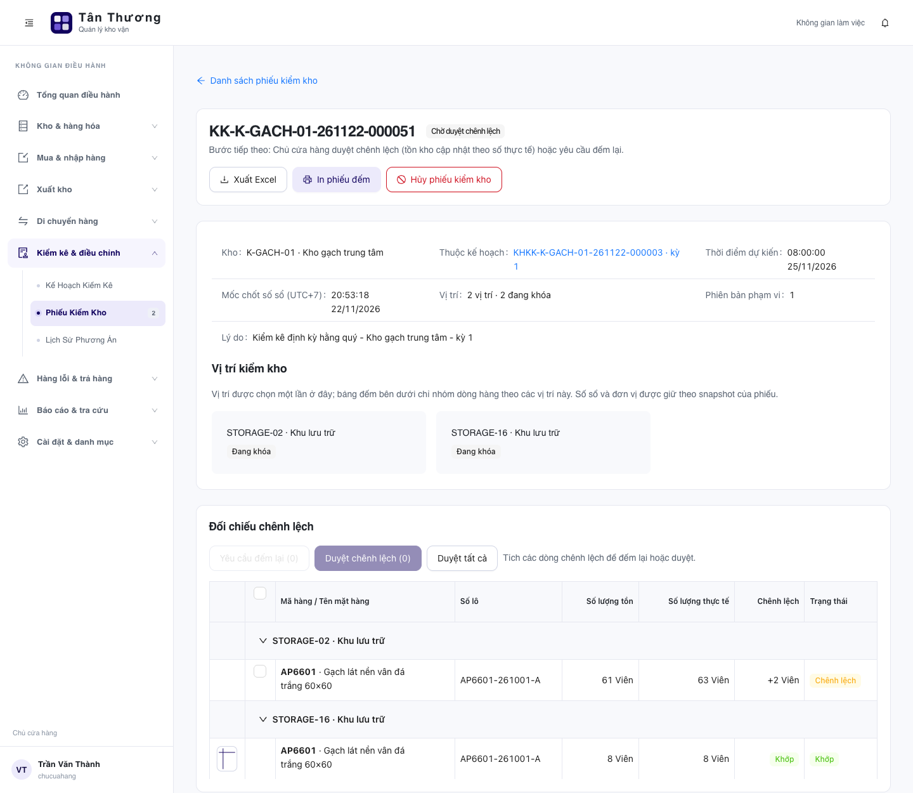

#### Bước 25. Tick dòng dư

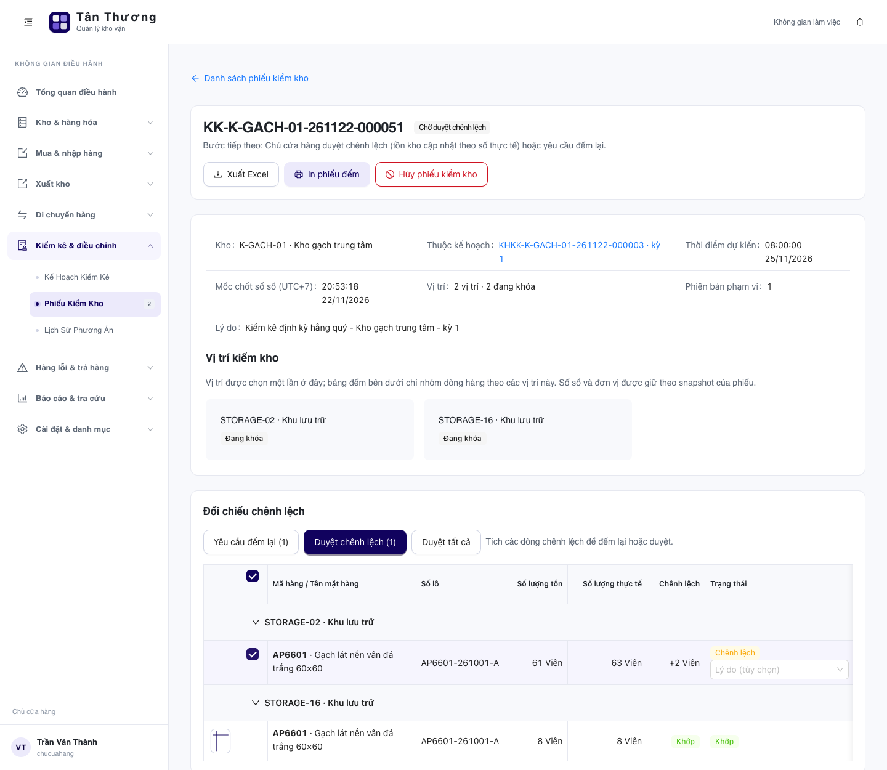

#### Bước 26. Hộp thoại xác nhận duyệt

Hộp thoại ghi: số dòng chênh lệch được duyệt 1; tổng chênh lệch `+2 Viên` (ghi tăng +2 Viên; ghi giảm 0 Viên); "Tồn kho sẽ được cập nhật theo số thực tế. Thao tác ghi sổ một lần và không thể hoàn tác." Bấm "Duyệt và cập nhật tồn kho".

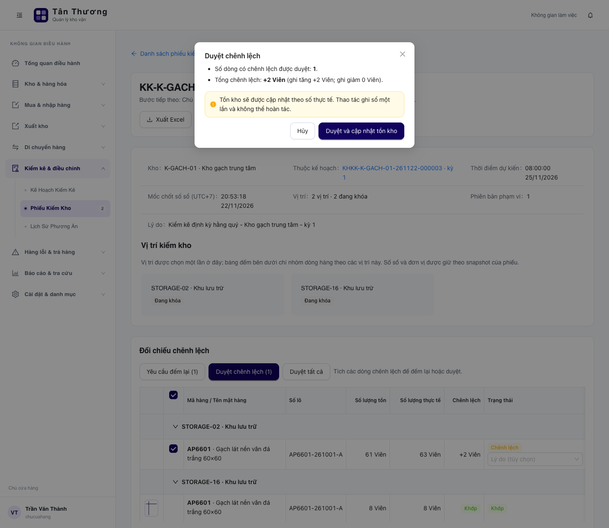

#### Bước 27. Phiếu Hoàn tất

Phiếu "Hoàn tất", hai vị trí "Không có khóa đang hiệu lực". Dòng `+2 Viên` ghi "Đã duyệt · đã ghi tồn"; dòng khớp ghi "Đã duyệt · khớp sổ". Thông báo: "Phiếu kiểm kho đã hoàn tất, tồn kho đã cập nhật theo số thực tế và các vị trí đã mở khóa." Phiếu tự đóng khi mọi dòng đã được xử lý, **không có ô "Lý do chốt"**.

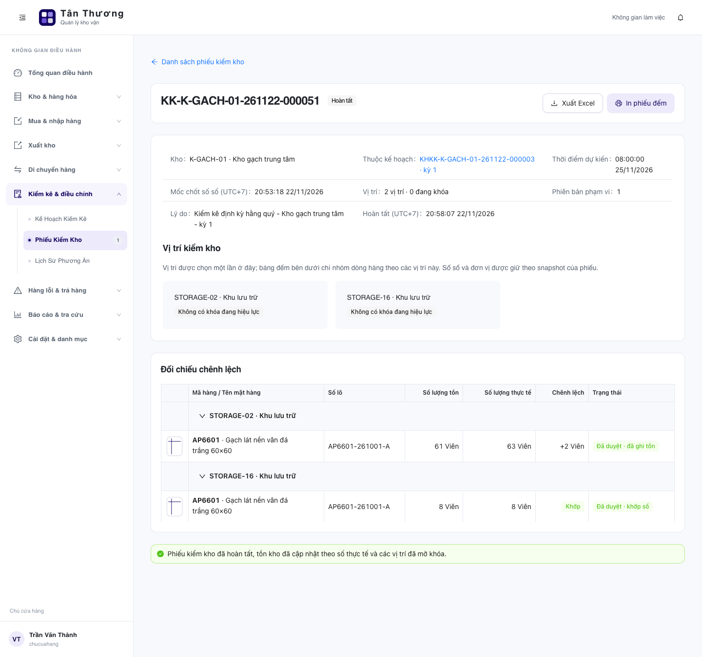

Kiểm tra DB sau bước này (bản sao cô lập): phiếu `COMPLETED`, 2 dòng đã xử lý; tồn của `STORAGE-02` từ 61 lên **63** `Viên`; `STORAGE-16` giữ 8 (dòng khớp không ghi tồn); phiếu điều chỉnh `ĐCKK-K-GACH-01-261122-000003` ở trạng thái `POSTED` với `quantityDeltaBase +2`, `beforeQty 61`, `afterQty 63` (đây là bản ghi lịch sử).

#### Bước 28. Lịch sử đếm của dòng đã đếm lại

Bấm "Xem lịch sử đếm" ở dòng `STORAGE-16`: "Lần 1: 7 Viên · 20:53:45 22/11/2026", "Lần 2: 8 Viên · 20:56:53 22/11/2026 · Thieu 1 vien, nghi dem sot, de nghi dem lai", "Đã duyệt 20:58:07 22/11/2026 · khớp sổ, không ghi tồn". Mọi lần đếm và lý do yêu cầu đều được lưu.

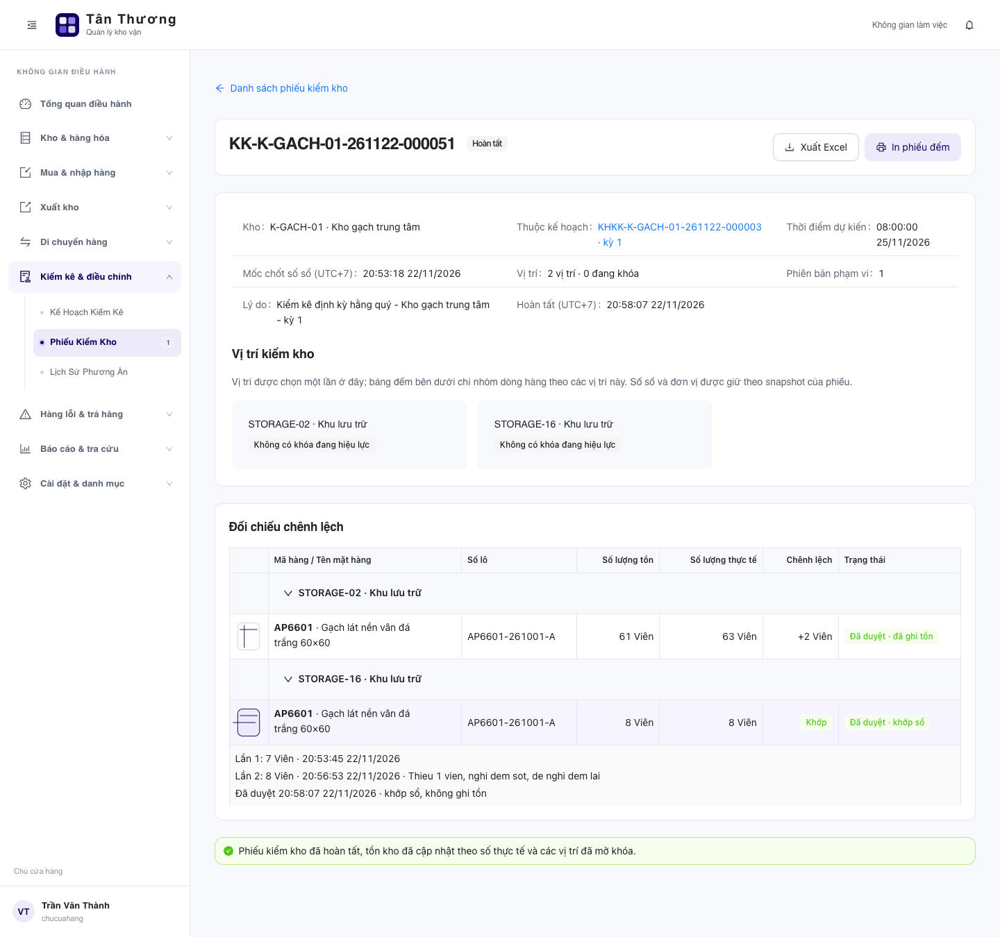

### Phần F — Quay lại kế hoạch

#### Bước 29. Kế hoạch sau khi phiếu hoàn tất

Bảng "Phiếu kiểm kho đã tạo từ kế hoạch" có phiếu `KK-K-GACH-01-261122-000051` (kỳ 1, "Hoàn tất", giờ hoàn tất). Kế hoạch chuyển sang **kỳ 2 vào 25/02/2027** (cộng 3 tháng theo tần suất quý); nút tạo phiếu khóa lại vì chưa đến hạn nhắc.

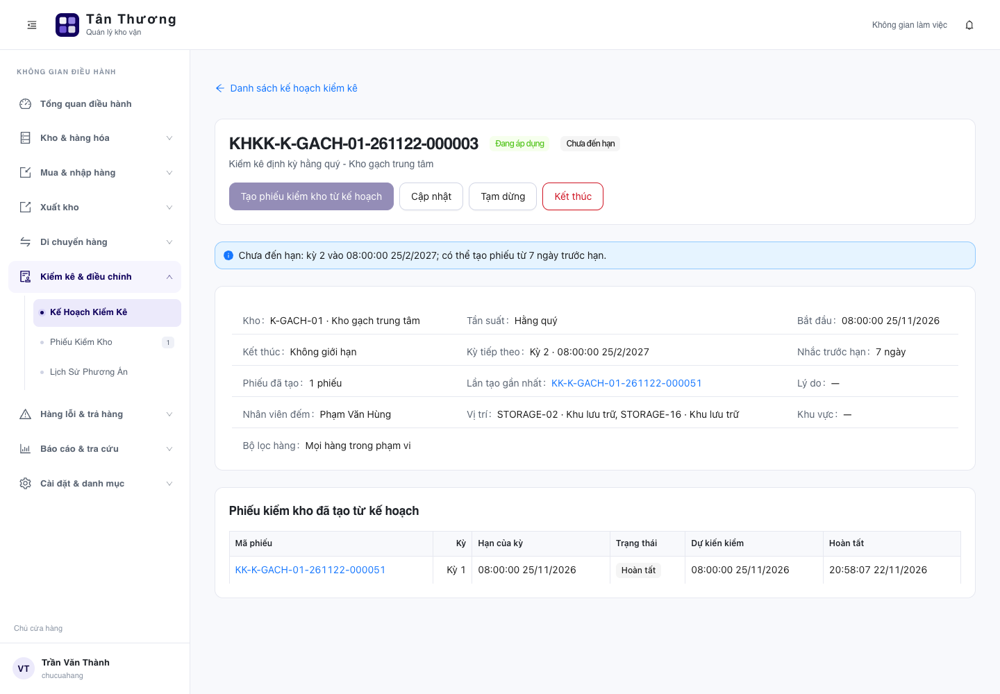

#### Bước 30. Danh sách kế hoạch

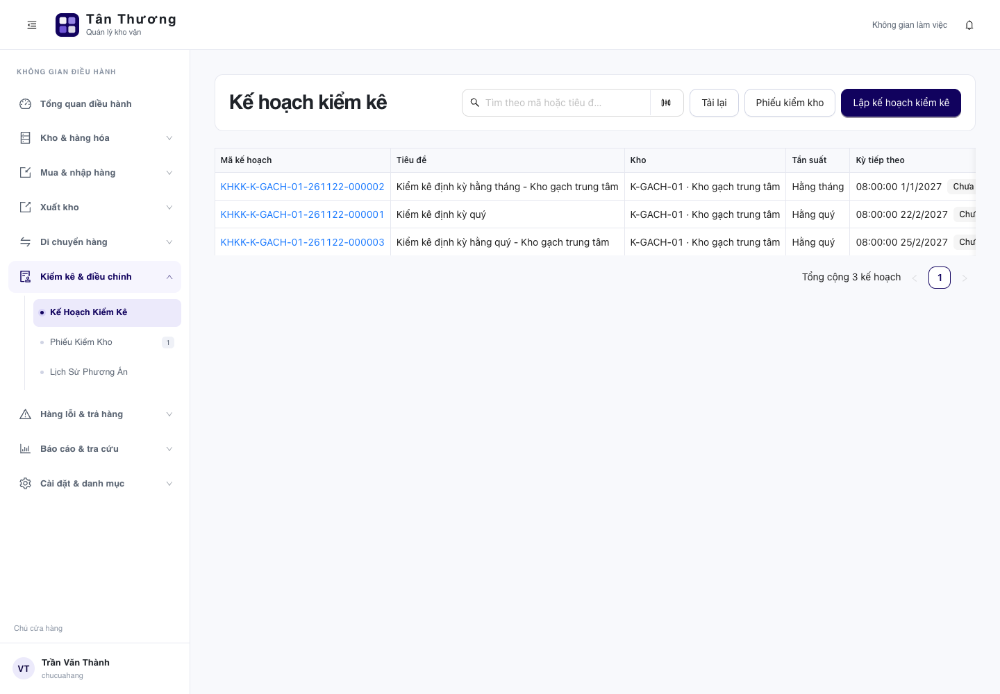

## Đối chiếu với góp ý của cô giáo

| # | Yêu cầu | Kết quả khi chạy |
|---|---|---|
| 1 | Kế hoạch ≠ phiếu; kế hoạch có kỳ hạn tháng / quý / năm | Đạt — bước 1–8 (màn riêng, mã `KHKK-` và `KK-`, chọn tần suất ở bước 4, kỳ 2 cộng đúng 3 tháng ở bước 29). |
| 2a | Vị trí chọn một lần, không lặp lại ở danh sách hàng | Đạt — bước 8 và 11 (vị trí chọn một lần; bảng đếm chỉ nhóm dòng theo vị trí). |
| 2b | Không đếm mù; bảng có mã/tên hàng, số lô, số lượng tồn, ô nhập số thực tế ngay trên dòng | Đạt — bước 11–14. |
| 2c | Bỏ cột/trường "Chất lượng chủ cửa hàng" | Đạt — không có cột này ở bảng đếm và bảng đối chiếu. |
| 3a | Số lượng luôn kèm đơn vị tính | Đạt trên mọi màn kiểm kho (`61 Viên`, `+2 Viên`, hộp thoại). Chưa rà các màn khác trong lần chạy này. |
| 3b | Đơn giá luôn kèm đơn vị tiền tệ | **Không áp dụng ở đây:** payload và màn kiểm kho không có giá/giá trị (xem STOCKTAKE_LIFECYCLE, "Units everywhere"). Quy tắc được thực hiện ở `formatCurrency` (thiếu tiền tệ thì in `(thiếu tiền tệ)`), xem mục frontend 22/11/2026 trong `change_logs.md`. |
| 4 | Recount và Clear difference bằng checkbox; tồn theo số thực tế và lưu lịch sử | Đạt — bước 16–28 (cả nhánh đếm lại lẫn nhánh duyệt hàng dư; tồn 61 → 63; phiếu điều chỉnh POSTED; lịch sử đếm ở bước 28). Luồng "gửi phương án qua lại" không còn trong luồng này. |
| 5 | Bỏ "Lý do chốt" | Đạt — không xuất hiện trên phiếu và màn cuối; phiếu tự đóng khi xử lý hết các dòng. |

## Lỗi đã gặp và sửa trong quá trình chạy

Ở lượt chạy đầu tiên (đếm thiếu 62 → 61), bước duyệt thất bại: `POST /api/stocktakes/:id/approve-differences` trả 400 `InventoryBalance validation failed: packagingPortions.0.createdAt: Path 'createdAt' is immutable and strict mode is set to throw.` Nguyên nhân: với **hàng thiếu**, service gán trực tiếp các object thuần trả về từ `splitPortions` vào `balance.packagingPortions`, làm ghi đè trường `createdAt` bất biến của các phần hàng đã có. Các luồng ghi tồn khác giữ nguyên sub-document và chỉ cập nhật các trường được phép qua `retainPortions`. Sửa trong `src/modules/stocktake-closure/stocktake-reconciliation.service.js` bằng `retainPortions(balance, kept)`. Sau khi khởi động lại backend thì bước đó thành công. Lượt chạy chi tiết ở trên (29 ảnh) được thực hiện **sau** bản sửa; nó kiểm thêm nhánh duyệt **hàng dư** (`receiveStock`, +2 Viên) chạy đúng. Nhánh duyệt hàng thiếu sau bản sửa đã được kiểm ở lượt chạy đầu (62 → 61) và qua bộ test tích hợp (xem `change_logs.md`), nhưng không có ảnh trong tài liệu này.

## Giới hạn của bằng chứng

- Một trình duyệt, một khổ rộng (1440 px), Chrome headless. Để chụp được hộp thoại và danh sách thả của antd, trình chụp chèn CSS tắt animation và chờ khoảng 2 giây; đây chỉ ảnh hưởng ảnh chụp, không đổi mã nguồn.
- Chưa kiểm trong lần chạy này: tần suất hằng tháng/hằng năm, tạm dừng/tiếp tục/kết thúc kế hoạch, tạo lại phiếu của kỳ đã hủy, hàng phát hiện ngoài sổ, đếm nhiều đơn vị (Thùng + Viên), in/xuất Excel, giao diện mobile.
- Biểu tượng mở rộng ở cột đầu bảng đối chiếu ("Xem lịch sử đếm") hiển thị lớn hơn kích thước thường trong ảnh chụp; không xử lý trong phạm vi này.
- Bước 19 không có ảnh riêng (ảnh chụp lúc đó được chụp trước khi yêu cầu được gửi nên đã loại bỏ).
- Khung thời gian nhắc trước (`reminderDays`) trong lượt chạy này giữ mặc định 7 ngày, ngày bắt đầu đặt 25/11/2026 để kỳ 1 đủ điều kiện tạo phiếu; không sửa tay giá trị nào trong DB ngoài việc đặt lại mật khẩu tài khoản demo cục bộ.
